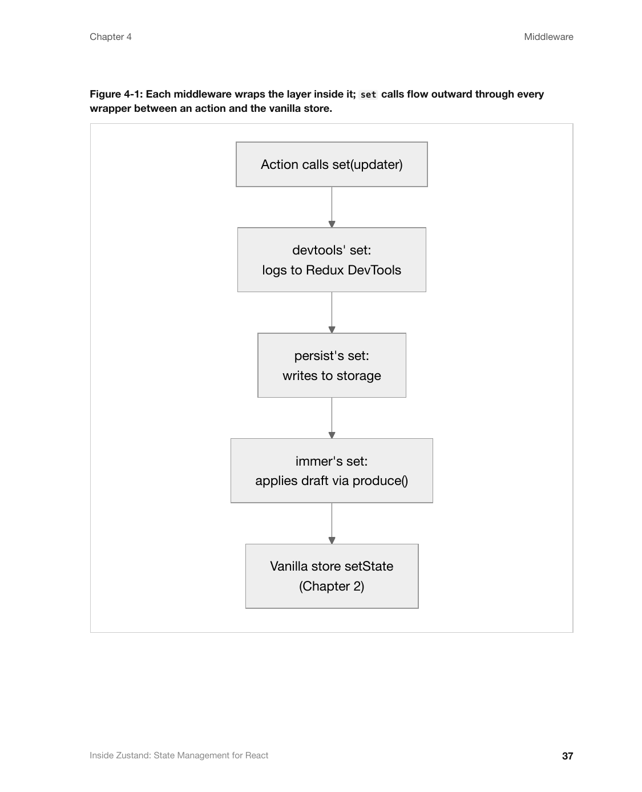

# inside-mac

Agent skills for writing technical documentation in the style of Apple's **Inside Macintosh**, updated for modern APIs, SDKs, CLIs, and web docs, plus a pipeline that renders the result as a print-quality PDF book.

*Inside Macintosh* (1985–1994) is still one of the best-taught developer documentation series. It separates concepts from tasks from reference. It tells each reader what they can skip. It puts warnings at the point of danger, and it specifies every contract completely. These skills capture those techniques and drop what hasn't aged well: page references, Pascal-first examples, global result codes, and hedged sample code.

## Example

[`examples/zustand`](examples/zustand) is a complete, from-scratch guide these skills produced for
[Zustand](https://github.com/pmndrs/zustand), the pmndrs React state-management library — six
chapters, a preface, and three appendixes, rendered to a 68-page PDF with `imac-pdf-book`. It is
unofficial and not affiliated with pmndrs; see the example's own README for how it was produced and
which version of Zustand it documents.

<p>
  
  
</p>

[Read the PDF](<examples/zustand/Inside Zustand- State Management for React.pdf>) ·
[Read the source](examples/zustand/src) · [Read the README](examples/zustand/README.md)

## Skills

| Skill | Use it to |
|---|---|
| [`imac-style`](skills/imac-style/SKILL.md) | Pick the other skills for a job, and apply the default chapter contract (About → Using → Reference → Summary) |
| [`imac-doc-architecture`](skills/imac-doc-architecture/SKILL.md) | Plan a documentation set: layers, reader roadmaps, and cross-links |
| [`imac-voice-and-tone`](skills/imac-voice-and-tone/SKILL.md) | Write precise, practical prose: modal verbs, rules with their rationale and consequences, callouts |
| [`imac-concept-explainer`](skills/imac-concept-explainer/SKILL.md) | Write "About X" sections: mental models, vocabulary, lifecycles, figures |
| [`imac-task-guides`](skills/imac-task-guides/SKILL.md) | Write "Using X" guides: one example that grows step by step, failure paths, verification |
| [`imac-api-reference`](skills/imac-api-reference/SKILL.md) | Write reference entries: parameters, returns, behavior, errors, and related entries |
| [`imac-review`](skills/imac-review/SKILL.md) | Check a draft against the style |
| [`imac-pdf-book`](skills/imac-pdf-book/SKILL.md) | Render Markdown as a paginated PDF with a table of contents, chapter openers, running heads, and Mermaid figures |

## Install

With the [`skills`](https://github.com/vercel-labs/skills) CLI:

```sh
npx skills add tomdale/inside-mac
```

Or copy the directories under `skills/` into your agent's skills directory, for example `~/.claude/skills/`, `~/.agents/skills/`, or a project's `.agents/skills/`.

Then ask your agent something like:

> Using the imac skills, write a full-length technical guide to our billing API and render it as a PDF.

## What a guide looks like

An agent using these skills typically produces:

- a **preface** that states the audience, supported versions, what to read for each goal, what to skip, and the conventions used;
- **chapters** that open with a roadmap ("Read this chapter if…", "In this chapter you will…"), explain the model before the calls, teach the common path with a tested example, specify the complete contract, and end with a summary of mental model and invariants;
- **appendixes** with a glossary, error index, limits, and known gaps.

`imac-pdf-book` then lays it out at 7.5 × 9.25 in with Palatino body text and Helvetica headings, like the 1990s series.

## Reproducing the research

The skills were distilled from 33 books of the series by a parallel multi-agent analysis. This repository contains **no Apple material**: the PDFs and their text are downloaded locally, gitignored, and used only for study. To reproduce:

```sh
scripts/fetch-sources.sh     # ~830 MB of PDFs from vintageapple.org → corpus/pdf/
scripts/extract-text.sh      # pdftotext -layout → corpus/text/  (requires poppler)
```

Then run [`research/analyze.workflow.js`](research/analyze.workflow.js) with a workflow runner that provides `agent()`, `parallel()`, and `phase()` (for example [pi-dynamic-workflows](https://github.com/tomdale/toolbelt)). It sends one small-model agent to each book and one large-model agent to write the skills. The original run cost about $1.20 and took six minutes. Leave out the six X-Ref index volumes, but include the X-Ref glossary.

[`skills/imac-style/references/sources.md`](skills/imac-style/references/sources.md) maps each technique to the book and line range in `corpus/text/` where it appears. Each entry paraphrases the technique rather than quoting it.

Sources, all hosted by [vintageapple.org](https://vintageapple.org):

- Original series, Volumes I–VI (1985–1991): <https://vintageapple.org/inside_o/>
- New series (1992–1994): <https://vintageapple.org/inside_r/>

The full URL list is in [`scripts/sources.txt`](scripts/sources.txt).

## Legal

*Inside Macintosh* is © Apple Inc. This project is not affiliated with or endorsed by Apple. It contains original skill text written after studying the series, and links to publicly hosted copies. It redistributes no Apple content.

The skills and scripts are released under the [MIT License](LICENSE).
