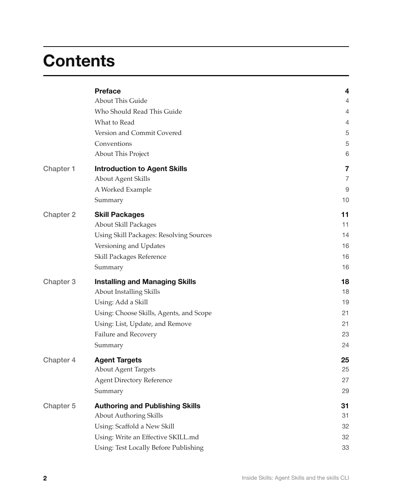
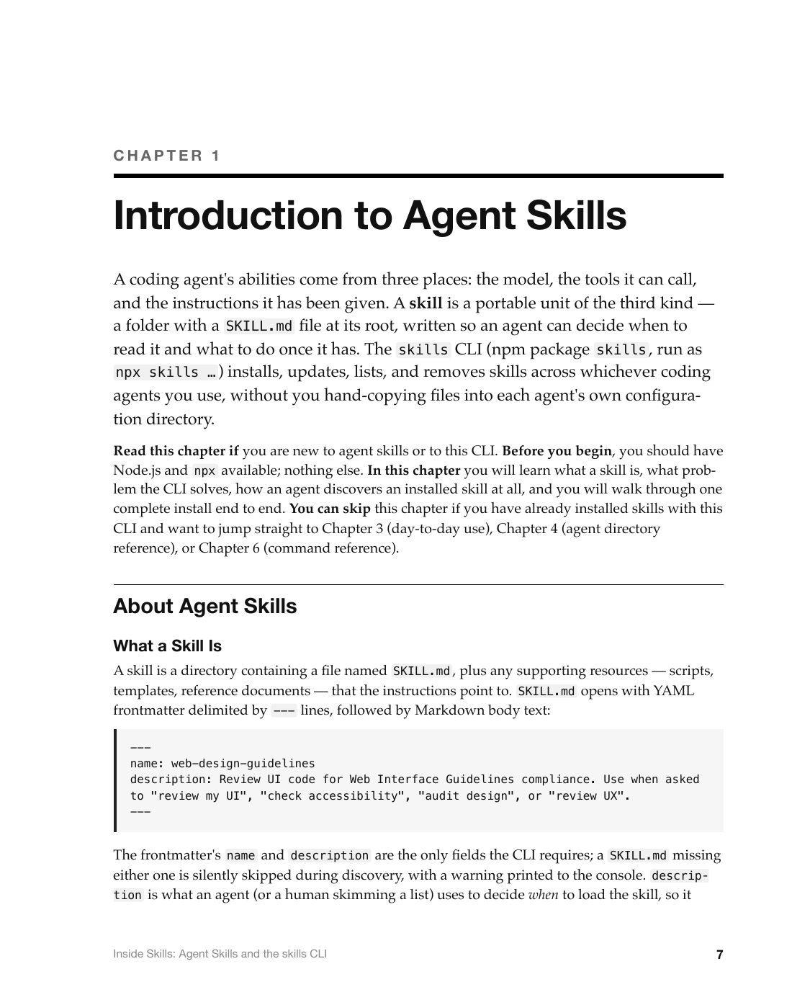
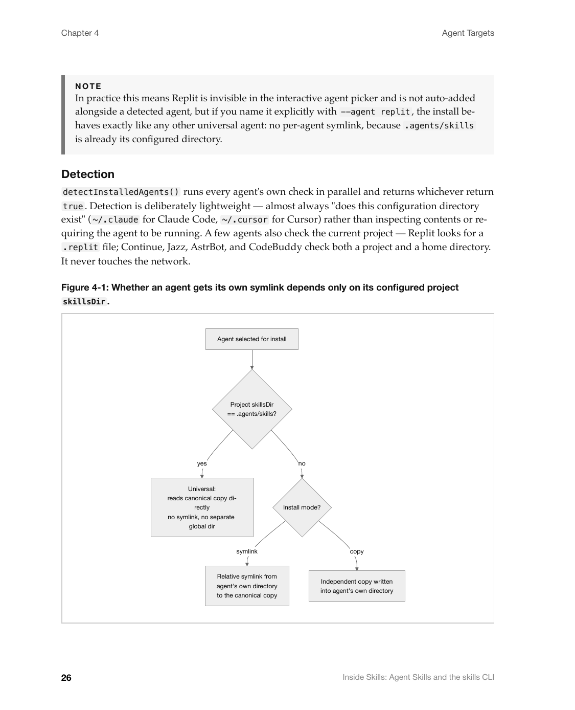
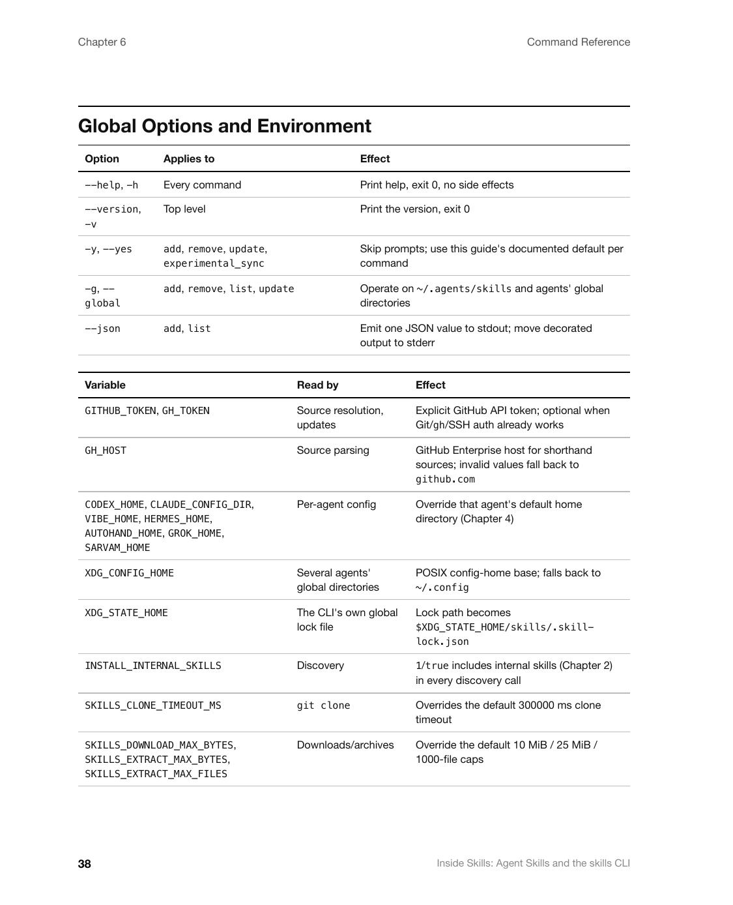

# Inside Skills: Agent Skills and the skills CLI

A complete, from-scratch technical guide to the [`skills`](https://github.com/vercel-labs/skills)
CLI — the open agent skills ecosystem, installed and run as `npx skills …` — written and rendered
using this repository's `imac-*` skills. It is **unofficial**: not affiliated with, endorsed by, or
reviewed by Vercel, Inc. or the `skills` maintainers.

- **Covers:** `skills` v1.7.0, commit [`7407f38`](https://github.com/vercel-labs/skills/commit/7407f3893ad4dceab546ac002c3ef806e4000c73)
  (`7407f3893ad4dceab546ac002c3ef806e4000c73`), cloned `--depth 1` from
  `https://github.com/vercel-labs/skills`.
- **Length:** 51 pages (front matter, 6 chapters, 3 appendixes).
- **License of the subject project:** MIT, © Vercel, Inc. This guide quotes only command names,
  flag names, and short output fragments from that public repository; the surrounding prose is
  original.

## Contents

1. Introduction to Agent Skills
2. Skill Packages
3. Installing and Managing Skills
4. Agent Targets
5. Authoring and Publishing Skills
6. Command Reference

Plus a Preface and three appendixes: Glossary, File Formats, and Known Gaps and Open Questions.

## Previews

<p>
  
  
  
</p>
<p>
  
  
</p>

## How this was produced

1. **Read** every `imac-*` SKILL.md in [`skills/`](../../skills) at the repository root, especially
   `imac-api-reference`'s CLI command template (synopsis, arguments, options,
   environment/config precedence, stdio, exit statuses, side effects, idempotency, examples, see
   also).
2. **Researched** the CLI by cloning `vercel-labs/skills` at the commit above and reading its
   TypeScript source, tests, and README directly — every command, source-parsing rule, agent
   registry entry, and lock-file schema in this guide traces back to that source. A handful of
   command transcripts were captured by running the CLI from a clean temporary `HOME` directory
   against local, non-network test fixtures (see the manuscript's per-chapter examples).
3. **Wrote** the chapters in [`src/`](src) following the `imac-doc-architecture` four-layer
   contract (About → Using → Reference → Summary), `imac-voice-and-tone` for prose, and
   `imac-concept-explainer`/`imac-task-guides` for the conceptual and workflow sections.
4. **Rendered** the PDF with `imac-pdf-book`: this directory is a copy of
   `skills/imac-pdf-book/assets/` with its sample `src/` replaced by this guide's chapters and
   `book.json`'s title set.
5. **Verified** visually: rasterized pages with `pdftoppm`, checked the cover, contents, a chapter
   opener, every figure, and a reference page, and iterated on Mermaid syntax and figure sizing
   until the build produced no `pageerror` and no figure was separated from its caption or pushed
   to an awkwardly blank page.

## Rebuilding

```sh
cd examples/skills-cli
npm install
npm run build        # writes "Inside Skills- Agent Skills and the skills CLI.pdf" and build/book.html
```

Requires a local Google Chrome install (or set `CHROME_PATH`). To re-export the previews after a
rebuild:

```sh
PDF="Inside Skills- Agent Skills and the skills CLI.pdf"
pdftoppm -r 150 -png -f 1  -l 1  -singlefile "$PDF" preview/01-cover
pdftoppm -r 150 -png -f 2  -l 2  -singlefile "$PDF" preview/02-contents
pdftoppm -r 150 -png -f 7  -l 7  -singlefile "$PDF" preview/03-chapter-opener
pdftoppm -r 150 -png -f 26 -l 26 -singlefile "$PDF" preview/04-figure
pdftoppm -r 150 -png -f 38 -l 38 -singlefile "$PDF" preview/05-reference
```

(Page numbers will shift if you edit the source; check the build's own page count and the table of
contents first.)

## Claims marked Inferred

This guide marks exactly one claim as **Inferred** rather than directly verified: the precise scope
of `skills add`'s Notion-workspace source integration (Chapter 2, "Using Skill Packages: Resolving
Sources"). The source recognizes and routes Notion URLs through a dedicated code path, but this
guide did not verify its authentication or pack-selection behavior to the same depth as every other
source format. See Appendix C, "Known Gaps and Open Questions," for the full list of intentionally
underspecified areas.

## What this is not

This example does not modify, vendor, or redistribute any code from `vercel-labs/skills`. The
cloned checkout used for research was made in a scratch directory outside this repository and is
not included here.
</content>
