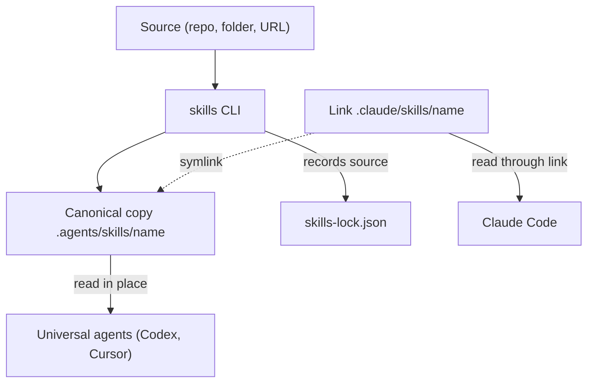

# Introduction to Agent Skills

This chapter explains what an agent skill is, what the `skills` CLI does with one, and where the CLI's responsibility ends, then installs one skill into a sample project. If you already know the model and want only the commands, go to [Installing and Managing Skills](#installing-and-managing-skills).

## Read this chapter if

- You have not used agent skills before, or you have only copied them into place by hand.
- You need to explain to a team what the CLI changes on disk and what it leaves to each agent.

## In this chapter you will

- Learn what a skill is and why several agents complicate sharing one.
- Learn what the CLI does and where its responsibility ends.
- Install a skill into a project and list it.

## The problem skills solve

A coding agent works from general knowledge plus the instructions it finds in a session. Many tasks need narrower guidance, such as how your team writes release notes or which checks run before a release is tagged. Pasting that guidance into each conversation is unreliable, and copying it into each repository produces versions that drift apart.

A [skill](#what-a-skill-is) packages that guidance as a directory. The directory holds a `SKILL.md` file, which gives the skill a name, a short description, and Markdown instructions, along with any supporting files the instructions refer to. An agent that supports skills reads the descriptions and loads a skill's instructions when a task calls for them.

Because a skill is only files, it can travel between projects and between agents. The obstacle is location, because agents look for skills in different directories. In a project, Codex and Cursor read `.agents/skills`, while Claude Code reads `.claude/skills`. Without a tool, a team that uses two of these agents keeps two copies of every skill and updates both by hand.

## What the skills CLI does

The `skills` CLI, run as `npx skills`, is a package manager for skills. An install does three things:

1. It fetches skills from a [source](#source-formats), such as a local folder, a Git repository, or a website.
2. It places each selected skill where the agents you chose will look for it, in the current project or in your [home directory](#project-scope-and-global-scope).
3. It records where each skill came from in a [lock file](#lock-files), so that later commands can update, restore, and remove the skill.

Once the files are in place, the CLI's part is over. It does not run a skill, and it does not decide when an agent uses one; the agent makes that choice. The CLI does not sandbox a skill either. An installed skill acts with the agent's permissions, so if the agent can run shell commands, edit files, or reach the network, a skill's instructions can direct it to do those things.

The CLI does not inspect or approve a skill's content. For a public GitHub repository, it can display risk assessments from the skills.sh audit service, but they are advisory, and when the service fails or has no data the install proceeds without them ([what the CLI sends](#network-access-authentication-and-telemetry)).

Responsibility for a skill's content stays with you, which is why a successful install ends with a reminder to review skills before use. Read a skill's `SKILL.md` and supporting files before you install it from a source you do not control.

## The parts of the system

An install connects six parts: a source, the CLI, the [canonical directory](#the-canonical-skills-directory) that holds a skill's real files, the [agent directories](#universal-and-agent-specific-agents) that link to it, the lock file, and the agents that read the result.

**Figure 1-1: In symlink mode, the CLI keeps one copy in .agents/skills, and every chosen agent reads it from there.**



In [symlink mode](#symlink-mode-and-copy-mode), the result is one real copy with many readers. When a project installs `release-notes` for Claude Code and Codex, the files exist once, in `.agents/skills/release-notes`. Codex, a universal agent, reads them there, and `.claude/skills/release-notes` is a symbolic link to the same directory. Replacing that one copy changes what every linked agent reads.

## A first skill, end to end

This example uses the sandbox from [The sample setup](#the-sample-setup): a project at `/tmp/demo/project` and, beside it, a local source at `/tmp/demo/acme-skills` that contains two skills.

From the project directory, install the `release-notes` skill for Claude Code. The `--skill` option selects one of the two skills, `-a claude-code` names the target agent, and `-y` accepts defaults instead of prompting. Name the agent explicitly, because without `-a` the CLI chooses targets by detecting agents and can install for many more than you intend ([How the CLI chooses target agents](#how-the-cli-chooses-target-agents)).

```console
$ npx skills add ../acme-skills --skill release-notes -a claude-code -y
┌   skills
◇  Source: /tmp/demo/acme-skills
◇  Local path validated
◇  Found 2 skills
●  Selected 1 skill: release-notes
◇  Installation Summary ───────────╮
│                                  │
│  ./.agents/skills/release-notes  │
│    copy → Claude Code            │
│                                  │
├──────────────────────────────────╯
◇  Installation complete
◇  Installed 1 skill ──────────────────╮
│                                      │
│  ✓ release-notes (copied)            │
│    → ./.claude/skills/release-notes  │
│                                      │
├──────────────────────────────────────╯
└  Done!  Review skills before use; they run with full agent permissions.
```

The project now contains three files:

```console
$ find . -type f | sort
./.claude/skills/release-notes/SKILL.md
./.claude/skills/release-notes/template.md
./skills-lock.json
```

Claude Code is the only target, so there is nothing to share and no link to create. The CLI uses [copy mode](#symlink-mode-and-copy-mode) and writes the whole skill directory, supporting file included, straight into `.claude/skills`, although the summary names the canonical path. No `.agents/skills` directory exists.

List what the project has installed:

```console
$ npx skills list
Project Skills

release-notes ./.claude/skills/release-notes
  Agents: Claude Code  Source: /tmp/demo/acme-skills
```

[Installing and Managing Skills](#installing-and-managing-skills) continues from this project with the complete workflow.
