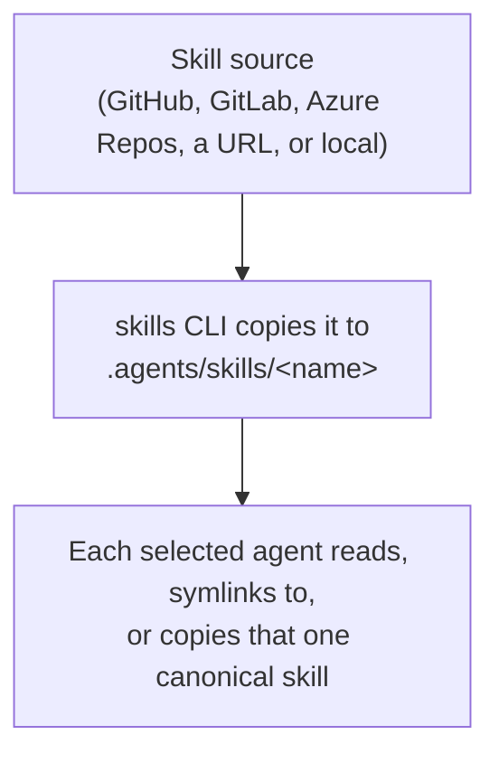

# Introduction to Agent Skills

A coding agent's abilities come from three places: the model, the tools it
can call, and the instructions it has been given. A **skill** is a portable
unit of the third kind — a folder with a `SKILL.md` file at its root, written
so an agent can decide when to read it and what to do once it has. The
`skills` CLI (npm package `skills`, run as `npx skills …`) installs, updates,
lists, and removes skills across whichever coding agents you use, without
you hand-copying files into each agent's own configuration directory.

**Read this chapter if** you are new to agent skills or to this CLI. **Before
you begin**, you should have Node.js and `npx` available; nothing else. **In
this chapter** you will learn what a skill is, what problem the CLI solves,
how an agent discovers an installed skill at all, and you will walk through
one complete install end to end. **You can skip** this chapter if you have
already installed skills with this CLI and want to jump straight to
Chapter 3 (day-to-day use), Chapter 4 (agent directory reference), or
Chapter 6 (command reference).

## About Agent Skills

### What a Skill Is

A skill is a directory containing a file named `SKILL.md`, plus any
supporting resources — scripts, templates, reference documents — that the
instructions point to. `SKILL.md` opens with YAML frontmatter delimited by
`---` lines, followed by Markdown body text:

```yaml
---
name: web-design-guidelines
description: Review UI code for Web Interface Guidelines compliance. Use when asked to "review my UI", "check accessibility", "audit design", or "review UX".
---
```

The frontmatter's `name` and `description` are the only fields the CLI
requires; a `SKILL.md` missing either one is silently skipped during
discovery, with a warning printed to the console. `description` is what an
agent (or a human skimming a list) uses to decide *when* to load the skill,
so it does double duty as documentation and as a matching signal — Chapter 5
covers how to write a description that earns its place.

### Progressive Disclosure

The instructions in `SKILL.md` are meant to be read completely once a skill
is relevant, but the frontmatter `description` should be readable — and
distinguishing — without loading the rest of the file at all. This is
progressive disclosure applied to agent context: an agent (or the CLI's own
`find` and `list` commands) can scan hundreds of descriptions cheaply, then
pay the cost of reading a full `SKILL.md` only for the one or two skills a
task actually needs. A skill's supporting files extend this further: a
`SKILL.md` can defer detail to a linked reference document that only gets
read if the instructions tell the agent to open it, rather than inlining
everything up front.

### The Problem the CLI Solves

Every coding agent that supports skills reads them from its own directory,
by its own convention — `.claude/skills` for Claude Code, `.agents/skills`
for Codex, OpenCode, and dozens of others, `.windsurf/skills` for Windsurf,
and so on for more than seventy agents in total. Without a shared installer,
distributing one skill to a team using three
different agents means either maintaining three copies or hand-symlinking
directories. `skills` treats this as a package-management problem: a skill
has a *source* (a GitHub repository, a URL, a local path), and the CLI
resolves that source, copies the skill into one canonical location, and
links or copies it into every agent directory you choose — the same shape
of problem `npm` solves for JavaScript dependencies, applied to Markdown
instructions instead of code.

> [!NOTE]
> Many agents — Codex, Cursor, OpenCode, Amp, and dozens of others — actually
> read skills from a shared **universal** directory, `.agents/skills` at the
> project root or `~/.agents/skills` for a global install, rather than an
> agent-specific one. Chapter 4 has the full directory-by-directory
> reference; the important idea for now is that the CLI, not you, tracks
> which agents share a directory and which need their own copy.

### Non-Goals

The CLI installs and manages skill *files*. It does not:

- execute a skill or interpret its instructions — that is the agent's job,
  once the skill is on disk and the agent chooses to read it;
- sandbox or restrict what a skill's instructions can ask the agent to do —
  the CLI prints a standing reminder that "skills run with full agent
  permissions" after every install, and means it;
- provide a runtime plugin API, a package registry with its own hosting, or
  dependency resolution between skills. A skill can bundle supporting files,
  but skills do not declare dependencies on other skills.

### How Agents Discover Skills

Once a skill's files are in an agent's configured skills directory, it is
the agent's own harness — not `skills` — that decides when to surface that
skill's `description` to the model and when to load the rest of `SKILL.md`.
The CLI's job ends at getting the right bytes into the right directory,
tracked well enough that a later `update` or `remove` can find them again.

**Figure 1-1: A skill's source, the CLI's canonical copy, and each agent's own directory are three distinct locations connected by one installation.**



## A Worked Example

Installing the `web-design-guidelines` skill from the `vercel-labs/agent-skills`
repository, into the current project, for Claude Code only:

```sh
$ npx skills add vercel-labs/agent-skills --skill web-design-guidelines --agent claude-code -y
```

Following this one command through the system:

1. The CLI parses `vercel-labs/agent-skills` as GitHub shorthand and resolves
   it to `https://github.com/vercel-labs/agent-skills.git` (Chapter 2 covers
   every source format it accepts).
2. It fetches the repository's skill listing — using a fast metadata lookup
   for eligible GitHub sources, falling back to a shallow `git clone`
   otherwise — and discovers every `SKILL.md` under the repository's `skills/`
   directory.
3. `--skill web-design-guidelines` narrows that list to one match; without
   it, and without `-y`, the CLI would prompt you to choose.
4. It copies that skill's files into the canonical project directory,
   `.agents/skills/web-design-guidelines/`.
5. Because you asked for one non-universal agent (`claude-code`), it also
   creates `.claude/skills/web-design-guidelines` as a symlink back to the
   canonical copy — the default installation mode. `--copy` would write an
   independent copy there instead.
6. It records the install in `skills-lock.json` at the project root, so a
   later `skills update` or `skills remove web-design-guidelines` knows
   exactly where the skill came from.

Claude Code needs no further step: the next time it starts (or reloads its
skills), `.claude/skills/web-design-guidelines/SKILL.md` is there to read.

## Summary

**Mental model.** A skill is a `SKILL.md` file with required `name` and
`description` frontmatter, plus optional supporting files. The CLI resolves
a source, keeps one canonical copy per project or per user, and links or
copies that copy into whichever agent directories you choose. Agents decide
for themselves when to read an installed skill; the CLI's job stops at
installation.

**Common path.** Resolve a source → discover its skills → choose which
skills and which agents → write the canonical copy → link or copy into
agent directories → record the install in a lock file.

**Invariants.**

- A `SKILL.md` without both `name` and `description` in its frontmatter is
  never installed.
- Skills run with the full permissions of the agent that reads them; the
  CLI does not sandbox their instructions.
- Universal agents (Chapter 4) always read from `.agents/skills`, never from
  a separate agent-specific copy, for either scope.

**Continue.** To understand what makes a valid skill package and how the CLI
resolves the sources it can install from, read Chapter 2. To skip straight
to day-to-day commands, read Chapter 3.
</content>
