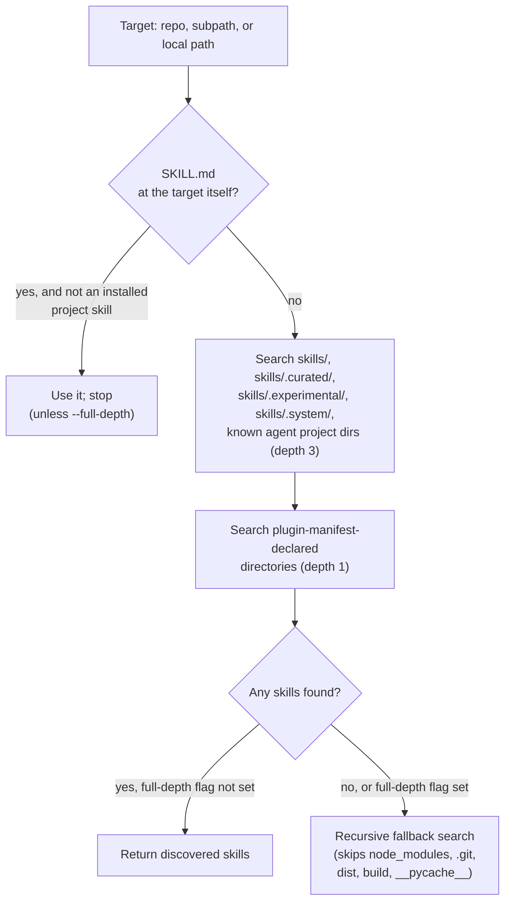

# Skill Packages

A "skill package," in this guide, means whatever the CLI can point at and
install from: a single skill directory, or a repository containing many. This
chapter specifies the anatomy of both, and the complete set of source formats
the CLI accepts when you name one.

**Read this chapter if** you want to know exactly what makes a `SKILL.md`
valid, how a repository organizes more than one skill, or which URL shapes
`skills add` understands. **Before you begin**, read Chapter 1 for the
one-paragraph model. **In this chapter** you will learn the frontmatter
contract, the directory layout the discovery algorithm searches, and every
source format from GitHub shorthand to a local path. **You can skip** the
source-format reference on a first read and come back to it when you hit a
URL shape that does not seem to work.

## About Skill Packages

### Anatomy of a Skill

At minimum, a skill is one file:

```
web-design-guidelines/
  SKILL.md
```

A richer skill adds supporting files that its instructions reference by
relative path:

```
web-design-guidelines/
  SKILL.md
  references/
    contrast-ratios.md
    aria-patterns.md
  scripts/
    check-headings.py
```

The CLI copies a skill's entire directory — everything alongside
`SKILL.md` — into its install location, with two exceptions: it always
excludes `metadata.json` files and `.git`, `__pycache__`, and `__pypackages__`
directories, wherever they appear inside a skill folder. Broken symlinks
inside a skill directory are skipped with a warning rather than aborting the
whole install.

### Frontmatter Fields

`SKILL.md`'s frontmatter is plain YAML between two `---` lines. The parser is
intentionally minimal: it supports only the standard `---` YAML delimiter, and
explicitly does not support embedded-script frontmatter engines, to avoid
executing arbitrary code from a downloaded file.

| Field | Required | Type | Meaning |
|---|---|---|---|
| `name` | Yes | string | The skill's identifier. Used to derive its install directory name and to match `--skill` filters. |
| `description` | Yes | string | What the skill does and when to use it. The only signal most discovery surfaces (agent context, `find`, `list -l`) have before loading the full file. |
| `license` | No | string | Preserved as-is; notably passed through when a skill installs into Eve, one of the few agents that reads structured frontmatter beyond name/description. |
| `version` | No | string or number | Preserved as-is; not interpreted by the CLI's own update logic, which tracks content hashes instead (Chapter 6, `skills update`). |
| `compatibility` | No | any | Preserved as-is for agents (currently Eve) that read it; the CLI itself does not filter on it. |
| `metadata` | No | object | Free-form. One key has CLI-specific meaning: `metadata.internal: true` marks a skill hidden from discovery by default (below). |

> [!IMPORTANT]
> `name` and `description` must both be present **and both be strings**. A
> `SKILL.md` where either field is missing, or where YAML parsed it as a
> number or boolean, is skipped during discovery with a warning printed to
> the console — it never silently installs with a blank name.

### Internal Skills

A skill whose frontmatter sets `metadata.internal: true` is excluded from
ordinary discovery — it will not appear in `skills add <repo> --list`, in an
unfiltered `skills add <repo>` skill picker, or in `find` results. It still
installs when named explicitly: by `--skill <exact-name>`, by the
`owner/repo@skill-name` shorthand (Chapter 2's source-format table), or
globally for every discovery call when the environment variable
`INSTALL_INTERNAL_SKILLS=1` is set. Repository maintainers use this to ship
skills meant for one workflow (an internal test fixture, a skill still under
review) without surfacing them to every consumer of the repository.

### Directory Layout of a Skills Repository

A repository can hold one skill at its root, or many skills nested under
conventional container directories. When you point `skills add` at a
repository, subpath, or local directory, it searches in this order and stops
at the first match unless `--full-depth` is given:

1. **Root `SKILL.md`.** If the target itself has a `SKILL.md`, that single
   skill is used and the search stops — unless it is a project skill already
   tracked by `skills-lock.json`, in which case it is skipped so a
   repository can also serve as a *consumer* of installed skills without the
   CLI mistaking its own install for a source skill.
2. **Conventional containers**, searched up to three directories deep:
   `skills/`, `skills/.curated/`, `skills/.experimental/`, `skills/.system/`,
   and every directory in the table of agent project skill directories from
   Chapter 4 (so a repository that is itself an agent's project — with its
   own `.claude/skills/`, say — is still searchable).
3. **Claude Code plugin manifests.** If a `.claude-plugin/marketplace.json`
   or `.claude-plugin/plugin.json` file declares skill paths or a plugin
   root, those declared directories are added to the search, and skills
   found under them are grouped under the plugin's name in `--list` and
   `list` output.
4. **A full recursive fallback**, only if nothing was found by the steps
   above, or always when `--full-depth` is passed.

Every discovered skill is deduplicated by `name`; the first occurrence found
by the search order above wins. `node_modules`, `.git`, `dist`, `build`, and
`__pycache__` directories are never descended into.

**Figure 2-1: Discovery walks conventional containers before falling back to a full recursive search.**



## Using Skill Packages: Resolving Sources

`skills add`, `skills use`, and `skills find` all accept the same source
formats, parsed by one shared resolver. Knowing the exact shapes saves a trip
to `--help` when a URL you pasted does not behave as expected.

| You write | The CLI resolves it as |
|---|---|
| `owner/repo` | GitHub shorthand → `https://github.com/owner/repo.git` (or another host, honoring `GH_HOST`) |
| `owner/repo/path/to/skill` | The same repository, narrowed to one subpath |
| `owner/repo@skill-name` | The same repository, pre-filtering to the skill named `skill-name` |
| `github:owner/repo` | Identical to `owner/repo` shorthand |
| `https://github.com/owner/repo` | A full GitHub URL |
| `https://github.com/owner/repo/tree/<ref>/<path>` | A specific branch or tag, optionally scoped to a subpath |
| `https://gitlab.com/owner/repo` and `.../-/tree/<ref>/<path>` | The equivalent GitLab forms |
| `gitlab:owner/repo` | Shorthand for `https://gitlab.com/owner/repo` |
| `https://dev.azure.com/org/project/_git/repo` | Azure Repos (Cloud or Server); `?path=` and `?version=GBbranch\|GTtag` query parameters map to a subpath and ref |
| `git@host:owner/repo.git`, `ssh://git@host/owner/repo.git` | A direct SSH Git URL, cloned as-is |
| Any other `https://…git` or bare Git URL | A generic Git source, cloned with `git clone --depth 1` |
| `./local/path`, `../local/path`, `/absolute/path` | A local directory, read directly with no network access |
| `https://raw.githubusercontent.com/…`, a GitHub release/archive asset, or a bare `.tar.gz`/`.zip` URL | A direct download: fetched, and if it is an archive, extracted before discovery runs |
| Any other `http(s)://` URL | A **well-known** source: the CLI first checks `/.well-known/agent-skills/index.json` (falling back to the legacy `/.well-known/skills/index.json`) at that URL's origin, then falls back to treating the URL itself as a direct download |
| A `#ref` fragment on a Git-like URL, e.g. `owner/repo#v2` | Pins the branch, tag, or full 40-character commit SHA; `#ref@skill-name` combines a ref with a skill filter |

> [!NOTE]
> A trailing `@skill-name` and a `#ref@skill-name` fragment both set the same
> internal skill filter; if `--skill` is also given and disagrees, the
> explicit flag value is merged in rather than silently overridden.

Subpaths are sanitized against path traversal: a subpath containing a `..`
segment that would resolve outside the repository root is rejected outright,
whether it came from a URL, a `#fragment`, or an Azure Repos `?path=` query
parameter.

`skills add` also accepts a Notion workspace or page URL as a source,
resolving it through a separate Notion-specific integration rather than the
generic Git/HTTP resolver described above. That path is out of scope for this
guide's depth of coverage; treat it as an additional supported source family
rather than a fully specified one here — **Inferred**: the exact scope of
Notion-source behavior (authentication, pack selection UI) was not verified
beyond confirming the source type is recognized and routed separately.

### Private Repositories

The same command works for public and private sources. For GitHub HTTPS and
shorthand sources, the CLI tries, in order: your existing Git credential
helper, then (if the failure looks like a SAML SSO or auth block and the
GitHub CLI is authenticated) `gh repo clone`, then an SSH fallback using your
loaded SSH keys. It never runs `gh auth token` or copies a GitHub CLI
credential into its own process. Setting `GITHUB_TOKEN` or `GH_TOKEN`
explicitly enables faster GitHub API-based installs and is required for
private-repository update checks that rely on the Trees API rather than a
full clone.

## Versioning and Updates

A skill's frontmatter `version` field is preserved on disk but is not what
the CLI checks to decide whether an update is available. Instead, `skills
update` compares a content hash — a GitHub tree SHA for global installs from
GitHub, or a SHA-256 over every file in the skill's folder for local-lock
project installs and other sources — against the hash recorded at install
time. Chapter 6's `skills update` reference has the complete contract,
including what happens when a locked skill's upstream path moves or the
skill disappears entirely.

## Skill Packages Reference

The frontmatter field table and discovery order above (Figure 2-1) are this
chapter's canonical contract; there is nothing to add beyond one internal
detail worth naming explicitly. A resolved source carries one of six type
tags, visible in lock files and JSON output: `github`, `gitlab`, `git`,
`local`, `well-known`, or `download`. `skills list --json` and `skills add
--json` both surface this value as `sourceType`.

## Summary

**Mental model.** A skill package is a directory with a valid `SKILL.md` at
its root; a skills repository is a directory (or Git repository) that may
contain many such packages under conventional container paths or
manifest-declared paths. The CLI's source resolver turns almost any way you
would naturally reference such a repository — shorthand, full URL, pinned
ref, subpath, local path — into one of six internal source types.

**Common path.** Name a source → the resolver classifies it → the CLI
fetches or reads it → discovery walks conventional containers, then falls
back to a full search → matching `SKILL.md` files with valid frontmatter
become installable skills.

**Invariants.**

- `name` and `description` are always required, and both must be strings.
- A subpath, fragment ref, or query-parameter path can never resolve outside
  its source's root.
- `metadata.internal: true` skills are hidden from every discovery surface
  unless named explicitly or unlocked with `INSTALL_INTERNAL_SKILLS=1`.

**Continue.** Chapter 3 puts these packages to work: choosing which skills
and which agents to install to, day to day.
</content>
