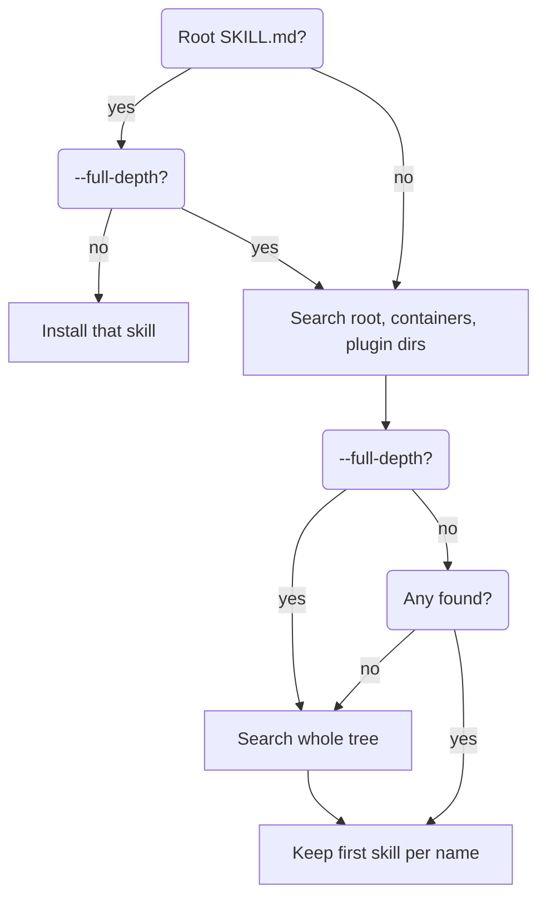

# About Skills and Sources

This chapter explains what the CLI accepts as a skill, how it reads a source string, and how it chooses skills inside a source. [About Scopes, Agents, and Lock Files](#about-scopes-agents-and-lock-files) explains where the files go.

## Read this chapter if

- an install skipped a skill, chose the wrong one, or used an unexpected directory name;
- you write skills and need to know what the CLI requires of them.

## You can skip

- the rows of the source table for hosts you do not use.

## What a skill is

A skill is a directory that contains a file named `SKILL.md`. The file starts with YAML frontmatter that names and describes the skill, followed by Markdown instructions for the agent. The directory can also hold supporting files, which the instructions refer to by relative path.

The CLI installs the whole directory, so a relative reference that works in the source also works after installation.

## The SKILL.md contract

The frontmatter must set `name` and `description`, and both must be strings. It must be YAML between two `---` lines at the top of the file. JavaScript frontmatter (`---js`) is not evaluated, so such a file has no fields.

A `SKILL.md` that lacks a required field, sets either field to a non-string value, or contains invalid YAML is skipped with a warning, and discovery continues. The examples in this chapter add two folders to the source from [The sample setup](#the-sample-setup): `skills/draft-checklist`, whose frontmatter has only a `name`, and `skills/notes-v2`, whose `name` is `Release Notes v2`.

```console
$ npx skills add ../acme-skills --list
…
⚠ Skipped /tmp/demo/acme-skills/skills/draft-checklist/SKILL.md — missing required frontmatter field(s): description
◇  Found 3 skills
```

The command lists the other three skills and exits with status 0. If no valid skill remains, `add` fails ([Errors when adding skills](#errors-when-adding-skills)).

Setting `metadata.internal: true` makes a skill internal and hides it from discovery ([Selecting skills to install](#selecting-skills-to-install)). [Hide work-in-progress skills](#hide-work-in-progress-skills) shows the task.

When the CLI copies a skill, it leaves out every `.git`, `__pycache__`, and `__pypackages__` directory and every `metadata.json` file, at any depth.

## Skill names and install directories

The CLI names the installed directory after the frontmatter `name`, not after the source folder. It lowercases the name, replaces each run of characters other than `a-z`, `0-9`, `.`, and `_` with a hyphen, trims leading and trailing dots and hyphens, and truncates the result to 255 characters. A name that sanitizes to nothing becomes `unnamed-skill`. The skill in the `notes-v2` folder therefore installs as `release-notes-v2`:

```console
$ npx skills add ../acme-skills --skill "Release Notes v2" -a claude-code -y
…
$ ls .claude/skills
release-notes-v2
```

Because the directory comes from the name, two skills with the same name share one install directory, even when their sources differ. Installing the second replaces the first one's files and its lock entry.

## Source formats

The CLI tests the source argument of `add` and `use` against these forms from top to bottom and uses the first match.

| Form | Example | Recognized by | Source type |
|---|---|---|---|
| Notion | `notion` | `add` only. **Unverified:** also a Notion page URL; fetches skills from Notion | none |
| Local path | `../acme-skills` | Absolute; starts with `./` or `../`; `.` or `..`; a Windows drive path | `local` |
| Hosted artifact URL | `https://raw.githubusercontent.com/…/SKILL.md` | Raw, archive, and release-download URLs on GitHub and GitLab | `download` |
| GitHub URL | `https://github.com/acme/acme-skills/tree/main/skills` | `github.com` repository or tree URL | `github` |
| GitLab | `gitlab:acme/acme-skills` | `gitlab:` prefix, `gitlab.com` repository URL, or `/-/tree/` URL on any host | `gitlab` |
| Azure Repos URL | `https://dev.azure.com/acme/app/_git/skills` | A `/_git/<repo>` path on any host | `git` |
| GitHub shorthand | `acme/acme-skills/skills/release-notes` | `owner/repo`, optional subpath, no `:`; also `github:owner/repo` | `github` |
| Other HTTP(S) URL | `https://acme.dev/skills` | Any other HTTP(S) URL not ending in `.git`; tried as a well-known index, then downloaded as a `SKILL.md` or archive | `well-known` |
| Git URL | `git@github.com:acme/acme-skills.git`, `file:///tmp/demo/acme-skills.git` | Anything no row above matches, such as SSH or an HTTP(S) URL ending in `.git` | `git` |

> [!WARNING]
> Start a relative path with `./` or `../`. Otherwise the CLI reads `my-skills/release-notes` as a GitHub repository and clones it, which can install skills that someone else wrote.

When `GH_HOST` names a GitHub Enterprise host, shorthand sources clone from that host as `git` sources ([Environment variables](#environment-variables)).

## Pinning a ref and naming a skill

A source can carry a Git ref (a branch or tag) and a skill name:

- A `#ref` fragment pins the ref on shorthand and on Git, GitHub, GitLab, and Azure Repos sources, as in `acme/acme-skills#v1`. A `file://` URL does not accept one.
- A tree URL (`…/tree/v1/skills`) carries its own ref and subpath.
- `owner/repo@skill` selects one skill by name, and `owner/repo#v1@skill` also pins the ref. The `@skill` part works only on shorthand and Azure Repos sources; other URLs drop it and offer every skill, so use `--skill` with them.

A local path accepts neither form, because the CLI treats `@release-notes` as part of the path:

```console
$ npx skills add ../acme-skills@release-notes -a claude-code -y
…
└  Local path does not exist: /tmp/demo/acme-skills@release-notes
```

The command exits with status 1; pass `--skill release-notes` instead.

## How the CLI discovers skills

**Figure 2-1: A SKILL.md at the top of a source hides everything below it unless you pass --full-depth.**



Discovery follows six rules:

1. A subpath makes that directory the search root. A subpath containing `..` is rejected, so the search cannot leave the source.
2. If the search root holds a valid `SKILL.md`, that one skill is the result, unless you pass `--full-depth` ([layout advice](#lay-out-a-repository-of-skills)).
3. Otherwise the CLI checks the immediate subdirectories of the search root, then walks container directories such as `skills/` and `.claude/skills` up to three levels deep ([the full list](https://github.com/vercel-labs/skills/blob/main/src/skills.ts)). A directory that holds a skill ends the walk on its branch, so the walk misses skills nested below it.
4. Skill directories declared in `.claude-plugin/marketplace.json` or `.claude-plugin/plugin.json` are searched too.
5. If nothing is found, or you passed `--full-depth`, the CLI searches every directory up to five levels below the search root, skipping `node_modules`, `.git`, `dist`, `build`, and `__pycache__`.
6. When two skills share a name, the first one found wins, and the CLI drops the other without a warning.

## Selecting skills to install

Without `--skill` or `@skill`, a source with one skill installs it directly, `--yes` installs every discovered skill, and otherwise the CLI prompts ([Non-interactive mode and agent detection](#non-interactive-mode-and-agent-detection)).

A `--skill` value selects the skill whose frontmatter `name` matches it exactly, ignoring case. Partial names and sanitized directory names do not match, so `--skill release-notes-v2` finds nothing here. If none of the requested names matches, `add` exits with status 1 and lists the names of the skills it found. If at least one matches, the CLI ignores unmatched names without a warning and exits with status 0. With `--json`, each unmatched name appears as a `skipped` entry and the command exits with status 1.

`--skill '*'` selects every discovered skill. Naming an internal skill makes it visible and installs it, but `'*'` and `--yes` leave internal skills out. Setting `INSTALL_INTERNAL_SKILLS=1` includes them in every discovery.
