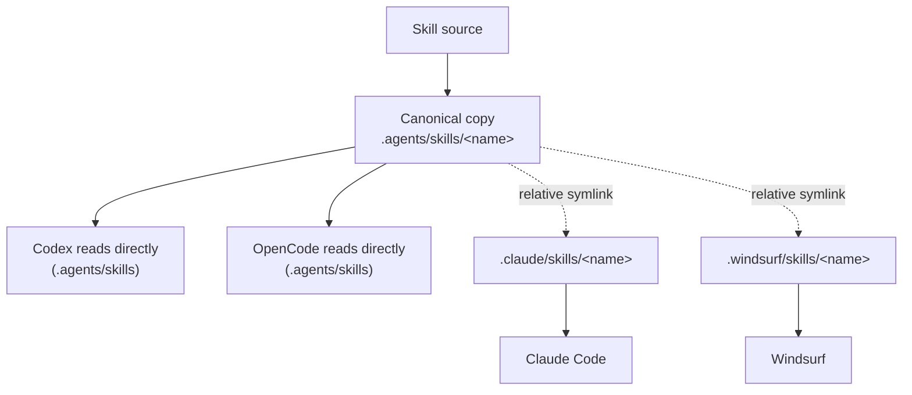
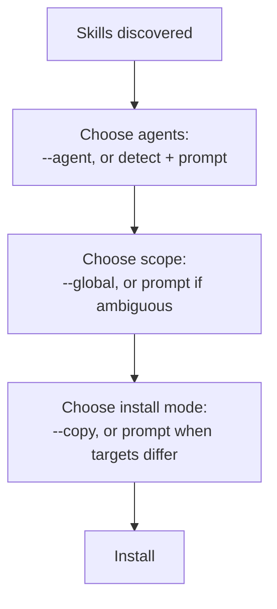

# Installing and Managing Skills

This is the chapter for day-to-day use: adding a skill, choosing where it
goes, listing what is installed, updating it later, and removing it cleanly.

**Read this chapter if** you install, update, or remove skills as part of
your normal workflow. **Before you begin**, read Chapter 1's worked example
if you have never run `skills add`. **In this chapter** you will install
skills interactively and non-interactively, choose project versus global
scope, select specific skills and agents, and recover from the failures that
actually occur in practice. **You can skip** the troubleshooting table on a
first read.

## About Installing Skills

### Canonical Copies, Scope, and Install Mode

Every install has three independent choices, each covered in its own section
below:

- **Scope** — project (the current directory, the default) or global (your
  home directory, via `-g`/`--global`).
- **Agents** — which of the CLI's known agents get the skill; auto-detected,
  prompted for, or given explicitly with `-a`/`--agent`.
- **Install mode** — `symlink` (the default) or `copy` (`--copy`).

Regardless of scope or mode, the CLI keeps one **canonical copy** of each
skill's files at `.agents/skills/<name>` (project scope) or
`~/.agents/skills/<name>` (global scope). In symlink mode, every
**universal** agent (Chapter 4) reads that canonical copy directly with no
extra file; every **agent-specific** agent gets a symlink from its own
directory back to the canonical copy. In copy mode, every selected agent
gets its own independent copy instead, and no canonical directory is used at
all for that install. Symlinks are created as relative paths so a project
directory stays portable if it is copied or moved as a whole; if symlink
creation fails for a target (common on Windows without Developer Mode
enabled), the CLI falls back to a real copy for that agent only and reports
the fallback rather than failing the whole install.

**Figure 3-1: One canonical copy serves every universal agent directly; agent-specific agents get a symlink back to it.**



> [!IMPORTANT]
> A global install of a **universal** agent never creates that agent's own
> global directory, even when one is configured (for example, Codex's
> `~/.codex/skills`). `~/.agents/skills` alone serves every universal agent
> at both scopes. Only agent-*specific* agents (Chapter 4's non-universal
> rows) get a real symlink or copy for a global install.

### Non-Interactive Detection

When `skills add` runs inside a coding agent's own execution environment —
detected via `@vercel/detect-agent` — it behaves as if `-y` were passed and
defaults `--agent` to the detected agent plus every universal agent, unless
you passed `--agent` yourself. A banner names the detected agent, so this
never happens silently:

```
│
●   codex  Agent detected — installing non-interactively
```

Outside of that detection, and without a TTY on stdin, an install that would
otherwise need a prompt exits with status 1 and a message pointing at
`--agent` and `-y`, rather than hanging or silently doing nothing.

## Using: Add a Skill

The minimum command is a source:

```sh
$ npx skills add vercel-labs/agent-skills
```

Run with no other flags and a real terminal, this: detects installed agents
on your machine, asks you to confirm or adjust that agent list, asks whether
to install every skill in the repository or pick specific ones (skipped
automatically when the repository has exactly one skill), asks project or
global scope, and — only when your agent selection spans more than one
distinct skills directory — asks symlink or copy, before printing an
installation summary and asking you to confirm.

For a scripted or CI install, skip every prompt:

```sh
$ npx skills add vercel-labs/agent-skills --skill web-design-guidelines --agent claude-code -g -y
```

`--all` is shorthand for `--skill '*' --agent '*' -y`: every skill in the
source, installed for every known agent, without prompts.

### JSON Output

`--json` suppresses every decorated prompt, spinner, and note — they move to
stderr — and prints exactly one JSON array to stdout on every exit path,
success or failure. It requires `-y` or `--all`; `skills add <source> --json`
alone (without a non-interactive flag) exits 1 with an explanation rather
than hanging on a prompt it cannot show:

```sh
$ npx skills add ./my-skills --skill demo-skill --agent claude-code --json -y
```
```json
[
  {
    "name": "demo-skill",
    "status": "installed",
    "source": "/path/to/my-skills",
    "ref": null,
    "hash": "f96afae8...",
    "path": "/path/to/project/.claude/skills/demo-skill",
    "scope": "project",
    "agents": ["Claude Code"],
    "mode": "copy",
    "security": null
  }
]
```

Each entry's `status` is `installed`, `skipped` (a requested `--skill` name
matched nothing), or `failed`. `mode` reflects what actually happened for
that skill — `copy` here because a single agent means a single target
directory, and the CLI skips the pointless indirection of a symlink to one
place.

## Using: Choose Skills, Agents, and Scope

Explicit flags always win over detection or prompts. Agents:

```sh
$ npx skills add vercel-labs/agent-skills --agent claude-code cursor -y   # named agents
$ npx skills add vercel-labs/agent-skills --agent '*' -y                  # every agent
$ npx skills add vercel-labs/agent-skills --agent claude-code -g -y       # global scope
```

Without `--agent`, the CLI detects which agents are actually configured on
your machine (Chapter 4) and, when exactly one is found, installs to it plus
every universal agent automatically. With several found and neither `-y`
nor `--agent` given, it prompts with a searchable multi-select, pre-populated
from your last selection (persisted per machine, not per project).

`--skill` accepts one or more names, matched case-insensitively against a
skill's `name` frontmatter — a name with spaces must be quoted as one shell
argument:

```sh
$ npx skills add vercel-labs/agent-skills --skill frontend-design skill-creator
$ npx skills add owner/repo --skill "Convex Best Practices"
```

`--skill '*'` selects every non-internal skill — equivalent to answering
"install everything" at the interactive prompt. `--list`/`-l` prints every
available skill's name and description without installing anything, a quick
way to discover a repository's skill names before writing the `--skill`
list you actually want:

```sh
$ npx skills add vercel-labs/agent-skills --list
```

## Using: List, Update, and Remove

`skills list` (alias `ls`) defaults to project scope; `-g` switches to
global; `-a <agent>` filters by agent:

```sh
$ npx skills list
Project Skills

demo-skill  ./.agents/skills/demo-skill
  Agents: Codex  Source: ./my-skills
```

`skills update` (aliases `check`, `upgrade`) checks — and, unless it only
finds nothing to do, refreshes — every locked skill whose source supports an
update check. It prompts for project, global, or both scope unless `-g`,
`-p`, or a positional skill name narrows it, or unless it is running
non-interactively, in which case it infers project scope if the project has
any locked skills and falls back to global otherwise:

```sh
$ npx skills update
Checking for skill updates…

✓ Updated 2 skill(s)
```

A skill installed from a local path, a bare Git URL without a recorded
subpath, or a private repository the CLI cannot re-query is reported as
unable to check automatically, with the exact reinstall command to refresh
it by hand — `skills update` never silently gives up on a skill without
telling you why.

`skills remove` (aliases `rm`, `r`) accepts names, or opens an interactive
multi-select with none:

```sh
$ npx skills remove demo-skill -y
✓ Successfully removed 1 skill(s)
```

`--all` removes everything and cannot be combined with named skills — the
CLI refuses that combination outright, because early versions of this same
flag silently discarded the named skills and wiped every install instead:

```sh
$ npx skills remove --skill foo --all
Cannot combine --all with specific skill names.
Use `skills remove --all` to remove every skill, or omit --all to remove
only the named skills.
Example: skills remove foo -y
```

> [!WARNING]
> Removing a skill deletes its canonical directory only when no other
> installed agent still references it, but it always removes the
> agent-specific copy or symlink for every agent you targeted (or, with no
> `--agent`, every known agent) — including ghost symlinks left behind by an
> agent you no longer use. There is no undo short of reinstalling.

**Figure 3-2: Choosing agents, scope, and install mode are three independent decisions, in this order.**



## Failure and Recovery

| Symptom | Cause | Recovery |
|---|---|---|
| `Missing required argument: source` | `skills add` (or `use`) called with no source | Pass a source; see Chapter 2's format table |
| Install hangs, then a non-interactive-required error | A prompt was needed but stdin is not a TTY | Add `--agent <name>` (or `'*'`) and `-y` |
| `No valid skills found` | The source has no `SKILL.md` with both `name` and `description` | Check the source path/subpath; try `--full-depth` if skills are nested unusually deep |
| Symlinks silently became copies | Symlink creation failed for that target (commonly Windows without Developer Mode) | Enable Developer Mode, or accept `--copy` as the working fallback the CLI already used |
| Clone times out on a large repository | The default 5-minute clone timeout was exceeded | Set `SKILLS_CLONE_TIMEOUT_MS` higher, or pass a `local` path to an already-cloned copy |
| Authentication fails for a private repository | Git credentials, `gh`, and SSH all failed in sequence | Confirm access with `gh auth status -h <host>` or `ssh -T git@<host>`, per the error's exact suggestion |
| `update` reports a skill "cannot be checked automatically" | Installed from a local path, an un-pathed Git URL, or an inaccessible private repo | Run the printed `skills add <source> -g -y` command by hand to refresh it |
| `remove --skill foo --all` refused | `--all` and named skills were combined | Choose one: `remove --all`, or `remove foo -y` |

## Summary

**Mental model.** Every install is scope (project/global) × agents ×
install mode (symlink/copy), applied to one or more discovered skills, from
one resolved source, recorded in a lock file for later update or removal.

**Common path.** `skills add <source>` → pick skills → pick agents → pick
scope → confirm → installed, linked, and locked. `skills list` to check what
is there; `skills update` to refresh it; `skills remove` to take it back
out.

**Invariants.**

- `--json` always emits exactly one JSON array to stdout, on every exit
  path.
- `--all` on `remove` can never be combined with named skills.
- A canonical directory is only deleted when no remaining agent still
  references it.

**Continue.** Chapter 4 is the exact directory-by-directory reference for
every supported agent; Chapter 6 gives every flag, exit status, and
environment variable a canonical entry.
</content>
