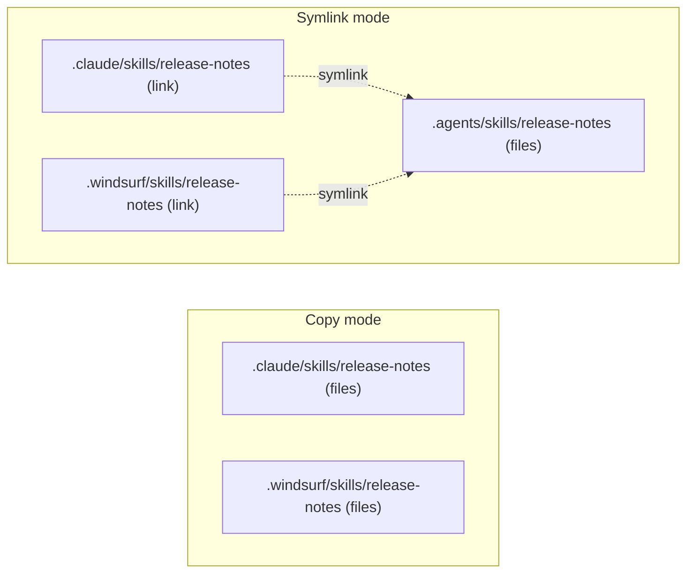

# About Scopes, Agents, and Lock Files

Every install makes the same decisions. The CLI picks a base directory (the scope), picks the agents that receive each skill, and gives each agent either a link to a shared copy or a copy of its own. It then records the install in a lock file, which later drives updates and restores. This chapter explains those decisions so that you can predict which files a command creates.

## Read this chapter if

- you share a project or a machine with more than one coding agent;
- you run the CLI from scripts, from CI, or inside an agent session.

## In this chapter you will

- tell project scope from global scope and find the canonical copy;
- learn which agents read the canonical directory and which need links;
- follow the order in which the CLI picks target agents;
- see what each lock file records and how `update` uses it.

## Project scope and global scope

Project scope is the default, and it writes under the current working directory. The CLI does not search upward for a project root such as a Git repository or an existing `skills-lock.json`. If you run `npx skills add` in `packages/web/`, the skill and a new `skills-lock.json` land in `packages/web/`, even when the repository root already has a lock file. Change to the directory that should own the skills before you run the command.

Global scope (`-g`) writes under your home directory. An interactive run without `-g` or `--yes` asks for a scope when at least one target agent supports global skills. With `--yes` and no `-g`, the scope is the project.

## The canonical skills directory

The canonical skills directory is `.agents/skills/` in a project, or `~/.agents/skills/` in global scope. In symlink mode it holds the one real copy of each skill, in a subdirectory named after the skill, such as `.agents/skills/release-notes/`. [Skill names and install directories](#skill-names-and-install-directories) explains how the CLI derives that name.

## Universal and agent-specific agents

A universal agent is one whose project skills directory is `.agents/skills`, the canonical directory itself. Codex, Cursor, Gemini CLI, and GitHub Copilot are universal. A universal agent reads the canonical copy directly, so the CLI creates nothing extra for it. An agent-specific agent reads its own directory, such as `.claude/skills` for Claude Code or `.windsurf/skills` for Windsurf, and receives a link to the canonical copy or a copy of its own.

In global scope, the CLI places a universal agent's skills in `~/.agents/skills` and writes nothing into the agent's own home directory. A global install for Cursor creates only `~/.agents/skills/release-notes`, even when `~/.cursor` exists. `CLAUDE_CONFIG_DIR`, `CODEX_HOME`, and similar variables move an agent's home directory ([Environment variables](#environment-variables)).

Eve (`agent/skills`) and PromptScript are project-only. A global install that includes either one reports a per-agent failure, such as `PromptScript does not support global skill installation`, installs for the other agents, and exits with status 0.

The [supported agents table](https://github.com/vercel-labs/skills/blob/main/docs/agents.md), generated from [`src/agents.ts`](https://github.com/vercel-labs/skills/blob/main/src/agents.ts), lists every agent with its `--agent` name and paths.

## Symlink mode and copy mode

In symlink mode, the default, the CLI copies the skill once into the canonical directory and links each agent-specific directory to that copy. Links are relative, such as `.claude/skills/release-notes -> ../../.agents/skills/release-notes`, so they still resolve after the project is cloned to another path. In copy mode (`--copy`), the CLI writes an independent copy into each target's directory and creates no links.

**Figure 3-1: Symlink mode keeps one real copy; copy mode gives each agent its own.**

When every target shares one directory, the CLI uses copy mode without `--copy`, because no link is needed. An install for Claude Code alone, or for universal agents alone, therefore reports `(copied)`. If a link cannot be created, the CLI copies the files into that agent's directory and warns `Symlinks failed for:`.

An edit to the canonical copy reaches every linked agent at once. Copies drift apart when you edit one of them. A reinstall deletes and rewrites each directory it targets, which discards local edits.

## How the CLI chooses target agents

Without `-a`, the CLI chooses the agents itself. It checks the conditions in the following table in order, and the first one that applies decides the targets.

| Condition, checked in order | With `-y` | Without `-y` |
|---|---|---|
| `-a` names agents | Those agents | Those agents |
| Running inside an agent that the CLI maps to a target | That agent + universal | Same (`-y` is implied) |
| Eve detected in the project | Eve only | Asks about Eve, then prompts for agents if you decline |
| One agent detected on the machine | That agent + universal | Same |
| Several agents detected | Detected + universal | Prompt |
| No agent detected | Every agent | Prompt |

When you pass `-a`, the CLI installs for exactly those agents and adds no universal agents; `-a '*'` selects every agent. Otherwise it checks for an agent session through environment variables ([Non-interactive mode and agent detection](#non-interactive-mode-and-agent-detection)). If the session maps to none of its agents, such as `AI_AGENT=pi`, `-y` is still implied, so selection continues down the table and, in a clean home, reaches every agent. Next, it looks for Eve: an `agent/` directory in the project plus an `eve` dependency in `package.json`. Failing that, machine detection looks for agent home and config directories such as `~/.claude`.

In symlink mode and project scope, a detected agent-specific agent gets a link only when its top-level directory, such as `.windsurf/`, already exists in the project. Otherwise the result reports `skipped: Windsurf (project directory not found)`, and Windsurf sees nothing until you create the directory and reinstall. The CLI creates the directory anyway for agents you named with `-a` or chose at the prompt, for Claude Code, the one agent the CLI always provisions, and for Eve, which always receives a real copy in `agent/skills`. With `--copy`, the CLI writes a copy into every target's directory and creates directories such as `.windsurf/` that did not exist.

> [!WARNING]
> Pass `-a` in every script and CI job. Without it, the targets depend on the machine and the environment. On a clean runner, `--yes` installs for every agent and creates `.claude/` and `agent/` in the project, and `--yes --copy` creates more than 50 agent directories there. Inside an agent session, the CLI targets that agent and the universal agents without prompting.

## Lock files

The project lock, `skills-lock.json` in the project directory, records project installs so that teammates can restore them and `update` can check them. Commit it. It has `version` 1 and no timestamps, and its entries are sorted by skill name, so branches that add different skills usually merge cleanly. Each entry records the source, the source type, the ref and skill path when they apply, and `computedHash`, a SHA-256 hash of the skill folder's contents. A local source is stored as a path relative to the project, such as `../acme-skills`.

The global lock records `-g` installs, in `~/.agents/.skill-lock.json`, or in `$XDG_STATE_HOME/skills/.skill-lock.json` when that variable is set. It has `version` 3, install and update timestamps, and a `skillFolderHash`, which is the GitHub tree SHA for GitHub sources. The CLI discards a global lock older than version 3, so its skills become updatable only after you reinstall them with `add -g`.

Neither lock records which agents received a skill or which mode was used. Skills installed by direct download from a URL are not in the project lock. [Project lock file fields](#project-lock-file-fields) and [Global lock file](#global-lock-file) describe the fields.

## How updates are detected and applied

`npx skills update` compares lock entries with their sources ([`skills update` and `skills check`](#skills-update-and-skills-check) gives the scope rules). In project scope, it clones each recorded Git source, hashes each skill folder, and compares the result with `computedHash`. In global scope, it compares GitHub tree SHAs for GitHub sources, cloning when the API is unavailable. Local-path and npm-package entries are never updated in place.

For each changed skill, the CLI runs `add <source> --skill <name> -y` in a child process, adding `-g` for global entries. The child chooses agents by the [selection rules](#how-the-cli-chooses-target-agents) as they apply at update time, so placement can change. With no agents detected, a skill copied with `-a claude-code` comes back as a link to a new copy in `.agents/skills`, and `agent/skills` appears. Rerun `add` with your `-a` list to restore a placement. A skill that disappeared from its source is reported as deleted upstream.
