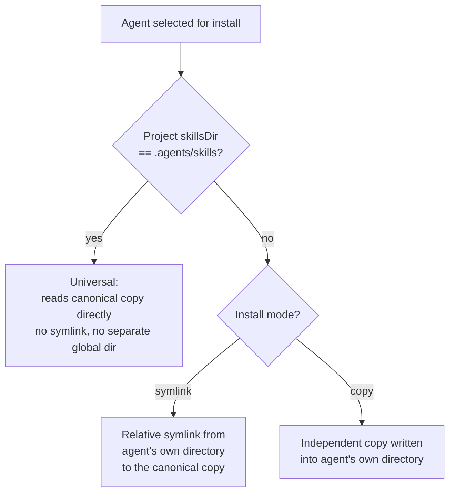

# Agent Targets

This chapter is the reference for exactly where the CLI writes files, agent
by agent, and how it decides which agents are "installed" on your machine at
all.

**Read this chapter if** you need your agent's exact skills directory, you
are debugging why a skill did not appear where you expected, or you are
deciding whether to target an agent by name. **Before you begin**, read
Chapter 3's install-mode section — this chapter assumes you already know the
difference between a canonical copy, a symlink, and a copy. **In this
chapter** you will find a directory table covering every universal agent
and the most widely used agent-specific ones (79 agents in total; see the
note for how to enumerate the rest), how "installed" is detected per agent, and
the one genuine special case (Eve subagents). **You can skip** straight to
the row for your own agent and treat the rest as reference.

## About Agent Targets

### Universal Versus Agent-Specific

Chapter 3 introduced two categories of agent. The distinction is entirely
mechanical: an agent is **universal** if its configured project `skillsDir`
is exactly `.agents/skills`. Every other value makes it **agent-specific**.
This single check drives two related but distinct behaviors:

- **Which agents are auto-included and interactively listed.** A slightly
  narrower set — universal agents minus a small number explicitly flagged
  `showInUniversalList: false` (Replit, and the CLI's own generic
  `universal` placeholder target) — is what gets added automatically
  alongside a detected agent, and shown in the interactive "Universal"
  locked section.
- **Which agents skip a redundant symlink or agent-specific global
  directory at install time.** This check is broader: *any* agent whose
  `skillsDir` is `.agents/skills` — including Replit — is treated as
  reading the canonical directory directly, so it never gets its own
  symlink.

> [!NOTE]
> In practice this means Replit is invisible in the interactive agent
> picker and is not auto-added alongside a detected agent, but if you name
> it explicitly with `--agent replit`, the install behaves exactly like any
> other universal agent: no per-agent symlink, because `.agents/skills` is
> already its configured directory.

### Detection

`detectInstalledAgents()` runs every agent's own check in parallel and
returns whichever return `true`. Detection is deliberately lightweight —
almost always "does this configuration directory exist" (`~/.claude` for
Claude Code, `~/.cursor` for Cursor) rather than inspecting contents or
requiring the agent to be running. A few agents also check the current
project — Replit looks for a `.replit` file; Continue, Jazz, AstrBot, and
CodeBuddy check both a project and a home directory. It never touches the
network.

**Figure 4-1: Whether an agent gets its own symlink depends only on its configured project `skillsDir`.**

### Eve Subagents

Eve is the one agent with structure inside its own skills tree: a project
using Eve can define subagents, each with its own skills directory at
`agent/subagents/<name>/skills`, alongside the root agent's own
`agent/skills`. `skills add --subagent <name>` (repeatable; `root` selects
the root agent explicitly) targets one or more of these; `skills list` and
`skills remove` both scan every subagent directory they can find under
`agent/subagents/` in addition to the root. Eve detection itself requires
both an `agent/` directory and an `eve` dependency in the project's
`package.json` — the only agent whose detection reads a manifest file rather
than checking for a directory alone.

## Agent Directory Reference

This version's registry recognizes 79 agents in total. The table below is
generated from that registry and lists every **universal** agent (Chapter
4's category that shares `.agents/skills` and therefore needs no directory
lookup at all) plus a curated set of the most widely used agent-specific
ones — the project-scope `skillsDir` and the global-scope directory used for
`-g`/`--global` installs. "Not supported" in the Global column means that
agent has no global install location at all — `skills add --global --agent
<name>` for it fails outright with an explicit error. Several global paths
honor an environment variable override before falling back to the path
shown — notably `$CODEX_HOME`, `$CLAUDE_CONFIG_DIR`, `$XDG_CONFIG_HOME`,
`$XDG_STATE_HOME`, and several single-purpose `*_HOME` variables listed in
Chapter 6's environment reference.

> [!NOTE]
> For the complete, always-current list of every valid `--agent` key —
> including the roughly 40 narrower or region-specific agents not printed
> below — run any `add` or `remove` command with a deliberately invalid
> agent name, for example `skills add . --agent x -y`. The CLI's own
> "Invalid agents" error prints every valid key it knows about, generated
> from the exact registry your installed version ships, which will not
> drift out of date the way a printed table can.

| Agent | Project `skillsDir` | Global `skillsDir` | Universal |
|---|---|---|---|
| Amp | `.agents/skills` | `~/.config/agents/skills` | Yes |
| Antigravity | `.agents/skills` | `~/.gemini/antigravity/skills` | Yes |
| Cline | `.agents/skills` | `~/.agents/skills` | Yes |
| Codex | `.agents/skills` | `~/.codex/skills` | Yes |
| Cursor | `.agents/skills` | `~/.cursor/skills` | Yes |
| Deep Agents | `.agents/skills` | `~/.deepagents/agent/skills` | Yes |
| Dexto | `.agents/skills` | `~/.agents/skills` | Yes |
| Droid | `.agents/skills` | `~/.factory/skills` | Yes |
| Firebender | `.agents/skills` | `~/.firebender/skills` | Yes |
| Gemini CLI | `.agents/skills` | `~/.gemini/skills` | Yes |
| GitHub Copilot | `.agents/skills` | `~/.copilot/skills` | Yes |
| Kilo Code | `.agents/skills` | `~/.kilo/skills` | Yes |
| Loaf | `.agents/skills` | `~/.agents/skills` | Yes |
| OpenCode | `.agents/skills` | `~/.config/opencode/skills` | Yes |
| PromptScript | `.agents/skills` | Not supported | Yes |
| Sarvam Code | `.agents/skills` | `~/.agents/skills` | Yes |
| Warp | `.agents/skills` | `~/.agents/skills` | Yes |
| Zed | `.agents/skills` | `~/.agents/skills` | Yes |
| Replit | `.agents/skills` | `~/.config/agents/skills` | No (hidden; see note above) |
| Claude Code | `.claude/skills` | `~/.claude/skills` | No |
| Windsurf | `.windsurf/skills` | `~/.codeium/windsurf/skills` | No |
| Roo Code | `.roo/skills` | `~/.roo/skills` | No |
| Continue | `.continue/skills` | `~/.continue/skills` | No |
| Goose | `.goose/skills` | `~/.config/goose/skills` | No |
| AiderDesk | `.aider-desk/skills` | `~/.aider-desk/skills` | No |
| Devin for Terminal | `.devin/skills` | `~/.config/devin/skills` | No |
| Junie | `.junie/skills` | `~/.junie/skills` | No |
| Kiro CLI | `.kiro/skills` | `~/.kiro/skills` | No |
| Qwen Code | `.qwen/skills` | `~/.qwen/skills` | No |
| Trae | `.trae/skills` | `~/.trae/skills` | No |
| ForgeCode | `.forge/skills` | `~/.forge/skills` | No |
| Grok Build | `.grok/skills` | `~/.grok/skills` | No |
| Pi | `.pi/skills` | `~/.pi/agent/skills` | No |
| Eve | `agent/skills` | Not supported | No |
| OpenClaw | `skills` | `~/.openclaw/skills` | No |
| Mistral Vibe | `.vibe/skills` | `~/.vibe/skills` | No |
| OpenHands | `.openhands/skills` | `~/.openhands/skills` | No |
| Crush | `.crush/skills` | `~/.config/crush/skills` | No |

The remaining ~40 agents follow the same two-column shape under their own
configuration directory (for example `.zencoder/skills`, `.qoder/skills`,
`.trae-cn/skills`) with no further surprises; the note above is the fastest
way to enumerate them precisely for the version you have installed.

> [!NOTE]
> OpenClaw's global directory additionally depends on which of three
> possible config directories exists on disk at detection time — `~/.openclaw`,
> `~/.clawdbot`, or `~/.moltbot`, checked in that order, falling back to
> `~/.openclaw` if none exist yet. Kilo Code's detection additionally
> recognizes its legacy `~/.kilocode` directory. Droid deliberately keeps
> its listed global directory (`~/.factory/skills`) distinct from the
> canonical `~/.agents/skills` it now installs into, solely so `skills
> remove` can still clean up skills a previous CLI version placed there
> directly.

### Symlink Versus Copy, Summarized

| Install mode | Canonical copy written? | Per-agent result |
|---|---|---|
| `symlink` (default) | Yes, at `.agents/skills/<name>` or `~/.agents/skills/<name>` | Universal agents read it directly; agent-specific agents get a relative symlink to it |
| `copy` (`--copy`, or auto-selected when every target shares one directory) | No | Every selected agent gets its own independent copy |

## Summary

**Mental model.** "Universal" is not a special agent — it is what any agent
configured to read `.agents/skills` becomes, automatically, because that is
already the canonical directory the CLI writes to. Every other agent gets a
symlink (or, in copy mode, its own copy) from that canonical location into
its own configured directory.

**Common path.** Look up your agent's row above → know its exact project
and global directory → decide whether `--copy` is worth the duplication for
your case (Chapter 3 covers when it is: independent per-agent edits, or
avoiding symlinks in an environment that mishandles them).

**Invariants.**

- Any agent with project `skillsDir` equal to `.agents/skills` never gets a
  separate global directory written during a fresh symlink-mode install,
  even if one is configured.
- Detection never touches the network and, for most agents, never inspects
  file contents — only directory existence.

**Continue.** Chapter 5 is for the other side of this table: writing a
skill so it installs cleanly everywhere in it.
</content>
