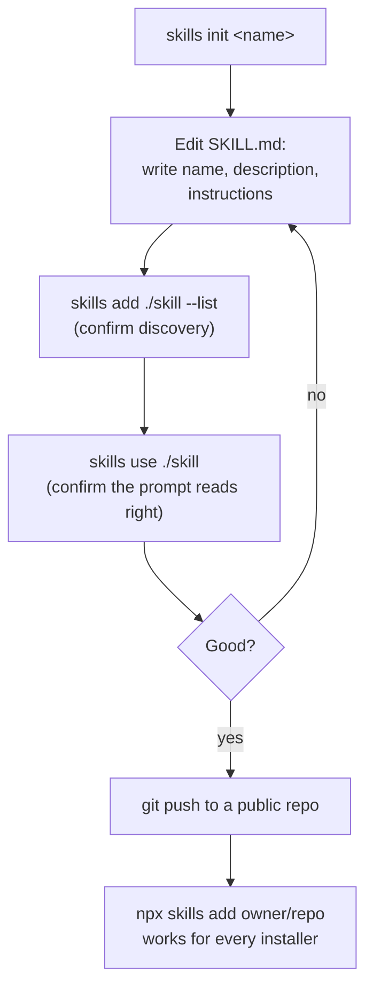

# Authoring and Publishing Skills

This chapter is for writing a skill, not consuming one: scaffolding a new
`SKILL.md`, writing a description worth matching on, testing it locally, and
publishing it somewhere the CLI can install it from.

**Read this chapter if** you are packaging instructions for others (or your
future self) to install. **Before you begin**, read Chapter 2's frontmatter
contract — this chapter assumes you know what `name`, `description`, and
the discovery search order require. **In this chapter** you will scaffold a
skill, test it without installing it anywhere, and publish it to a Git host.
**You can skip** the plugin-grouping section unless you specifically
maintain a Claude Code plugin marketplace.

## About Authoring Skills

### What Makes a Description Worth Writing

`description` is the entire signal an agent — or a person running `skills
find` or `--list` — has before deciding whether to read the rest of
`SKILL.md`. A description that only states the topic ("Guidelines for web
design") fails to say *when* the skill applies; a description that also
states the trigger does not:

```yaml
description: >-
  Review UI code for Web Interface Guidelines compliance. Use when asked to
  "review my UI", "check accessibility", "audit design", or "review UX".
```

Write it the way you would brief a colleague handing off a task: what the
skill does, and the concrete phrases or situations that mean it is the right
one to reach for. A one-line topic summary is not enough; naming the
triggering intent is what makes discovery actually work, whether the
"reader" is a model deciding what to load or a person scanning `--list`
output.

### The Publishing Model

There is no separate registry to push to. A skill is publishable the moment
it is a valid `SKILL.md` reachable by one of Chapter 2's source formats: most
often, committed to a Git repository. `skills.sh` is a discovery index layered
on top of public GitHub repositories — `find` searches it, and installing
from a public repository is what makes a skill appear there — but it is not
a separate build or submission step.

## Using: Scaffold a New Skill

`skills init [name]` creates a starting `SKILL.md`. With a name, it creates
`<name>/SKILL.md`; without one, it writes `SKILL.md` directly into the
current directory, using the directory's own name as the skill name:

```sh
$ npx skills init web-design-guidelines
Initialized skill: web-design-guidelines

Created:
  web-design-guidelines/SKILL.md
```

It refuses to overwrite an existing `SKILL.md` at the target location,
printing "Skill already exists" instead — safe to run again by accident. The
scaffold it writes is intentionally minimal:

```markdown
---
name: web-design-guidelines
description: A brief description of what this skill does
---

# web-design-guidelines

Instructions for the agent to follow when this skill is activated.

## When to use

Describe when this skill should be used.

## Instructions

1. First step
2. Second step
3. Additional steps as needed
```

Treat `description` as the one line you must not leave at its placeholder
value; everything else is a starting shape, not a required structure.

## Using: Write an Effective SKILL.md

A few checks before you consider a skill done:

- **`name` and `description` are both present and both strings.** Chapter 2
  covers exactly what happens if either is missing — the skill is silently
  excluded from discovery, not installed with a blank value.
- **The description names a trigger, not just a topic**, as above.
- **Supporting files are referenced by relative path** from `SKILL.md`, so
  they still resolve after the CLI copies the whole skill directory
  somewhere else.
- **Nothing sensitive is bundled alongside the skill.** The CLI reminds
  every installer that skills run with full agent permissions; treat a
  skill's instructions the same way you would treat a script you are asking
  someone else to execute, because that is effectively what they are.
- **If the skill should stay hidden from casual discovery**, set
  `metadata.internal: true` (Chapter 2) rather than relying on obscurity —
  an internal skill is still installable by exact name.

## Using: Test Locally Before Publishing

Two commands let you exercise a skill before it is anywhere public.

`skills add <local-path> --list` discovers and prints every skill under a
local directory without installing anything — the fastest way to confirm the
CLI actually finds a new skill and parses its frontmatter correctly:

```sh
$ npx skills add ./my-skill --list
Available Skills
  web-design-guidelines
    Review UI code for Web Interface Guidelines compliance. ...
```

`skills use <local-path>` goes one step further: it materializes the skill
into a temporary directory and prints exactly the prompt an agent would
receive, without installing it into any agent's directory at all — useful
for checking the instructions read the way you intend before anyone
installs them:

```sh
$ npx skills use ./my-skill
You are being given a Skill to execute for the user's next request.

Use the following SKILL.md as your instructions:

<SKILL.md>
---
name: web-design-guidelines
description: ...
---
...
</SKILL.md>
```

Piped into a supported agent's own CLI, or run with `--agent claude-code` or
`--agent codex` to launch that agent interactively with the prompt already
loaded, this is a full dry run — nothing is written to any skills directory,
so there is nothing to remove afterward.

## Using: Publish to GitHub

Once a skill is committed to a public GitHub repository, it installs with
GitHub shorthand immediately:

```sh
$ git push origin main
$ npx skills add <owner>/<repo>
```

`skills init`'s own closing output states this directly, plus the URL-hosted
alternative for a single file without a full repository:

```
Publishing:
  GitHub:  Push to a repo, then npx skills add <owner>/<repo>
  URL:     Host the file, then npx skills add https://example.com/<name>/SKILL.md
```

A repository with more than one skill needs no extra manifest for the CLI to
find them — Chapter 2's discovery order already searches a conventional
`skills/` directory automatically. `skills add <owner>/<repo> --list` is the
fastest way to confirm what a freshly pushed repository actually exposes to
installers before telling anyone to run `skills add` against it.

## Grouping Skills as a Claude Code Plugin

If your skills repository is also a Claude Code plugin — with a
`.claude-plugin/plugin.json` or a multi-plugin
`.claude-plugin/marketplace.json` — the CLI's discovery reads the same
manifest. Skills whose paths are declared under a named plugin are grouped
under that plugin's name in `--list` and `list` output, which is purely a
display grouping: installation, agent selection, and the lock file all treat
each skill individually regardless of which plugin it was grouped under.

**Figure 5-1: Authoring is a loop between the scaffold, local testing, and one publish step; nothing here is a separate submission or review process.**



## Summary

**Mental model.** Authoring is: scaffold, write a description that names its
trigger, test with `--list` and `use` (which never install anything), then
push. There is no build step and no separate registry submission — a
reachable, valid `SKILL.md` is a publishable skill.

**Common path.** `skills init <name>` → edit `SKILL.md` → `skills add
./<name> --list` to confirm discovery → `skills use ./<name>` to confirm the
generated prompt → push to a public repository → `skills add owner/repo`
from anywhere.

**Invariants.**

- `skills init` never overwrites an existing `SKILL.md`.
- `skills add --list` and `skills use` never write to any agent's skills
  directory.
- A skill runs with the full permissions of whatever agent reads it; there
  is no sandboxing layer to rely on instead of reviewing what you publish.

**Continue.** Chapter 6 is the exact reference for every command used in
this chapter and the two before it — synopsis, every option, exit statuses,
and the files each command writes.
</content>
