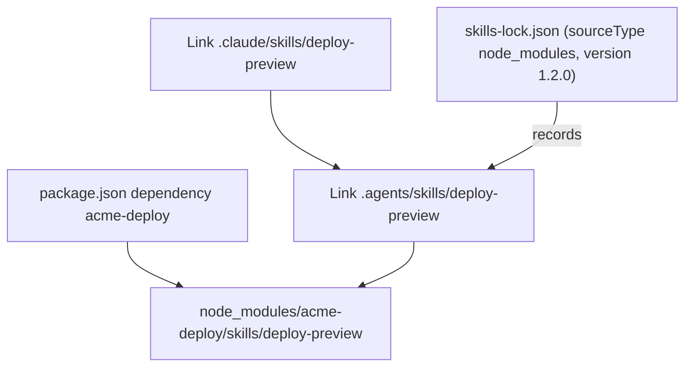

# Sharing Skills Through a Project

A team shares a project's skills by committing its lock file, and optionally the installed files, to the repository. The restore and sync commands are experimental in skills 1.7.4 and can change in later releases; see [`skills experimental_install`](#skills-experimental-install) and [`skills experimental_sync`](#skills-experimental-sync).

## Before you begin

- Read [Lock files](#lock-files) in Chapter 3.
- Build the sandbox in [The sample setup](#the-sample-setup), then run `mkdir -p ~/.claude` so that the CLI detects Claude Code.

## In this chapter you will

- choose which installed files to commit;
- restore a project's skills in a fresh checkout;
- sync skills from npm dependencies, and declare skills in `package.json`.

## Decide what to commit

Commit `skills-lock.json`. It is the only record of where each project skill came from.

Choose how teammates get the skill files:

| Choice | A fresh clone contains | Consequence |
|---|---|---|
| Commit `.agents/skills` and agent link directories such as `.claude/skills` | The files you reviewed | The agent links resolve because their target is committed too. |
| Ignore both | Only the lock file | Each teammate restores, then adds agent links. |

Restoring does not reproduce the files you reviewed. The lock file records a content hash but no commit, so a restore installs whatever each Git source's `ref`, or its default branch, holds at that moment. Commit the files, or [pin a ref](#pinning-a-ref-and-naming-a-skill), when the team must run exactly what it reviewed.

> [!WARNING]
> Do not commit the links that [sync](#sync-skills-shipped-in-npm-packages) creates. They point into `node_modules`, so they dangle in a fresh clone until someone runs `npm install`. List them in `.gitignore`, and let sync recreate them.

## Restore skills from the lock file

The first command installs both sample skills and records them in the lock file. The others delete the files and restore them:

```sh
npx skills add ../acme-skills --skill '*' -a claude-code codex -y
rm -rf .agents .claude
npx skills experimental_install
```

```text
●  Restoring 2 skills from skills-lock.json into .agents/skills/
◇  Found 2 skills
◆  Restored changelog-lint, release-notes
```

The command installs lock entries into `.agents/skills`, which universal agents read. It creates no agent-specific links, so `.claude/skills` is still missing; rerun the `add` command to create it.

Entries with source type `node_modules` go to sync, which links them from the installed packages, so run `npm install` first.

> [!WARNING]
> If a synced package is missing from `node_modules`, sync deletes its skill's lock entry and still exits 0. Recover with `git checkout skills-lock.json`, run `npm install`, and restore again.

When one source fails, the command prints `Failed to install from <source>: …`, restores the remaining sources, and exits with status 1.

> [!IMPORTANT]
> In skills 1.7.4, `npx skills install` is an alias of `add` and does not restore. Without a source, it fails with `Missing required argument: source` and exits 1.

## Sync skills shipped in npm packages

An npm package can ship skills for the projects that depend on it. Sync scans each package listed in the project's `dependencies`, `devDependencies`, `optionalDependencies`, or `peerDependencies`. A package with a `SKILL.md` at its root is one skill. Otherwise sync reads every `skills/<name>/SKILL.md` and `dist/skills/<name>/SKILL.md` in it.

Give `acme-app` a dependency. Because `acme-deploy` is fictional, these commands stand in for `npm install`:

```sh
cat > package.json <<'EOF'
{
  "name": "acme-app",
  "private": true,
  "devDependencies": { "acme-deploy": "1.2.0" }
}
EOF
mkdir -p node_modules/acme-deploy/skills/deploy-preview
echo '{ "name": "acme-deploy", "version": "1.2.0" }' > node_modules/acme-deploy/package.json
cat > node_modules/acme-deploy/skills/deploy-preview/SKILL.md <<'EOF'
---
name: deploy-preview
description: Deploy a preview build with acme-deploy.
---

Run `acme-deploy preview` and report the preview URL.
EOF
```

Preview the result with `npx skills experimental_sync --dry-run -y`, which changes nothing. Then sync and inspect the links:

```sh
npx skills experimental_sync -y
readlink .agents/skills/deploy-preview .claude/skills/deploy-preview
```

```text
../../node_modules/acme-deploy/skills/deploy-preview
../../.agents/skills/deploy-preview
```

The lock entry records the package version:

```json
"deploy-preview": {
  "source": "acme-deploy",
  "sourceType": "node_modules",
  "skillPath": "skills/deploy-preview/SKILL.md",
  "version": "1.2.0",
  "computedHash": "d499257bf750a7d5974b8256a115d507fa3824c1b653fb6b289ed97780c58172"
}
```

**Figure 5-1: Synced skills are links into node_modules, so they change when the package changes.**



Agents see a package upgrade as soon as npm writes the new files. Rerun sync after an upgrade to record the new version and to pick up skills the package added or dropped. If you pass `--copy`, sync copies the files instead of linking them, and agents see an upgrade only after the next sync.

Sync chooses agents [as `add` does](#how-the-cli-chooses-target-agents), except that with `-y` and no agent detected it installs for universal agents only. Inside a detected agent, it targets that agent and the universal agents.

Each run removes the skills that sync installed and that nothing provides anymore, with their links and lock entries. `--no-cleanup` keeps them, and their links dangle once the package is gone.

## Declare skills in package.json

The `skills` array in `package.json` names skills to install without shipping their files. Sync reads it from the project and from each direct dependency. The [skills-npm specification](https://github.com/antfu/skills-npm/blob/main/SPEC.md) defines its grammar, and skills 1.7.4 accepts two kinds of entries:

- `npm:<package>` installs the skills an installed package ships, even when the package is not a direct dependency.
- A Git source is a string, or an object with `source`, an optional `skills` list of names to keep, and an optional `ref`. A local path or plain URL is rejected, and in the project's own field it stops sync with exit status 1.

This field installs `release-notes` from the sample repository at tag `v1.0.0`:

```json
"skills": [
  {
    "source": "file:///tmp/demo/acme-skills.git",
    "skills": ["release-notes"],
    "ref": "v1.0.0"
  }
]
```

To try it, add the field to `package.json` and run:

1. `git -C /tmp/demo/acme-skills.git tag v1.0.0`, which tags the bare repository that the field names.
2. `npx skills remove release-notes -y`, because sync never replaces a skill that `add` installed.
3. `npx skills experimental_sync -y`, which clones the source at the tag and copies the skill into `.agents/skills`.

Sync fetches a Git entry only once. To pick up changes, run `npx skills update`. Update refreshes the files but records the skill as an `add` install, so sync no longer removes the skill when you delete it from the field.

A dependency can declare the field too, which makes the package a skill pack.

To narrow a sync, pass patterns to `--include` and `--exclude`. A pattern `pkg` matches every skill that package ships or declares, `pkg#skill` matches one of them, and `.` matches the Git entries in the project's own field. Both parts accept globs, and an exclusion wins. [`skills experimental_sync`](#skills-experimental-sync) lists the other options.
