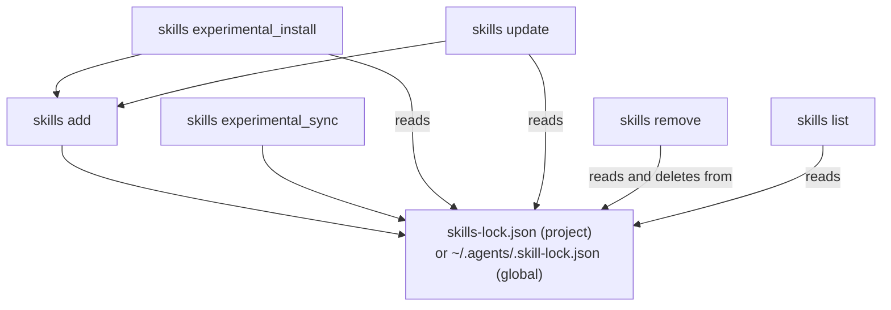

# Command Reference

This chapter specifies every command's contract: synopsis, arguments,
options, precedence, stdio behavior, exit statuses, side effects,
idempotency, and examples. Read Chapters 1–5 first for the model; read this
chapter to stop guessing at a flag.

## Shared Rules

These apply to every command below unless a command's own entry says
otherwise.

**Binary names.** The package installs two identical binaries: `skills` and
`add-skill`. Every example here uses `skills`.

**Aliases.** `add` also answers to `a`, `i`, `install`. `remove` also
answers to `rm`, `r`. `find` also answers to `search`, `f`, `s`. `update`
also answers to `upgrade`, `check`. `list` also answers to `ls`.

**Non-interactive detection.** Every command that would otherwise prompt
checks, once per process, whether it is running inside a detected coding
agent (Chapter 3). If so, it behaves as though `-y` were passed and prints a
one-line banner naming the detected agent; it never prompts silently and
never hangs waiting on a TTY that will not respond.

**`--help`/`-h`** short-circuits to that command's help before any
side-effecting work runs. **`--version`/`-v`** (first argument only) prints
the installed version, e.g. `1.7.0`, and exits 0.

**Telemetry.** Every command except `init` sends a fire-and-forget usage
event (command, source, skill/agent counts — never skill contents) unless
`DISABLE_TELEMETRY` or `DO_NOT_TRACK` is set. Failures are always silent and
never change a command's exit status; the process waits up to 5 seconds for
pending telemetry before exiting.

**Exit status convention**, used throughout this chapter: `0` means the
command completed, including "nothing to do" and a deliberate interactive
cancel. `1` means a validation error, a missing prerequisite (TTY, matching
skill, matching agent), or at least one real failure inside an otherwise
completed batch.

## Global Options and Environment

| Option | Applies to | Effect |
|---|---|---|
| `--help`, `-h` | Every command | Print help, exit 0, no side effects |
| `--version`, `-v` | Top level | Print the version, exit 0 |
| `-y`, `--yes` | `add`, `remove`, `update`, `experimental_sync` | Skip prompts; use this guide's documented default per command |
| `-g`, `--global` | `add`, `remove`, `list`, `update` | Operate on `~/.agents/skills` and agents' global directories |
| `--json` | `add`, `list` | Emit one JSON value to stdout; move decorated output to stderr |

| Variable | Read by | Effect |
|---|---|---|
| `GITHUB_TOKEN`, `GH_TOKEN` | Source resolution, updates | Explicit GitHub API token; optional when Git/`gh`/SSH auth already works |
| `GH_HOST` | Source parsing | GitHub Enterprise host for shorthand sources; invalid values fall back to `github.com` |
| `CODEX_HOME`, `CLAUDE_CONFIG_DIR`, `VIBE_HOME`, `HERMES_HOME`, `AUTOHAND_HOME`, `GROK_HOME`, `SARVAM_HOME` | Per-agent config | Override that agent's default home directory (Chapter 4) |
| `XDG_CONFIG_HOME` | Several agents' global directories | POSIX config-home base; falls back to `~/.config` |
| `XDG_STATE_HOME` | The CLI's own global lock file | Lock path becomes `$XDG_STATE_HOME/skills/.skill-lock.json` |
| `INSTALL_INTERNAL_SKILLS` | Discovery | `1`/`true` includes internal skills (Chapter 2) in every discovery call |
| `SKILLS_CLONE_TIMEOUT_MS` | `git clone` | Overrides the default 300000 ms clone timeout |
| `SKILLS_DOWNLOAD_MAX_BYTES`, `SKILLS_EXTRACT_MAX_BYTES`, `SKILLS_EXTRACT_MAX_FILES` | Downloads/archives | Override the default 10 MiB / 25 MiB / 1000-file caps |
| `SKILLS_API_URL` | `find` | Overrides the default `https://skills.sh` search API |
| `DISABLE_TELEMETRY`, `DO_NOT_TRACK` | Telemetry | Disable the usage event and the `add` security-audit lookup |
| `CI`, `GITHUB_ACTIONS`, `GITLAB_CI`, `CIRCLECI`, `TRAVIS`, `BUILDKITE`, `JENKINS_URL`, `TEAMCITY_VERSION` | Telemetry only | Marks the event as CI; no other behavior change |

## `skills add`

Resolves a source, discovers its skills, and installs selected skills into
selected agents' directories.

**Synopsis:** `skills add <source> [options]` (aliases `a`, `i`, `install`)

| Option | Description |
|---|---|
| `source` (positional, required) | Any format from Chapter 2 |
| `-g`, `--global` | Install to global scope instead of project |
| `-a`, `--agent <agents...>` | Target these agents (Chapter 4 keys), or `'*'` for all |
| `-s`, `--skill <skills...>` | Install these skills by name (case-insensitive), or `'*'` for all non-internal |
| `-l`, `--list` | Print discovered skills and exit; installs nothing |
| `-y`, `--yes` | Skip prompts, using this section's default order |
| `--copy` | Independent copy per agent instead of canonical copy plus symlinks |
| `--metadata <json>` | Attached only to this install's telemetry event |
| `--subagent <names...>` | Target Eve subagent directories; `root` selects the root agent |
| `--all` | Shorthand for `--skill '*' --agent '*' -y` |
| `--full-depth` | Search every subdirectory, even under a root `SKILL.md` |
| `--json` | One JSON array on stdout; requires `-y`/`--all`; incompatible with `--list` |

**Behavior.** Agent selection precedence: `--agent` > one auto-detected
agent plus universal agents > interactive prompt > all agents (`-y` with
none detected). Scope precedence: `--global` > interactive prompt > project
default. Full decision tree: Chapter 3, Figure 3-2. Decorated progress goes
to stdout (stderr under `--json`); errors always go to stderr. Writes the
canonical skill directory or per-agent copies, and the project or global
lock file; may create an agent-specific project directory that did not
exist, only for agents you selected. Re-running the same command overwrites
the previous install for that skill/agent pair rather than merging it —
idempotent in on-disk result, aside from lock-file timestamps.

**Exit statuses:** `0` installed (see per-entry JSON `status` under
`--json`), `--list` printed, or a deliberate cancel. `1` missing source; bad
`--agent`; no skills discovered; `--skill` matched nothing; `--json` without
`-y`/`--all`; `--json` with `--list`; a prompt was needed but stdin is not a
TTY.

**Examples:**

```sh
$ npx skills add vercel-labs/agent-skills --skill web-design-guidelines -a claude-code -y
$ npx skills add ./local-skills --list
$ npx skills add owner/repo@my-skill -g -y
```

**See also:** [`use`](#skills-use) to try a skill first; [`update`](#skills-update) to refresh; [`remove`](#skills-remove) to undo.

## `skills use`

Resolves one skill and prints the prompt an agent would receive, without
installing anything.

**Synopsis:** `skills use <source>[@<skill>] [options]`

| Option | Description |
|---|---|
| `source` (positional, required) | Any Chapter 2 source; trailing `@<skill>` selects one skill among several |
| `-s`, `--skill <skill>` | Select the skill; must agree with a source's `@<skill>` suffix if both given |
| `-a`, `--agent <agent>` | Launch `claude-code`, `codex`, or `sarvam-code` interactively with the prompt, instead of printing it |
| `--full-depth` | Same meaning as for `add` |

**Behavior.** Without `--agent`, the prompt goes to stdout alone — pipeable
into another program (`\| claude`); errors go to stderr. With `--agent`,
stdio is inherited by the launched process. Writes the skill's files to an
auto-cleaned temporary directory only; never touches any agent's configured
skills directory. Fully idempotent: no persisted state.

**Exit statuses:** `0` prompt printed, or the launched agent exited 0. `1`
missing/multiple sources; unsupported `--agent`; ambiguous or no matching
skill; the launched agent exited non-zero or was not found.

**Examples:**

```sh
$ npx skills use vercel-labs/agent-skills@web-design-guidelines | claude
$ npx skills use vercel-labs/agent-skills --skill web-design-guidelines --agent codex
```

**See also:** [`add`](#skills-add) to install the skill instead of trying it once.

## `skills list`

Prints installed skills for one scope. **Synopsis:** `skills list [options]` (alias `ls`)

| Option | Description |
|---|---|
| `-g`, `--global` | List global instead of project (project is default) |
| `-a`, `--agent <agents...>` | Filter to skills linked into these agents |
| `--json` | Emit a JSON array instead of formatted text |

**Behavior.** Read-only; all output on stdout. **Exit statuses:** `0`
always, including empty results; `1` an `--agent` value did not match a
known agent.

**Examples:**

```sh
$ npx skills list
$ npx skills ls -g -a claude-code --json
```

**See also:** [`remove`](#skills-remove) to act on what `list` shows.

## `skills remove`

Removes installed skills from one or more agents. **Synopsis:** `skills
remove [skills...] [options]` (aliases `rm`, `r`)

| Option | Description |
|---|---|
| `skills` (positional) | Names to remove; none opens an interactive multi-select on a TTY |
| `-g`, `--global` | Remove from global scope instead of project |
| `-a`, `--agent <agents...>` | Only these agents' directories; omitted checks and cleans every known agent |
| `-s`, `--skill <skills...>` | Alternative to positional names; `'*'` is a documented synonym for `--all` |
| `-y`, `--yes` | Skip the confirmation prompt |
| `--all` | Remove everything; implies `-y`; **cannot** combine with named skills |

**Behavior.** Deletes each targeted agent's copy or symlink for the named
skills. Deletes the canonical directory only if no remaining installed
agent still references it, and removes the matching lock entry only in that
same case — so a skill still used elsewhere stays updatable. Removing an
already-absent name is a no-op reported as "no skills found to remove."

> [!WARNING]
> There is no dry-run flag. `--all` removes every skill in scope immediately
> once you accept the prompt (or immediately with `-y`). Run `list` first if
> you are unsure what is installed.

**Exit statuses:** `0` completed, or a deliberate cancel. `1` `--all`
combined with named skills; an invalid `--agent` value.

**Examples:**

```sh
$ npx skills remove demo-skill -y
$ npx skills remove --skill '*' -a cursor
$ npx skills remove --all
```

**See also:** [`list`](#skills-list) to see what would be affected first.

## `skills find`

Searches the `skills.sh` index. **Synopsis:** `skills find [query]
[--owner <owner>]` (aliases `search`, `f`, `s`)

| Argument/Option | Description |
|---|---|
| `query` | Free-text terms; with one, results print and the process exits. Without one, on a TTY, opens an interactive incremental search. |
| `--owner <owner>` | Restrict to one GitHub owner |

**Behavior.** Non-interactive results print to stdout, one skill per block
with its install command and `skills.sh` URL. The interactive UI reads raw
keypresses; `Enter` installs the highlighted result exactly as `add` would,
`Esc` cancels. Running inside a detected agent, or without a TTY, `find`
with no query prints a short tip instead of attempting the interactive UI.
**Exit status** is always `0`; zero results or a bad `--owner` print a
message rather than failing.

**Examples:**

```sh
$ npx skills find typescript
$ npx skills find react --owner vercel
```

**See also:** [`add`](#skills-add), which `find` delegates an interactive install to.

## `skills update`

Checks locked skills for upstream changes and reinstalls the ones that
changed. **Synopsis:** `skills update [skills...] [options]` (aliases
`upgrade`, `check`)

| Option | Description |
|---|---|
| `skills` (positional) | Names to limit the check to; none checks every locked skill in scope |
| `-g`, `--global` / `-p`, `--project` | Check one scope only; both together mean both |
| `-y`, `--yes` | Skip the scope prompt and the prompt to delete skills removed upstream |

**Behavior.** Scope, non-interactively (no TTY or `-y`): project if the
project has any locked skills, else global. For each changed skill,
re-runs the equivalent of `add` against its recorded source, updating its
files and lock entry; GitHub sources are checked with a lightweight tree-hash
API call first, falling back to a full temporary clone when that is
unavailable or the recorded path moved. Nothing changed upstream reports
"up to date" and writes nothing.

**Exit statuses:** `0` every checked skill was current or updated. `1` at
least one skill failed to update (set only after every skill was still
attempted).

**Examples:**

```sh
$ npx skills update
$ npx skills update my-skill -g
```

**See also:** [`add`](#skills-add), which `update` re-runs under the hood.

## `skills init`

Scaffolds a new `SKILL.md`. **Synopsis:** `skills init [name]`

With a name, creates `<name>/SKILL.md`; without one, creates `./SKILL.md`
using the current directory's own name. Never overwrites an existing
`SKILL.md` — reports "Skill already exists" instead, making a repeated run
a safe no-op. Always exits `0`.

**Examples:**

```sh
$ npx skills init my-skill
$ npx skills init
```

**See also:** [`add --list`](#skills-add) to confirm the scaffolded skill is discoverable.

## `skills experimental_install` and `skills experimental_sync`

Two project-scope maintenance commands, named `experimental_*` by the CLI
itself — their contract is more likely to change in a future release than
the commands above.

**`skills experimental_install`** restores every skill recorded in a
project's `skills-lock.json`: it groups locked entries by source and calls
the equivalent of `add` for each group, installing only into
`.agents/skills` regardless of which agents originally received a symlink
or copy. Entries with `sourceType: "node_modules"` are handed to
`experimental_sync` instead. Always exits `0`; per-source failures are
logged, not fatal to the run. Safe to run repeatedly.

**`skills experimental_sync [options]`** scans `node_modules` (including
scoped `@org/pkg` packages) for `SKILL.md` files at a package's root,
`skills/`, or `.agents/skills/`, and installs matches into `.agents/skills`
— always symlink mode, always project-scoped — recording each with
`sourceType: "node_modules"` and a content hash in `skills-lock.json`.
`-a`/`--agent <agents...>` targets specific agents; `-y`/`--yes` skips
prompts; `-f`/`--force` reinstalls every discovered skill even if its
content hash has not changed. Without `--force`, a later run only reinstalls
packages whose skill content actually changed. Always exits `0`.

```sh
$ npx skills experimental_install
$ npx skills experimental_sync -y --agent claude-code
```

**Figure 6-1: Every command reads or writes the same two lock files; only `add`, `experimental_sync`, and `experimental_install` write skill files themselves.**



## Summary

| Command | Writes |
|---|---|
| `add` | Canonical directory or per-agent copies; project or global lock file |
| `use` | A temporary directory only, always cleaned up |
| `remove` | Agent copies/symlinks, conditionally the canonical directory and its lock entry |
| `update` | Same as `add`, for each skill it refreshes |
| `init` | One new `SKILL.md` (never overwrites) |
| `experimental_sync` | Canonical directory (symlink mode only); project lock file |
| `experimental_install` | Same as `add`, driven by the existing project lock file |
| `list`, `find` (query mode) | Nothing |

**Continue.** The appendixes that follow collect a glossary, both lock file
formats in full, and open questions this guide could not resolve from the
source alone.
</content>
