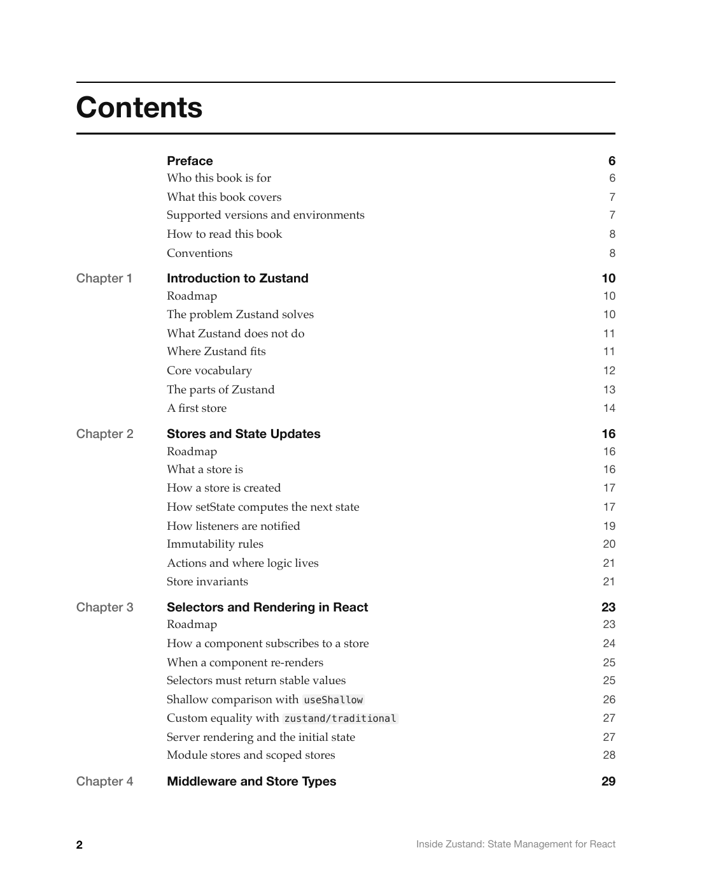
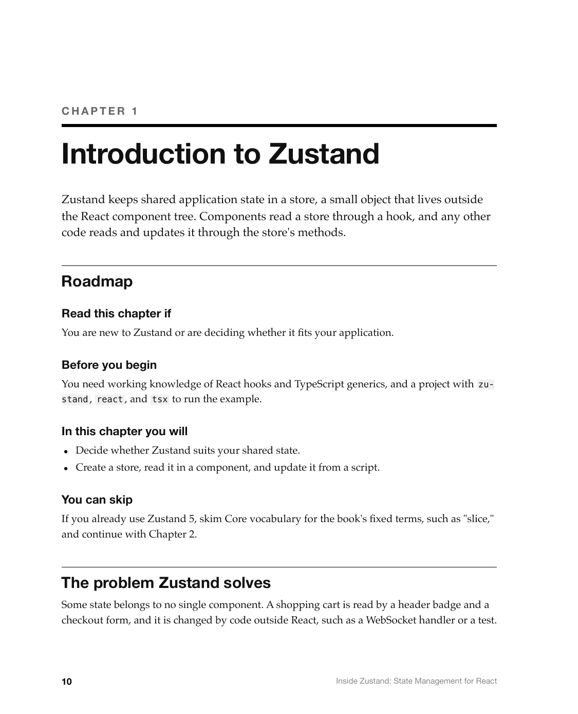

# Inside Zustand: State Management for React

A complete example output of the `inside-mac` skill: a from-scratch, Inside-Macintosh-style
technical guide to [Zustand](https://github.com/pmndrs/zustand), the pmndrs React state-management
library, rendered as a print-quality PDF book with the skill's PDF pipeline.

**[Read the PDF](./Inside%20Zustand-%20State%20Management%20for%20React.pdf)** (95 pages).

This guide is unofficial and independently written. It is not affiliated with, endorsed by, or
reviewed by the pmndrs organization or Zustand's maintainers. Zustand is MIT-licensed; see
[pmndrs/zustand](https://github.com/pmndrs/zustand) for the canonical source and official docs.

## Preview

| Cover | Contents |
|---|---|
|  |  |

| Chapter opener | Figure |
|---|---|
|  |  |

## What it covers

The guide documents **Zustand 5.0.16**, tag
[`v5.0.16`](https://github.com/pmndrs/zustand/tree/v5.0.16) (commit
[`382d29c`](https://github.com/pmndrs/zustand/commit/382d29c485e67018c06e75ec7235130d0968522c)).
The source was cloned for research and is not included in this repository. Behavioral claims were
checked against that commit's source and tests. Zustand's own docs were read as evidence, and none of
their prose is reproduced.

Zustand is one system, so the book separates concepts, tasks, and reference across chapters rather
than inside each one:

- Concepts: 1. Introduction to Zustand, 2. Stores and State Updates, 3. Selectors and Rendering in
  React, 4. Middleware and Store Types.
- Tasks: 5. Building Stores, 6. Using Stores in Components, 7. Persisting State, 8. Using
  Middleware, 9. Testing Stores. Chapter 7 also carries the persist reference, because persistence
  has its own lifecycle that readers learn on its own.
- Reference: 10. Zustand Reference.

The book also has a Preface and three appendixes: Glossary, Errors and Symptoms, and Compatibility
and Migration.

The book has 44 complete TypeScript programs, and each was type-checked under a strict
`tsconfig.json`. The programs that print output were run with `tsx` on Node.js, and the output
shown is the output they printed. The reference chapter also shows six short call signatures,
which are not programs. The harness
had no DOM, so component listings were type-checked and, where they render markup, rendered with
`renderToString`. The Preface states the exact toolchain.

## How this was produced

The guide was written with the [`inside-mac`](../../skills/inside-mac) skill by a multi-agent
workflow. Every agent loaded [`SKILL.md`](../../skills/inside-mac/SKILL.md) and the reference files
its job needed:

1. **Plan.** One agent read the skill, surveyed the Zustand source, tests, and docs, and wrote a
   book plan. The plan held the documentation contract, the structure decision, every chapter's
   sections and page budget, a map of which section owns each fact, the figures, and the sample
   model ([`architecture.md`](../../skills/inside-mac/references/architecture.md),
   [`content.md`](../../skills/inside-mac/references/content.md)).
2. **Draft.** One agent per file wrote its chapter from the plan, verified claims against the
   source, and ran or type-checked every listing
   ([`concepts.md`](../../skills/inside-mac/references/concepts.md),
   [`task-guides.md`](../../skills/inside-mac/references/task-guides.md),
   [`api-reference.md`](../../skills/inside-mac/references/api-reference.md),
   [`voice-and-tone.md`](../../skills/inside-mac/references/voice-and-tone.md)).
3. **Cut.** The drafts came to about 35,000 words, two and a half times the plan. One agent per file
   cut topics, repetition, and copied lists until the file fit its budget, which brought the book to
   about 15,500 words.
4. **Review.** Three agents reviewed the whole book against
   [`review.md`](../../skills/inside-mac/references/review.md), one each for structure and
   content, accuracy against the source, and concepts, figures, and prose. They reported 46
   findings, 13 of them major.
5. **Revise.** One agent per file applied the findings. The book ended at about 19,000 words.
6. **Render.** The book was built with the pipeline in
   [`skills/inside-mac/assets/`](../../skills/inside-mac/assets), whose figure check passed every
   figure at 5.5 pt or larger. Its internal links and listings were checked again afterward.

The overshoot in step 3 led to the word-budget guidance in `architecture.md` and `pdf-book.md`.

## Rebuilding

```sh
cd examples/zustand
npm install
npm run build        # writes "Inside Zustand- State Management for React.pdf" and build/book.html
```

Requires a local Google Chrome install; set `CHROME_PATH` if it isn't at the default macOS
location. See [`pdf-book.md`](../../skills/inside-mac/references/pdf-book.md) for the build
pipeline's source-file conventions, figure check, and troubleshooting.

To regenerate the preview images after a rebuild:

```sh
PDF="Inside Zustand- State Management for React.pdf"
pdftoppm -r 150 -png -f 1 -l 1 -singlefile "$PDF" preview/01-cover
pdftoppm -r 150 -png -f 2 -l 2 -singlefile "$PDF" preview/02-contents
pdftoppm -r 150 -png -f 10 -l 10 -singlefile "$PDF" preview/03-chapter-opener
pdftoppm -r 150 -png -f 13 -l 13 -singlefile "$PDF" preview/04-figure
pdftoppm -r 150 -png -f 80 -l 80 -singlefile "$PDF" preview/05-reference
```

Page numbers above match this build. A later edit to `src/` will shift them, so check the PDF's
table of contents before running the commands.
