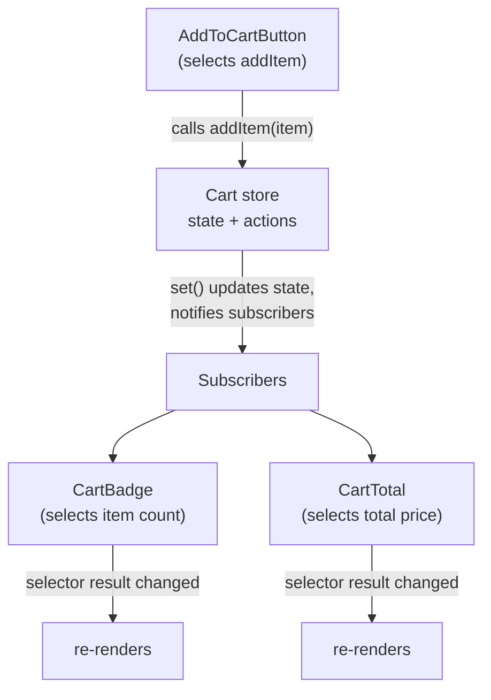

# Introduction to Zustand

Zustand gives a React application one or more stores: plain JavaScript objects that hold state
and the functions that change it, wrapped in a hook. Components call that hook with a selector to
read a slice of the store, and Zustand re-renders only the components whose slice actually
changed. There is no provider to mount and no reducer/action-type vocabulary to adopt unless you
want one.

## Read this chapter if

- You are evaluating Zustand for a new or existing React application.
- You have used `useState` or `useReducer` and want state that outlives one component's lifetime.
- You are coming from Redux, Context, or another store and want the vocabulary mapped over.

## In this chapter you will

- see the problem Zustand solves and what it deliberately leaves out;
- learn the five core concepts — store, state, actions, selectors, and subscriptions — that the
  rest of this guide builds on;
- follow one complete, runnable example from store definition to rendered UI;
- see where a Zustand store sits relative to your components, in a diagram.

## The problem

React's built-in state (`useState`, `useReducer`) is scoped to the component that owns it. Sharing
that state with a distant component means lifting it to a common ancestor and threading it down
through props, or wrapping the tree in a Context provider. Context works, but every value change
re-renders every component that reads the context, regardless of which part of the value it
uses, unless you split the context by hand.

Zustand stores state outside the React tree. Components subscribe directly to the store, not
through a provider, and each subscription re-renders only when the specific slice it selected
changes. The store survives remounts, is reachable from outside React (in event handlers, network
callbacks, or plain modules), and requires no wrapping component to exist.

## Non-goals

Zustand does not:

- **Replace `useState` for local UI state.** A single component's open/closed flag or input
  draft usually belongs in that component, not a shared store.
- **Enforce a reducer/action-type architecture.** You can colocate actions with state directly
  (the pattern this guide uses throughout) or opt into `redux`-style dispatch with the `redux`
  middleware from Chapter 4. Neither is mandatory.
- **Track fine-grained property access automatically.** Libraries such as Valtio or MobX
  re-render based on which properties a component actually read. Zustand re-renders based on
  what your selector function returns; you write the selector.
- **Provide server state, caching, or data fetching.** Pair Zustand with a data-fetching library
  (React Query, SWR, or your own) for request state; use Zustand for client state that isn't
  owned by a server response.

## Where Zustand fits

| | React Context | Redux (with Redux Toolkit) | Zustand |
|---|---|---|---|
| Requires a provider in the tree | Yes | Yes | No |
| Re-render granularity | Whole subtree, unless you split contexts by hand | Per-selector, via `useSelector` | Per-selector, via the store hook |
| State shape | Whatever you pass to the provider | Single normalized store, updated via reducers | Single store per `create` call; you can compose several |
| Update mechanism | `useState`/`useReducer` in the provider | Dispatched actions through reducers | Direct `set` calls from actions you define |
| Usable outside components | No — needs a component to read the context | Yes — `store.dispatch`, `store.getState()` | Yes — `store.getState()`, `store.setState()`, `store.subscribe()` |
| Boilerplate for one new piece of shared state | Provider + context object + hook | Slice + reducer + selectors + wiring into the root reducer | One property and one action in the store object |

Read Chapter 2 for the internal reasons a Zustand store gives per-selector re-renders without a
provider: it is a plain object with a subscriber list, and React's `useSyncExternalStore` connects
that list to the render cycle.

## Core concepts

Five terms recur through this guide. Later chapters define each precisely; this section gives the
minimum you need to read the worked example below.

**Store**
: An object created by `create` (for React) or `createStore` (framework-agnostic) that holds the
  current state and exposes `getState`, `setState`, and `subscribe`. A React store is also a hook:
  calling it inside a component subscribes that component to the store.

**State**
: The plain data the store holds — whatever object your state creator function returns. Zustand
  treats state as **immutable**: you never mutate it in place; you call `set` with a new value or
  a partial update.

**Actions**
: Functions that call `set` to change state. Zustand has no separate action-dispatch layer;
  actions are ordinary functions you define alongside your state, usually inside the same store.
  Chapter 6 covers the alternative of defining actions outside the store object.

**Selectors**
: Functions of the form `(state) => someSlice`. A component passes a selector to the store hook
  to read only the data it needs. The store hook re-renders the component when the selector's
  return value changes according to `Object.is`, not when any other part of the state changes.

**Subscriptions**
: The underlying mechanism selectors are built on. `store.subscribe(listener)` registers a
  function that runs after every state change; the React hook uses this internally so you rarely
  call it directly, except for work that must happen outside the render cycle (Chapter 6).

## A worked example

This example builds a small shopping cart store, then a component tree that reads and updates it.
It uses every core concept above.

```ts
// store.ts
import { create } from 'zustand'

type CartItem = { id: string; name: string; price: number; quantity: number }

type CartState = {
  items: CartItem[]
}

type CartActions = {
  addItem: (item: Omit<CartItem, 'quantity'>) => void
  removeItem: (id: string) => void
  clear: () => void
}

export const useCartStore = create<CartState & CartActions>()((set) => ({
  items: [],
  addItem: (item) =>
    set((state) => {
      const existing = state.items.find((i) => i.id === item.id)
      if (existing) {
        return {
          items: state.items.map((i) =>
            i.id === item.id ? { ...i, quantity: i.quantity + 1 } : i,
          ),
        }
      }
      return { items: [...state.items, { ...item, quantity: 1 }] }
    }),
  removeItem: (id) =>
    set((state) => ({ items: state.items.filter((i) => i.id !== id) })),
  clear: () => set({ items: [] }),
}))
```

The state creator function receives `set` and returns the initial state: an empty `items` array
plus the three actions. `addItem` reads the current state through the updater form of `set` so it
can decide whether to bump an existing line item's quantity or append a new one; `clear` uses the
object form of `set` because the new state does not depend on the old state.

Now two components read different slices of the same store:

```tsx
// CartBadge.tsx
import { useCartStore } from './store'

export function CartBadge() {
  const itemCount = useCartStore((state) =>
    state.items.reduce((sum, item) => sum + item.quantity, 0),
  )
  return <span className="badge">{itemCount}</span>
}
```

```tsx
// CartTotal.tsx
import { useCartStore } from './store'

export function CartTotal() {
  const total = useCartStore((state) =>
    state.items.reduce((sum, item) => sum + item.price * item.quantity, 0),
  )
  return <p>Total: ${total.toFixed(2)}</p>
}
```

```tsx
// AddToCartButton.tsx
import { useCartStore } from './store'

export function AddToCartButton({ id, name, price }: { id: string; name: string; price: number }) {
  const addItem = useCartStore((state) => state.addItem)
  return <button onClick={() => addItem({ id, name, price })}>Add to cart</button>
}
```

`CartBadge` and `CartTotal` each select a derived number, not the `items` array itself. Clicking
the button in `AddToCartButton` calls `addItem`, which calls `set`, which recomputes `items` and
notifies every subscriber. React re-runs each subscriber's selector against the new state and
re-renders only the components whose selector result changed according to `Object.is` — in this
case, both `CartBadge` and `CartTotal`, because both derived numbers changed. A third component
that selected, say, a customer's shipping address from a different slice of a different store
would not re-render at all.

> [!NOTE]
> None of these three components imports a provider or wraps the tree in one. `useCartStore` is
> the store and the hook; importing it is enough to read from or write to it anywhere in the
> component tree, or outside it.

## How the pieces connect

**Figure 1-1: A component subscribes to the store through a selector; only components whose selected slice changed re-render when an action runs.**



No component holds a reference to another. Each one holds a reference to the store, selects the
slice it needs, and reacts independently. Chapter 2 opens the store itself to show how `set`,
`subscribe`, and this notification path are implemented.

## Summary

- A Zustand store is a plain object with `getState`, `setState`, and `subscribe`; the React
  version of `create` also returns a hook.
- State is immutable data; actions are functions, usually defined alongside the state, that call
  `set` to produce new state.
- Selectors decide what a component reads and, by extension, when it re-renders; `Object.is`
  compares selector output across renders.
- Zustand does not require a provider, does not prescribe a reducer architecture, and does not
  fetch or cache server data — pair it with the tools that do.
- Continue to Chapter 2 to see the store's internals, or skip to Chapter 3 to focus on the React
  integration.
