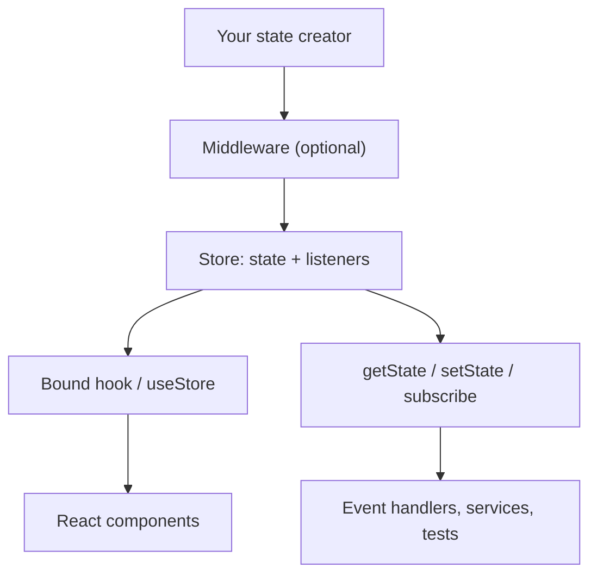

# Introduction to Zustand

Zustand keeps shared application state in a store, a small object that lives outside the React component tree. Components read a store through a hook, and any other code reads and updates it through the store's methods.

## Roadmap

### Read this chapter if

You are new to Zustand or are deciding whether it fits your application.

### Before you begin

You need working knowledge of React hooks and TypeScript generics, and a project with `zustand`, `react`, and `tsx` to run the example.

### In this chapter you will

- Decide whether Zustand suits your shared state.
- Create a store, read it in a component, and update it from a script.

### You can skip

If you already use Zustand 5, skim [Core vocabulary](#core-vocabulary) for the book's fixed terms, such as "slice," and continue with [Chapter 2](#stores-and-state-updates).

## The problem Zustand solves

Some state belongs to no single component. A shopping cart is read by a header badge and a checkout form, and it is changed by code outside React, such as a WebSocket handler or a test.

Lifting that state into a common parent means passing it through components that do not use it. A React context avoids the passing, but every reader re-renders when the value changes. Neither option lets code outside React reach the state, because hooks run only inside components.

Zustand moves the state into a store outside the tree. A component subscribes with a selector and re-renders when the part it selected changes; [When a component re-renders](#when-a-component-re-renders) gives the exact rule.

## What Zustand does not do

| Zustand does not | Consequence |
|---|---|
| Cache server data | Use a server-cache library such as TanStack Query alongside the store. |
| Enforce immutability | An in-place mutation goes unnoticed; follow [Immutability rules](#immutability-rules). |
| Memoize derived state | A derived array or object needs the handling in [Compute derived values](#compute-derived-values). |
| Provide async primitives | Loading and error states are fields you define, as in [Run asynchronous actions](#run-asynchronous-actions). |
| Require or supply a provider | A module store needs none; for one store per subtree, see [Scope a store to a component tree](#scope-a-store-to-a-component-tree). |

## Where Zustand fits

| Approach | Where state lives | What re-renders a reader | Setup |
|---|---|---|---|
| `useState` | One component | That component | None |
| React context | A provider | Every reader, on any value change | A context and a provider |
| Redux Toolkit | A store, reached through a provider | A reader whose `useSelector` result changes | A store, slice reducers, and a provider |
| Server-cache library, such as TanStack Query | A query cache, keyed by query | A reader whose query result changes | A client, a provider, and a fetch function per query |
| Zustand | Stores outside the tree, with no provider | A reader whose selected value changes | One `create` call |

Zustand's [comparison page](https://zustand.docs.pmnd.rs/learn/getting-started/comparison) covers other client-state libraries.

## Core vocabulary

Each term links to the section that explains it; the [Glossary](#glossary) defines the rest.

- **[Store](#what-a-store-is)**: an object outside React that holds one current state and notifies its subscribers when that state changes.
- **[State](#how-a-store-is-created)**: the value a store holds, usually an object of data fields and actions.
- **[Action](#actions-and-where-logic-lives)**: a function stored in the state, such as `addItem`, that updates the store when called.
- **[State creator](#how-a-store-is-created)**: the function you pass to `create`, `createStore`, or a middleware; its return value is the initial state.
- **[Selector](#when-a-component-re-renders)**: a function from the state to the part one reader uses.
- **[Selected value](#selectors-must-return-stable-values)**: what a selector returns. Zustand's type parameters call it a "slice"; this book does not.
- **[Slice](#split-a-large-store-into-slices)**: in this book, only a state creator that builds part of a store's state.
- **[Bound hook](#how-a-component-subscribes-to-a-store)**: the function `create` returns, a hook with the store's methods attached.
- **[Vanilla store](#createstore)**: the store object `createStore` returns, with no hook.
- **[Middleware](#what-middleware-is)**: a function that takes a state creator and returns one.

## The parts of Zustand

**Figure 1-1: Components and plain code reach the same store, through a hook or through the store API.**



Because the state is kept only in the store, a component and a WebSocket handler read the same value. The store itself comes from `zustand/vanilla`, which does not depend on React; [Entry points](#entry-points) lists the rest.

## A first store

Install the package with `npm install zustand`. This store keeps the quantity of each item in a cart, keyed by SKU, and an `addItem` action.

```ts
// cart-store.ts
import { create } from 'zustand'

export type CartState = {
  items: Record<string, number> // quantity by sku
  addItem: (sku: string, quantity?: number) => void
}

export const useCartStore = create<CartState>()((set) => ({
  items: {},
  addItem: (sku, quantity = 1) =>
    set((state) => ({
      items: { ...state.items, [sku]: (state.items[sku] ?? 0) + quantity },
    })),
}))
```

The empty first call in `create<CartState>()(…)` lets you name the state type while TypeScript infers the rest; [Why `create` is curried in TypeScript](#why-create-is-curried-in-typescript) explains why.

A component calls the bound hook with a selector, and needs no provider:

```tsx
// CartBadge.tsx
import { useCartStore } from './cart-store'

export function CartBadge() {
  const count = useCartStore((state) =>
    Object.values(state.items).reduce((n, quantity) => n + quantity, 0),
  )
  return <span aria-label="Items in cart">{count}</span>
}
```

Code outside React uses the methods attached to the hook:

```ts
// add-items.ts
import { useCartStore } from './cart-store'

const { addItem } = useCartStore.getState()
addItem('TEA-01')
addItem('TEA-01')
addItem('MUG-02', 2)

console.log(useCartStore.getState().items)
```

Run it with `npx tsx add-items.ts`. It prints:

```text
{ 'TEA-01': 2, 'MUG-02': 2 }
```

Each call updates the store before it returns. [Chapter 2](#stores-and-state-updates) explains how a store computes and announces every update.
