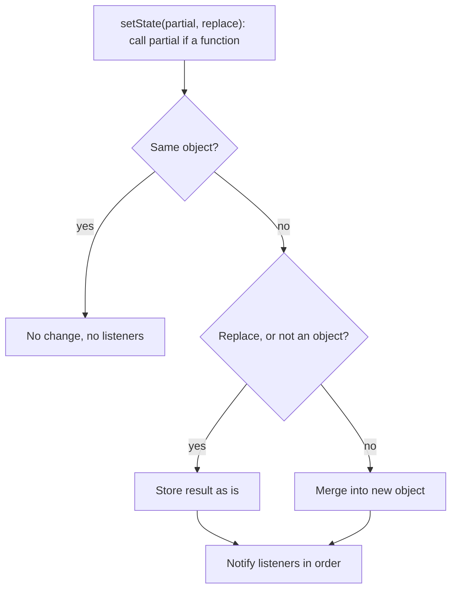
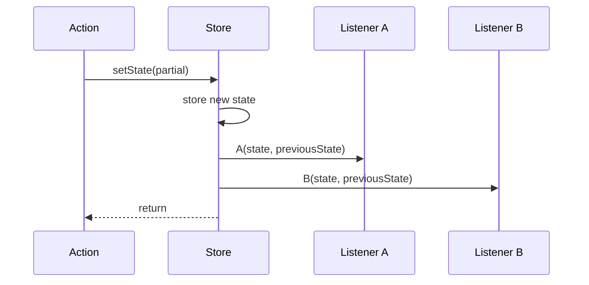

# Stores and State Updates

Read this first. This chapter explains the store: how it holds state, computes each update, and notifies subscribers. Selectors, middleware, and persistence all act on these updates, so every later chapter applies these rules.

## Roadmap

### Read this chapter if

You use Zustand in any form.

### Before you begin

Read [Core vocabulary](#core-vocabulary). The listings run in Node with `zustand/vanilla`.

### In this chapter you will

- predict the next state and the notifications for any `setState` call;
- learn the immutability rules that make change detection work;
- see where actions and asynchronous logic belong.

### You can skip

Nothing, if you are new to Zustand. If you know Zustand 4 well, read only [How listeners are notified](#how-listeners-are-notified) and [Immutability rules](#immutability-rules).

## What a store is

A store is a closure that holds one current state value and a set of listener functions. Four methods, specified in [`StoreApi`](#storeapi), are the only way to reach the state: `getState`, `setState`, `subscribe`, and `getInitialState`. The store does not depend on React, and `create` builds the same kind of store with these methods attached to the hook it returns.

A store lives as long as something references it, so a module store lives for the life of the process, or until the page unloads. Zustand has no method that disposes a store, and a listener keeps alive everything it closes over until you call the function that `subscribe` returned.

## How a store is created

`createStore` and `create` take a *state creator*, a function that returns the initial state. The store calls it once, synchronously, before `createStore` returns, passing `set` (the store's `setState`), `get` (its `getState`), and the store API object. The return value becomes the current state, and `getInitialState()` returns that same value for the rest of the store's life.

Actions are ordinary state fields whose values are functions. An action runs only after the state creator has returned, so `get()` inside it sees the current state. Called directly in the creator's body, before the state exists, `get()` returns `undefined`.

## How setState computes the next state

`setState` accepts either a value or an updater function, and computes the next state in these steps:

1. If the argument is a function, `setState` calls it with the current state and uses its return value.
2. If that result is identical to the current state under `Object.is`, `setState` returns without storing anything or calling any listener.
3. If `replace` is `true`, or `replace` is omitted and the result is not an object (or is `null`), the store keeps the result as is. An explicit `replace` of `false` always merges.
4. Otherwise the store keeps a new object built with `Object.assign({}, state, result)`.
5. The store calls every listener.

**Figure 2-1: setState merges into a new object unless the result is identical or replacement is requested.**



The second decision tests the result's type only when you omit `replace`. Passing `false` merges even a primitive, so `setState(5, false)` on a store whose state is a number stores `{}`.

For an object state, the only way to skip notification is to return the current state object itself. Any other object produces a new state object, so it notifies even when every value is unchanged.

The merge is one level deep: each top-level field in the result replaces its namesake, fields you leave out keep their values, and a nested object replaces the old one whole.

With `replace: true`, the `setState` type accepts only a complete state, while a merge accepts `Partial<T>`. TypeScript checks this because the store does not: at run time an incomplete object becomes the whole state, and the omitted fields are gone.

## How listeners are notified

The store calls listeners synchronously inside `setState`, after it has stored the new state and before `setState` returns. It calls them in subscription order and passes each one `(state, previousState)`. Zustand does not batch notifications, so listener cost adds to every update.

**Figure 2-2: Listeners run synchronously, in subscription order, before setState returns.**



Code that runs after `setState` returns therefore sees the new state and knows that every listener has run.

The store does not catch errors. If a listener throws, the error propagates out of `setState` after the new state is stored, and later listeners, including React subscriptions, miss that update. Catch errors inside a listener when the others must still run.

A listener can call `setState`. The nested call notifies every listener before the outer loop continues, so a later listener receives the nested change before the outer one. Consider a store with listeners A and B, subscribed in that order:

1. `count` is `0`, and an action sets it to `1`.
2. Listener A receives `0 -> 1` and calls `setState` to set `count` to `2`.
3. That nested call notifies A and then B, so B receives `1 -> 2`.
4. The outer loop resumes and calls B with the outer notification, `0 -> 2`. Its `previousState` is stale, because `count` was `1` in between.

To avoid this, compute both values in the action that makes the first change. One `setState` call then produces one notification, and every listener receives it with an accurate `previousState`.

## Immutability rules

You must create a new object, array, `Map`, or `Set` for every level of the state you change. Zustand and React detect change only by comparing references ([When a component re-renders](#when-a-component-re-renders)), and Zustand does not freeze your state, so an in-place mutation goes unnoticed in one of two ways:

- If the updater mutates the state and returns the same object, `Object.is` reports no change, so no listener runs.
- If the updater mutates a nested object and returns a merge, the store notifies, but `previousState` already contains the mutation.

```ts
import { createStore } from 'zustand/vanilla'

type CartState = { items: Record<string, { quantity: number }> }

const cartStore = createStore<CartState>()(() => ({
  items: { 'TEA-01': { quantity: 1 } },
}))

cartStore.subscribe((state, prev) =>
  console.log(prev.items['TEA-01'].quantity, '->', state.items['TEA-01'].quantity),
)

// Wrong: changes the existing item object in place.
cartStore.setState((state) => {
  state.items['TEA-01'].quantity = 2
  return { items: state.items }
})

// Right: new item, new items record, new state object.
cartStore.setState((state) => ({
  items: { ...state.items, 'TEA-01': { ...state.items['TEA-01'], quantity: 3 } },
}))
```

```text
2 -> 2
2 -> 3
```

The wrong update changed an object that `previousState` shares. The right update copies only the path to the change, so other items keep their references. To write the same update as a mutation, use [Immer](#write-updates-as-mutations-with-immer), which produces the new references for you.

## Actions and where logic lives

An action is defined in the state creator, so it closes over `set` and `get`. Inside an action, read state with `get()` when you need it, because a value captured earlier can be stale.

This matters most in asynchronous actions, which are ordinary `async` functions that call `set` when they start and again when results arrive; Zustand has no asynchronous concept. If two concurrent calls each build their update from state captured before an `await`, the second write discards the first. [Run asynchronous actions](#run-asynchronous-actions) shows the complete pattern.

Actions survive every merge, because a merge keeps the fields the partial state leaves out. A replacement keeps only what it contains, so `setState(value, true)` removes every action that `value` does not include. Replacing with `getInitialState()` keeps the actions, which is how [Reset a store](#reset-a-store) works.

Module-level functions that call `store.setState` also work as actions, bound to one store instance; see [Read and write state outside components](#read-and-write-state-outside-components).

## Store invariants

These facts hold for the core store; [middleware](#what-middleware-is) can add behavior around them.

- `getState()` returns the latest state synchronously.
- Zustand never mutates a state object.
- `getInitialState()` never changes.
- Listeners run only from `setState`, and only when the next state is not `Object.is`-identical to the current one.
- The core store throws no errors of its own; an error from `setState` comes from your updater or a listener.
