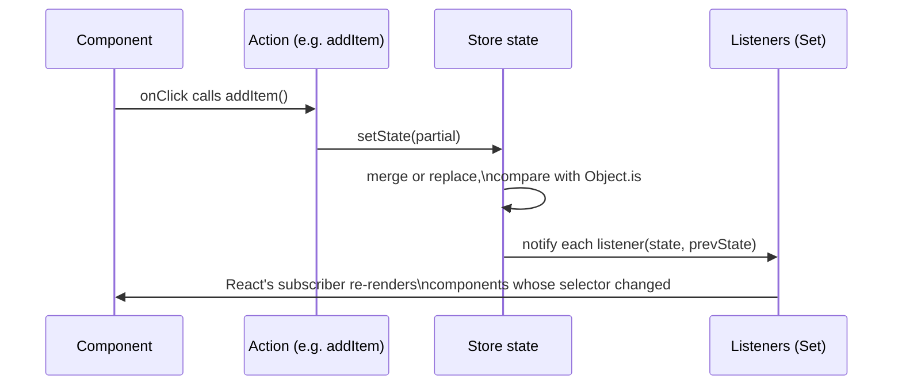

# Stores

A Zustand store is the object `createStore` returns: a closure over one piece of state, a set of
listener functions, and four methods that read, write, and subscribe to that state. Every other
API in this guide — the React hook from `create`, every middleware in Chapter 4 — wraps or
composes this object. Understanding it precisely makes the rest of the library predictable.

## Read this chapter if

- You want to know exactly what `set` does before you rely on its merge behavior.
- You are building a store that other code (middleware, a non-React UI, a test) will read or
  write directly through `getState`/`setState`, not only through the React hook.
- You hit a bug involving stale state, a missed re-render, or state that didn't merge the way you
  expected.

## In this chapter you will

- see the vanilla store's four methods and what each guarantees;
- learn the merge and replace semantics of `setState`, including where they differ for object and
  non-object state;
- write a vanilla store, add actions, add an asynchronous action, and read the store from outside
  a React component;
- get the complete reference for `createStore`, `StoreApi`, and each of its four methods.

## About stores

### The shape of a store

`createStore` takes one function — the **state creator** — and returns a `StoreApi<T>`:

```ts
interface StoreApi<T> {
  setState: (partial: T | Partial<T> | ((state: T) => T | Partial<T>), replace?: boolean) => void
  getState: () => T
  getInitialState: () => T
  subscribe: (listener: (state: T, prevState: T) => void) => () => void
}
```

Internally, the store closes over three private values: the current `state`, the `initialState`
captured once at creation, and a `Set` of listener functions. `setState`, `getState`, and
`subscribe` are the only way to read or change `state`; nothing outside the closure can reach it
directly.

> [!IMPORTANT]
> The state creator function receives `set`, `get`, and `store` as arguments, but none of the
> three is safe to call while the creator function itself is running — only afterward, from
> actions the creator returns. Calling `get()` or `store.getState()` during initialization returns
> `undefined`; calling `store.getInitialState()` during initialization throws, because
> `initialState` has not been assigned yet. Do the minimum work in the creator (return the initial
> object) and put logic that needs to read state in the actions you attach to it.

### `setState` merge and replace semantics

Calling `setState(partial)` does three things, in order:

1. If `partial` is a function, calls it with the current state to get the next value; otherwise
   uses `partial` directly.
2. Compares the result to the current state with `Object.is`. If they are the same reference,
   `setState` does nothing — no merge, no listener notifications.
3. Otherwise, produces the new state and notifies every listener with `(newState, previousState)`.

Step 3 is where merge behavior is decided. By default, Zustand treats state as **mergeable**:

- If the next value is not an object (a number, string, array, `null`, and so on), Zustand
  **replaces** the state with it outright.
- If the next value is an object, Zustand **shallow-merges** it onto the current state with
  `Object.assign({}, state, nextState)` — one level deep, like the object spread `{ ...state,
  ...nextState }`.

Pass `true` as the second argument to force a full replacement instead of a merge, even for
object state:

```ts
store.setState({ count: 0 }, true)
```

> [!WARNING]
> A full replace with an incomplete object discards every key not present in the replacement. If
> your state also holds actions or other fields, `setState({ count: 0 }, true)` deletes them. Use
> `replace: true` only when you are passing a complete state object, typically the result of
> `getInitialState()` (see [Resetting a store](#resetting-a-store-to-its-initial-state) below) or
> a fully-formed object from a reducer.

> [!NOTE]
> The merge is shallow. `setState({ nested: { count: 1 } })` replaces the entire `nested` object;
> it does not merge into whatever `nested` held before. For state more than one level deep, either
> spread each level by hand (`{ nested: { ...state.nested, count: 1 } }`) or use the `immer`
> middleware from Chapter 4, which lets you write direct-looking mutations that produce a correct
> immutable update.

### Listeners and notification order

`subscribe(listener)` adds `listener` to the store's internal `Set` and returns an unsubscribe
function that removes it. Every call to `setState` that actually changes the state (step 2 above
did not short-circuit) invokes every current listener once, synchronously, in the order they were
added, passing the new and previous state. There is no batching, deduplication across multiple
`setState` calls, or async scheduling inside the store itself — if you call `setState` three times
in a row, listeners run three times. React's `useSyncExternalStore`, which the React integration
uses internally, handles batching renders on the React side.

**Figure 2-1: Calling an action funnels through `set`, which updates state and synchronously notifies every subscriber, including the React hook's internal subscription.**



### `getInitialState`

`getInitialState()` returns the exact object the state creator produced on the store's first
call, before any `setState` call ever ran. Zustand captures it once, at creation, and never
updates it. Its main use is resetting a store (below); it is not a live snapshot of "the state
before the most recent change" — for that, use the `prevState` argument a listener receives.

## Using stores

### Create a store and add actions

The recommended way to type a store is the curried form `createStore<T>()(initializer)`; the extra
`()` lets TypeScript infer everything the initializer returns while you still supply `T` for the
state shape (Chapter 5 explains why this workaround exists). Actions live alongside state in the
object the initializer returns:

```ts
import { createStore } from 'zustand/vanilla'

type CounterState = {
  count: number
}

type CounterActions = {
  increment: (by?: number) => void
  reset: () => void
}

export const counterStore = createStore<CounterState & CounterActions>()(
  (set, get, store) => ({
    count: 0,
    increment: (by = 1) => set((state) => ({ count: state.count + by })),
    reset: () => set(store.getInitialState()),
  }),
)
```

`reset` calls `store.getInitialState()`, which is available here because this code runs inside an
action, after the store finished initializing — not inside the creator function itself.

### Add an asynchronous action

An action is an ordinary function; nothing about `set` requires it to run synchronously. A
`fetch`-backed action calls `set` once to record that a request started, awaits the request, then
calls `set` again with the result:

```ts
type UserState = {
  user: { id: string; name: string } | null
  status: 'idle' | 'loading' | 'error'
}

type UserActions = {
  loadUser: (id: string) => Promise<void>
}

export const userStore = createStore<UserState & UserActions>()((set) => ({
  user: null,
  status: 'idle',
  loadUser: async (id) => {
    set({ status: 'loading' })
    try {
      const response = await fetch(`/api/users/${id}`)
      if (!response.ok) throw new Error(`Request failed: ${response.status}`)
      const user = await response.json()
      set({ user, status: 'idle' })
    } catch {
      set({ status: 'error' })
    }
  },
}))
```

Each `set` call is a separate, synchronous notification to listeners — the store does not know or
care that the two calls are part of one logical operation. Components that select `status` see
`'loading'` and then `'idle'` or `'error'` as two distinct renders, which is what lets a loading
spinner show correctly in between.

### Read and write from outside React

Because a vanilla store is just an object, any module can import it and call its methods directly,
with no hook and no component:

```ts
import { counterStore } from './counter-store'

console.log(counterStore.getState().count) // 0

counterStore.getState().increment(5)
console.log(counterStore.getState().count) // 5

const unsubscribe = counterStore.subscribe((state, prevState) => {
  console.log(`count changed from ${prevState.count} to ${state.count}`)
})

// later, when you no longer need updates:
unsubscribe()
```

This is the basis for reading Zustand state in non-React code: route loaders, WebSocket handlers,
analytics listeners, or plain utility modules. Chapter 3 covers `useStore`, the hook that connects
a vanilla store like this one to React's render cycle without changing anything about the store
itself.

### Resetting a store to its initial state

Combine `getInitialState()` with `setState(..., true)` to reset every field, including nested
objects, back to what the creator originally returned:

```ts
reset: () => set(store.getInitialState(), true)
```

Passing `true` matters here: `getInitialState()` returns a complete state object, including
actions, so a full replace is safe and correct. Without `true`, the shallow merge would still
work for a flat state shape, but explicit replacement is clearer about intent and correct even if
the state later grows nested fields.

## Stores reference

### `createStore(stateCreatorFn)`

```ts
function createStore<T>(): (
  stateCreatorFn: StateCreator<T, [], []>,
) => StoreApi<T>
function createStore<T, Mos extends [StoreMutatorIdentifier, unknown][] = []>(
  stateCreatorFn: StateCreator<T, [], Mos>,
): Mutate<StoreApi<T>, Mos>
```

Creates a vanilla store. Import it from `zustand/vanilla` (also re-exported from `zustand`).

**Parameters**

| Name | Type | Description |
|---|---|---|
| `stateCreatorFn` | `StateCreator<T, [], []>` | Called once, synchronously, during `createStore`. Receives `set`, `get`, and `store`; must return the initial state object. |

**Returns**

A `StoreApi<T>` (or, when middleware is present, the mutated type the middleware adds — see
Chapter 4).

**Behavior**

- Calls `stateCreatorFn` exactly once, synchronously, before `createStore` returns.
- Captures the returned object as both the live state and `initialState`.
- Does not call any middleware or React code; `zustand/vanilla` has no React dependency.

**See also:** `create`, in Chapter 3, for the React-bound version that also returns a hook.

### `StoreApi<T>`

| Member | Signature | Description |
|---|---|---|
| `getState` | `() => T` | Returns the current state synchronously. Never throws. |
| `getInitialState` | `() => T` | Returns the state object the creator function returned. Throws if called from inside the creator function itself, before initialization finishes. |
| `setState` | `(partial, replace?) => void` | Updates state. See merge and replace semantics above. |
| `subscribe` | `(listener) => () => void` | Registers `listener`, called synchronously after every state-changing `setState`. Returns an unsubscribe function. |

#### `setState(partial, replace?)`

```ts
setState(partial: T | Partial<T> | ((state: T) => T | Partial<T>), replace?: false): void
setState(state: T | ((state: T) => T), replace: true): void
```

| Name | Direction | Type | Required | Description |
|---|---|---|---|---|
| `partial` | in | `T \| Partial<T> \| ((state: T) => T \| Partial<T>)` | yes | The next state, a partial update, or a function that computes one from the current state. |
| `replace` | in | `boolean` | no | When `true`, replaces state instead of merging. TypeScript then requires `partial` to be a *complete* `T`, not a `Partial<T>`, to prevent accidentally deleting keys. |

**Behavior:** Computes the next value, skips the update entirely if it is `Object.is`-equal to the
current state, otherwise merges (default) or replaces (`replace: true`) and notifies every
listener with `(nextState, previousState)`.

**Errors:** Does not throw for any input; a function `partial` that throws propagates that error
to the caller of `setState` before any listener runs.

#### `subscribe(listener)`

| Name | Direction | Type | Required | Description |
|---|---|---|---|---|
| `listener` | in | `(state: T, prevState: T) => void` | yes | Called after each state-changing `setState`, synchronously, in registration order. |

**Returns:** `() => void` — call it to remove the listener. Safe to call more than once; the
second call is a no-op.

**Special considerations**

- **Concurrency:** Listeners run synchronously on the same call stack as the `setState` call that
  triggered them. A listener that itself calls `setState` re-enters this same notification path.
- **Ownership:** The store owns the listener set; you do not need to track subscriptions yourself
  beyond keeping the returned unsubscribe function if you intend to call it later.

**See also:** `subscribeWithSelector`, in Chapter 4 — adds a selector and an equality function to
`subscribe` so a listener fires only when a chosen slice changes.

## Summary

### Mental model

A store is state plus listeners in a closure. `setState` updates the state and synchronously
notifies every listener; nothing about the store depends on React.

### Common path

1. Call `createStore<T>()(initializer)` with actions colocated in the returned object.
2. Call actions to update state; they call `set` internally.
3. Read `getState()` or subscribe with `subscribe()` from anywhere, React or not.
4. Reset with `setState(getInitialState(), true)` when you need to restore defaults.

### Invariants

- **Must not** call `get()`, `store.getState()`, or `store.getInitialState()` from inside the
  state creator function itself — only from actions, after initialization.
- **Must** pass a complete state object when calling `setState(value, true)`; a partial object
  with `replace: true` silently discards the missing keys.
- **Never** rely on `setState` batching multiple calls into one notification; each call notifies
  listeners independently.

### Continue

- To connect a store to React components and control re-renders with selectors, read Chapter 3.
- To add persistence, Redux DevTools, or Immer-style updates on top of `setState`, read Chapter 4.
