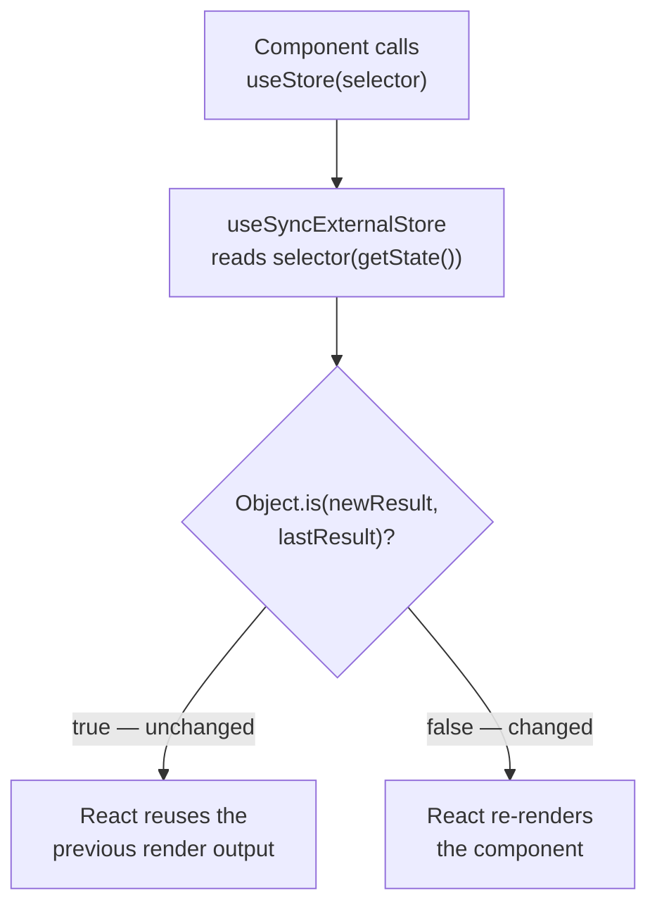

# Using Stores in React

Chapter 2 covered the vanilla store: state, `setState`, and `subscribe`. This chapter covers the
layer Zustand adds on top for React — `create`, the hook it returns, and the selector-based
re-render rules that make that hook efficient. It also covers the two variations most apps
eventually need: a custom equality function, and a store scoped to part of the component tree
instead of shared globally.

## Read this chapter if

- You are building React components that read or write a Zustand store.
- A component re-renders more often than you expect, or not when you expect it to.
- You need one store instance per component subtree — a modal, a form, a tab — instead of one
  global store.

## In this chapter you will

- see how `create` connects a store to React's render cycle through `useSyncExternalStore`;
- learn the exact rule that decides whether a selector triggers a re-render, and the two ways to
  loosen it (`useShallow`, `createWithEqualityFn`);
- scope a store to a subtree with React Context, for per-instance state or SSR-safe stores;
- get reference entries for `create`, `useStore`, `useShallow`, and the `zustand/traditional`
  equality-function hooks.

## About the React integration

`create` does two things: it calls `createStore` internally to build a vanilla store, then wraps
that store's `getState` and `subscribe` in a React hook built on `React.useSyncExternalStore`.
`useSyncExternalStore` is the hook React provides specifically for subscribing to state that lives
outside React — exactly what a Zustand store is. It requires three things: a way to subscribe, a
way to read the current value, and (for concurrent rendering and SSR consistency) a way to read the
value used for the initial server-rendered snapshot. Zustand supplies `subscribe`, `() =>
selector(getState())`, and `() => selector(getInitialState())` for those three roles respectively.

The object `create` returns is the hook itself, with `setState`, `getState`, `getInitialState`,
and `subscribe` attached to it directly — the same `StoreApi<T>` members from Chapter 2. That is
why `useCartStore.getState()` and `useCartStore((state) => state.items)` are both valid: the first
calls the store API attached to the hook; the second calls the hook.

**Figure 3-1: Every render of a component that calls the store hook re-evaluates its selector; only a changed result triggers React to re-render.**



## Using stores in React

### Create and read

`create<T>()(initializer)` returns a hook. Call it with no arguments to read the entire state, or
with a selector to read one slice:

```tsx
import { create } from 'zustand'

type BearState = {
  bears: number
  increment: (by: number) => void
}

const useBearStore = create<BearState>()((set) => ({
  bears: 0,
  increment: (by) => set((state) => ({ bears: state.bears + by })),
}))

function BearCounter() {
  const bears = useBearStore((state) => state.bears)
  return <h1>{bears} bears around here…</h1>
}

function Controls() {
  const increment = useBearStore((state) => state.increment)
  return <button onClick={() => increment(1)}>Add a bear</button>
}
```

`BearCounter` re-renders only when `bears` changes; `Controls` never re-renders after mount,
because the `increment` function reference is stable — it is created once, when the store is
created, and never replaced.

### The re-render rule, precisely

A selector's result is compared to its previous result with `Object.is`, the same comparison
`useState` and `useMemo` use. Primitives compare by value; objects, arrays, and functions compare
by reference. This has one direct consequence that surprises newcomers: a selector that
**constructs** a new object or array on every call always produces a new reference, so it always
looks "changed," even when its contents are identical.

```tsx
// Re-renders on every store update, even unrelated ones —
// { bears, fish } is a new object reference each call.
const { bears, fish } = useJungleStore((state) => ({
  bears: state.bears,
  fish: state.fish,
}))
```

> [!WARNING]
> Since v5, Zustand requires selector output to be referentially stable across calls with the same
> state, matching React's own expectations for external stores. A selector that returns a new
> object or array *and* is read with a dependency that re-triggers the read (for example, inside
> another piece of derived state) can throw `Maximum update depth exceeded` instead of merely
> over-rendering. Prefer one selector per primitive value, or wrap a multi-value selector in
> `useShallow`.

The direct fix is usually to call the hook once per value:

```tsx
const bears = useJungleStore((state) => state.bears)
const fish = useJungleStore((state) => state.fish)
```

### `useShallow`

When you need several values bundled into one object — for props, for a `useEffect` dependency
array, or for readability — wrap the selector in `useShallow` instead of splitting every call:

```tsx
import { useShallow } from 'zustand/react/shallow'

const { bears, fish } = useJungleStore(
  useShallow((state) => ({ bears: state.bears, fish: state.fish })),
)
```

`useShallow` memoizes the selector's result: it keeps the previous return value and reuses it
whenever the new value is shallowly equal to it (same keys, `Object.is`-equal values one level
deep), so `Object.is` sees the *same* reference across renders unless a selected field actually
changed. `useShallow` works on arrays, `Map`, and `Set` in addition to plain objects, using the
same shallow-equality function exported as `zustand/shallow`.

### `createWithEqualityFn` and `useStoreWithEqualityFn`

`useShallow` covers shallow equality. If you need a different comparison — deep equality for a
specific slice, or a domain-specific equality check — use `zustand/traditional`, which exposes a
hook variant that takes an explicit equality function as a third argument:

```tsx
import { createWithEqualityFn } from 'zustand/traditional'

const useBearStore = createWithEqualityFn<BearState>()(
  (set) => ({
    bears: 0,
    increment: (by) => set((state) => ({ bears: state.bears + by })),
  }),
  Object.is, // default equality function for every call, unless overridden per-call
)

// override per call:
const bears = useBearStore((state) => state.bears, (a, b) => a === b)
```

`createWithEqualityFn` requires the `use-sync-external-store` package (a peer dependency) because
it is built on `useSyncExternalStoreWithSelector`, the selector-and-equality-function variant of
React's hook, rather than the plain `useSyncExternalStore` that `create` uses. Reach for it when
you are migrating code that used a custom equality function with v4's `create`, or when
`useShallow`'s shallow comparison genuinely is not the comparison you need; for new code, prefer
`useShallow` on individual selectors, since it composes with the standard `create` hook.

### Scoping a store with React Context

`create` produces one shared, module-level store. Some UI needs one store instance per mounted
component — a form, a modal, or a row in a list — so that two instances of the same component do
not share state. Combine the vanilla `createStore` from Chapter 2 with a factory function and a
React Context provider:

```tsx
import { type ReactNode, createContext, useContext, useState } from 'react'
import { createStore, useStore } from 'zustand'

type FormState = { values: Record<string, string> }
type FormActions = { setField: (name: string, value: string) => void }
type FormStore = FormState & FormActions

function createFormStore() {
  return createStore<FormStore>()((set) => ({
    values: {},
    setField: (name, value) =>
      set((state) => ({ values: { ...state.values, [name]: value } })),
  }))
}

const FormStoreContext = createContext<ReturnType<typeof createFormStore> | null>(null)

function FormProvider({ children }: { children: ReactNode }) {
  const [store] = useState(createFormStore)
  return <FormStoreContext.Provider value={store}>{children}</FormStoreContext.Provider>
}

function useFormStore<T>(selector: (state: FormStore) => T): T {
  const store = useContext(FormStoreContext)
  if (!store) throw new Error('useFormStore must be used within a FormProvider')
  return useStore(store, selector)
}
```

`useState(createFormStore)` creates exactly one store per mounted `FormProvider`, on first render,
and reuses it for the provider's lifetime. `useStore` — the plain hook exported from `zustand`, not
`create` — connects that vanilla store instance to React the same way `create`'s internal hook
does, but for a store you built and scoped yourself. Two `<FormProvider>` instances in the same
tree get two independent stores; unmounting a provider drops its store for garbage collection.

> [!NOTE]
> This is also the pattern to use in server-rendered applications when state must not leak between
> requests: create the store per request (or per `FormProvider` mount) instead of at module scope,
> so one user's server-rendered state can never be read by another user's request.

## React reference

### `create(stateCreatorFn)`

```ts
function create<T>(): <Mos extends [StoreMutatorIdentifier, unknown][] = []>(
  stateCreatorFn: StateCreator<T, [], Mos>,
) => UseBoundStore<Mutate<StoreApi<T>, Mos>>
function create<T, Mos extends [StoreMutatorIdentifier, unknown][] = []>(
  stateCreatorFn: StateCreator<T, [], Mos>,
): UseBoundStore<Mutate<StoreApi<T>, Mos>>
```

Creates a store and returns it as a React hook with the `StoreApi` methods attached.

| Name | Direction | Type | Required | Description |
|---|---|---|---|---|
| `stateCreatorFn` | in | `StateCreator<T, [], []>` | yes | Same contract as `createStore`'s initializer (Chapter 2): returns the initial state, cannot read state synchronously during its own execution. |

**Returns:** `UseBoundStore<StoreApi<T>>` — callable with no arguments (returns the whole state),
or with a selector `(state: T) => U` (returns `U`, subscribing only to changes in `U`).

**Behavior:** Internally calls `createStore(stateCreatorFn)`, then returns a function that calls
`useStore(store, selector)`, with the store's own methods copied onto that function via
`Object.assign`.

**See also:** `createStore` (Chapter 2) for the framework-agnostic version this wraps.

### `useStore(store, selectorFn?)`

```ts
function useStore<T>(store: StoreApi<T>): T
function useStore<T, U>(store: StoreApi<T>, selectorFn: (state: T) => U): U
```

| Name | Direction | Type | Required | Description |
|---|---|---|---|---|
| `store` | in | `StoreApi<T>` | yes | Any vanilla store, from `createStore` or a `create`-based hook used as an API object. |
| `selectorFn` | in | `(state: T) => U` | no | Defaults to the identity function, returning the whole state. |

**Returns:** `U` (or `T` with no selector), re-rendering the calling component when the selected
value changes per `Object.is`.

**Behavior:** Wraps `React.useSyncExternalStore(store.subscribe, () =>
selectorFn(store.getState()), () => selectorFn(store.getInitialState()))`. This is the hook to
reach for when you already have a `StoreApi` — from `createStore` directly, or from a
context-scoped store as shown above — and want the same subscription behavior `create` gives you
automatically.

**See also:** `create`, above, for the common case of one global store that doesn't need a
separate `useStore` call.

### `useShallow(selectorFn)`

```ts
function useShallow<T, U>(selectorFn: (state: T) => U): (state: T) => U
```

| Name | Direction | Type | Required | Description |
|---|---|---|---|---|
| `selectorFn` | in | `(state: T) => U` | yes | A selector whose result may be a new object, array, `Map`, or `Set` on every call. |

**Returns:** A wrapped selector function with the same signature, memoized so repeated calls that
are shallowly equal to the previous result return the identical previous reference.

**Behavior:** Keeps one internal ref of the last returned value. On each call, compares the new
selector output to that ref with the same shallow-equality algorithm exported as `zustand/shallow`
(one level of `Object.is` comparisons across `Object.entries`, `Map` entries, or iterable
elements). Returns the cached reference on a shallow match; otherwise updates the ref and returns
the new value.

**Errors:** None specific to `useShallow`; a selector that throws propagates the error to the
calling render, as with any selector.

**See also:** `createWithEqualityFn`/`useStoreWithEqualityFn`, below, for equality functions other
than shallow.

### `createWithEqualityFn(stateCreatorFn, defaultEqualityFn?)` and `useStoreWithEqualityFn(store, selectorFn, equalityFn?)`

Exported from `zustand/traditional`. Signatures mirror `create` and `useStore` with one addition:

```ts
function createWithEqualityFn<T>(
  stateCreatorFn: StateCreator<T, [], []>,
  defaultEqualityFn?: <U>(a: U, b: U) => boolean,
): UseBoundStoreWithEqualityFn<StoreApi<T>>

function useStoreWithEqualityFn<T, U>(
  store: StoreApi<T>,
  selectorFn: (state: T) => U,
  equalityFn?: (a: U, b: U) => boolean,
): U
```

| Name | Direction | Type | Required | Description |
|---|---|---|---|---|
| `defaultEqualityFn` / `equalityFn` | in | `(a: U, b: U) => boolean` | no | Defaults to `Object.is`. Called with the previous and next selector results; a component re-renders only when it returns `false`. |

**Behavior:** Builds on `useSyncExternalStoreWithSelector` from `use-sync-external-store`, which
accepts an equality function directly, rather than `React.useSyncExternalStore`, which does not.

> [!IMPORTANT]
> `zustand/traditional` requires the `use-sync-external-store` package as a direct dependency —
> Zustand lists it as a peer dependency precisely because only this entry point needs it.

**See also:** `zustand/shallow`'s `shallow` function, a ready-made equality function for this hook
when you want shallow comparison without wrapping the selector in `useShallow`.

## Summary

### Mental model

`create` is `createStore` plus a `useSyncExternalStore`-based hook. Selector output is compared
with `Object.is` by default; a component re-renders exactly when that comparison is `false`.

### Common path

1. Call `create<T>()(initializer)` once, at module scope, for shared state.
2. Read with one selector per value; bundle multiple values with `useShallow` when you need one
   object.
3. For per-instance or per-request state, build a vanilla store with a factory function and scope
   it through React Context with `useStore`.

### Public surface

- **Hooks:** `create`, `useStore`, `useShallow`, `createWithEqualityFn`, `useStoreWithEqualityFn`
- **Functions:** `shallow` (from `zustand/shallow`)

### Invariants

- **Must** keep selector output referentially stable across calls with unchanged state — return
  primitives, existing references, or a `useShallow`-wrapped composite.
- **Should not** call `createWithEqualityFn` for new code unless a non-shallow equality function is
  actually required; `useShallow` covers the common case with less setup.
- **Never** assume `useSyncExternalStore` batches unrelated `setState` calls; each state-changing
  `setState` is a separate notification (Chapter 2).

### Continue

- To add persistence, DevTools, or Immer-based updates to a store used this way, read Chapter 4.
- To see how the curried `create<T>()(...)` form works and how to type middleware stacks, read
  Chapter 5.
