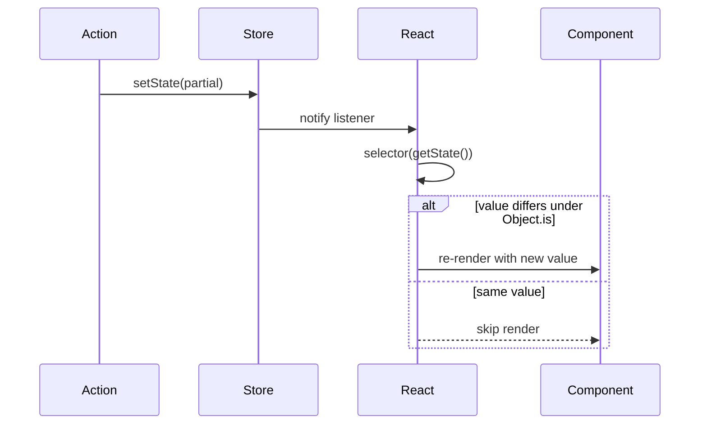

# Selectors and Rendering in React

This chapter explains how React components read a Zustand store and which updates make them render. Chapter 6 turns its rules into component tasks.

## Roadmap

### Read this chapter if

You read a store from React components, or a component renders more or less often than you expect.

### Before you begin

Read [How setState computes the next state](#how-setstate-computes-the-next-state) and [How listeners are notified](#how-listeners-are-notified).

### In this chapter you will

- Predict from a selector which updates re-render a component.
- Recognize unstable selectors and choose a fix.
- Choose between a module store and a scoped store.

### You can skip

Skip [Custom equality with `zustand/traditional`](#custom-equality-with-zustand-traditional) unless you port Zustand 4 code. Skim the server rendering section if your application renders only in the browser.

## How a component subscribes to a store

`useStore(store, selector)` connects a component to a store through React's `useSyncExternalStore` hook. It passes React three functions: the store's `subscribe` method, a snapshot function that returns `selector(store.getState())`, and a server snapshot function that returns `selector(store.getInitialState())`. The snapshot's result is the **selected value**, the value the component receives.

A bound hook, the function `create` returns, is `useStore` with its store already applied, plus the store's methods, so plain code can call `useCartStore.getState()`. No provider is involved: each hook call subscribes directly to the store object. The contracts are in [`useStore()`](#usestore) and [`create()`](#create).

**Figure 3-1: A component re-renders only when its selected value changes under Object.is.**



Every subscribed component runs its selector after every notification, whether or not it then renders, so keep selectors cheap and free of side effects ([Shared rules](#shared-rules)).

## When a component re-renders

After each notification, React calls the snapshot function and compares the new selected value with the value the component last rendered, using `Object.is`. React renders the component again only if the two differ. The store notifies on every change, so the selector is what filters notifications for one component. It does not prevent ordinary React renders, such as when the parent renders.

`Object.is` compares objects, arrays, and functions by reference, so the selector's shape decides how often a component renders:

| Selector returns | Example | The component re-renders |
|---|---|---|
| The whole state | `useCartStore()` | After every notification, because each change creates a new state object |
| A primitive | `(s) => s.coupon` | When that value changes |
| An object stored in state | `(s) => s.items` | When an update stores a new reference there |
| An action | `(s) => s.addItem` | Not on updates, because merges keep the function the state creator made |
| A newly built object or array | `(s) => ({ coupon: s.coupon })` | Again on every check, until React throws "Maximum update depth exceeded" (next section) |

An update that mutates an object in place keeps its reference, so components that select that object do not re-render ([Immutability rules](#immutability-rules)).

## Selectors must return stable values

A selector is stable when two calls on the same state return values that are equal under `Object.is`. A selector that builds a new object, array, or function on each call is unstable, including `Object.values(s.items)` and fallbacks such as `s.lastOrderSkus ?? []`.

React requires the snapshot to stay the same while the store is unchanged. With an unstable selector, React sees a new snapshot each time it checks, renders again, and gets another new value. In development React logs "The result of getSnapshot should be cached to avoid an infinite loop" and then throws "Maximum update depth exceeded". A selector that always builds a new value fails at mount, before any update. A fallback such as `?? []` builds a new value only when the field is missing, so the component fails only for the props or state that reach that branch.

| Situation | Fix |
|---|---|
| The component needs several fields | Call the hook once per field |
| The selector must build an object or array from state | Wrap it in `useShallow`: `useCartStore(useShallow((s) => Object.values(s.items)))` |
| A missing field needs an object or array default | Return a constant created once at module level, such as `s.lastOrderSkus ?? NO_SKUS` |
| The value is computed, such as a sorted list | Select the stored input and compute during render ([Compute derived values](#compute-derived-values)) |
| You need your own equality rule | Use `zustand/traditional` ([Custom equality with `zustand/traditional`](#custom-equality-with-zustand-traditional)) |

This requirement is new in Zustand 5, so code written for Zustand 4 can break on it ([Changes from Zustand 4](#changes-from-zustand-4)).

## Shallow comparison with `useShallow`

`useShallow(selector)` returns a selector that remembers its previous result. When a new result is shallowly equal to the remembered one, it returns the remembered reference, so `useStore` sees an unchanged value until an element changes.

Shallow equality looks one level deep. Two values are shallowly equal when their top-level elements or properties are equal under `Object.is`, so nested objects are equal only when they are the same reference. [`shallow()`](#shallow) gives the full comparison rules.

| First value | Second value | `shallow` |
|---|---|---|
| `{ a: 1, b: 2 }` | `{ b: 2, a: 1 }` | `true` |
| `{ item: { quantity: 2 } }` | `{ item: { quantity: 2 } }` | `false` |
| `['TEA-01', 'MUG-02']` | `['MUG-02', 'TEA-01']` | `false` |

The hook's contract is in [`useShallow()`](#useshallow).

## Custom equality with `zustand/traditional`

`zustand/traditional` provides counterparts of `create` and `useStore` that accept an **equality function**, which receives the previous and next selected values and returns `true` to skip the render. They need the optional `use-sync-external-store` package ([Requirements](#requirements)). Choose them when you port Zustand 4 code that passes `shallow` as the hook's second argument, or when you need a rule that `shallow` cannot express, such as "the same SKUs in any order". Otherwise prefer `useShallow`, which needs no extra package. The contracts are in [`createWithEqualityFn()`](#createwithequalityfn) and [`useStoreWithEqualityFn()`](#usestorewithequalityfn).

## Server rendering and the initial state

During server rendering, and in the first render of React hydration in the browser, React reads the server snapshot, `selector(getInitialState())`, not `getState()`. Server markup therefore shows the state the state creator returned, even when server code updated a module store before rendering, as the following listing shows.

```tsx
import { renderToString } from 'react-dom/server'
import { create } from 'zustand'

const useCartStore = create<{ coupon: string | null }>()(() => ({ coupon: null }))

function CouponBanner() {
  const coupon = useCartStore((s) => s.coupon)
  return <p>{coupon ?? 'No coupon'}</p>
}

useCartStore.setState({ coupon: 'SPRING10' })
console.log('getState():', useCartStore.getState().coupon)
console.log('server markup:', renderToString(<CouponBanner />))
```

The script prints:

```text
getState(): SPRING10
server markup: <p>No coupon</p>
```

To render request-specific state on the server, make it the initial state of a store created for that request. Persisted stores add their own step ([Control hydration for server rendering](#control-hydration-for-server-rendering)).

> [!WARNING]
> Do not write request or user data into a module store on a server. Every request in the process shares the store, so one request can read data that an overlapping request wrote. Create a store per request instead ([Create a store per server request](#create-a-store-per-server-request)).

## Module stores and scoped stores

A **module store** is created at the top level of a module. A **scoped store** is created by a provider component and passed to descendants through React context.

| | Module store | Scoped store |
|---|---|---|
| Created by | `create` at module level | `createStore` in a provider, once per mount |
| Instances | One per browser page or server process | One per provider: per subtree, request, or test |
| Initial state | Fixed by the state creator | Can come from props |
| Access | Import the hook, also outside React | Through context, inside the provider only |

Use a module store when the application renders only in the browser and needs one instance of the state. Use a scoped store when you render request data on the server, need several independent instances, or take initial state from props. Module stores in tests need a reset between tests ([Reset module stores between tests](#reset-module-stores-between-tests)). [Scope a store to a component tree](#scope-a-store-to-a-component-tree) builds the provider, and [Create a store per server request](#create-a-store-per-server-request) uses it on the server.
