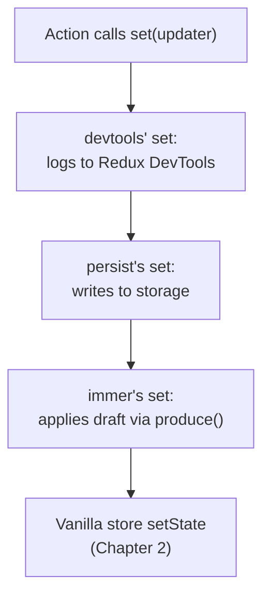

# Middleware

Every middleware in this chapter has the same shape: a function that takes a state creator and
returns a new state creator. Zustand calls this new creator instead of your original one, giving
the middleware a chance to wrap `set`, add properties to the store, or intercept the initial state
before `create` or `createStore` ever sees it. Nothing about this mechanism is special-cased in the
library — you can write your own middleware with the same shape, and Chapter 5 shows how to type
one.

## Read this chapter if

- You need to persist a store to `localStorage`, `AsyncStorage`, or another storage engine.
- You want to inspect and time-travel a store with the Redux DevTools browser extension.
- You are writing deeply nested state updates by hand and want Immer's draft-mutation syntax.
- You want a listener that fires only when a specific slice changes, or a reducer/action style on
  top of Zustand.

## In this chapter you will

- see how middleware compose by wrapping the state creator function, and why order matters;
- use `persist`, `devtools`, `immer`, `subscribeWithSelector`, `combine`, and `redux`, each with a
  minimal working example;
- get the complete option and method reference for each middleware.

## About middleware

A middleware has the signature `(config: StateCreator<T, Mps, Mcs>) => StateCreator<T, Mps,
[Mutator, ...Mcs]>` — it wraps a state creator and returns another one with the same three
parameters, `set`, `get`, and `store`. `create` and `createStore` are unaware of middleware; they
call whatever creator function you pass, and it is middleware's job to have already wrapped the
real one.

Composing several middleware means nesting function calls, and nesting determines which
middleware sees the *original* `set` versus a `set` another middleware has already replaced:

```ts
const useStore = create<State>()(
  devtools(
    persist(
      immer((set, get, store) => ({
        // your state and actions
      })),
      { name: 'my-store' },
    ),
  ),
)
```

Reading from the inside out: `immer` wraps your creator so that `set` accepts a draft-mutating
function; `persist` wraps *that* result so its own `set` calls (used to write to storage) go
through Immer's `set`; `devtools` wraps the outermost layer so every `set` call, including the ones
`persist` makes on rehydration, gets logged to the extension.

**Figure 4-1: Each middleware wraps the layer inside it; `set` calls flow outward through every wrapper between an action and the vanilla store.**



> [!IMPORTANT]
> Order is not cosmetic. Put `devtools` outermost so no other middleware's `setState` replacement
> happens after it — otherwise devtools loses track of the action name and state it wrapped.
> Put `immer` closest to your creator when combined with `persist`, so persisted `set` calls also
> accept Immer's draft-mutating form.

## Using middleware

### `persist`: save state to storage

`persist` writes the store to a storage engine after every `set` call and restores it — hydrates —
when the store is created:

```ts
import { create } from 'zustand'
import { persist, createJSONStorage } from 'zustand/middleware'

type SettingsState = {
  theme: 'light' | 'dark'
  setTheme: (theme: 'light' | 'dark') => void
}

const useSettingsStore = create<SettingsState>()(
  persist(
    (set) => ({
      theme: 'light',
      setTheme: (theme) => set({ theme }),
    }),
    {
      name: 'app-settings', // storage key; must be unique
      storage: createJSONStorage(() => localStorage), // default; shown for clarity
    },
  ),
)
```

`createJSONStorage` adapts any object with `getItem`/`setItem`/`removeItem` — `localStorage`,
`sessionStorage`, `AsyncStorage`, or a custom object — into the `PersistStorage` shape `persist`
expects, serializing with `JSON.stringify`/`JSON.parse`.

> [!NOTE]
> With a synchronous storage engine like `localStorage`, hydration completes before `create`
> returns, so the first render already has the persisted value. With an asynchronous engine like
> `AsyncStorage`, hydration finishes later, in a microtask; the first render sees the state your
> creator returned, not the persisted state. Use `onRehydrateStorage` or `persist.hasHydrated()` to
> detect the asynchronous case if your UI depends on the persisted value being present immediately.

### `devtools`: inspect and time-travel with Redux DevTools

```ts
import { create } from 'zustand'
import { devtools } from 'zustand/middleware'

const useJungleStore = create<{ bears: number; addBear: () => void }>()(
  devtools(
    (set) => ({
      bears: 0,
      addBear: () => set((state) => ({ bears: state.bears + 1 }), undefined, 'jungle/addBear'),
    }),
    { name: 'JungleStore' },
  ),
)
```

`devtools` requires the `@redux-devtools/extension` package and the browser extension of the same
name. It replaces `setState` with a version that accepts a third argument — an action name or
object — and forwards every call to the extension so you can inspect a timeline of state changes
and jump to any point in it. Pass `undefined` explicitly as the second (`replace`) argument when
you only want to name the action, not change replacement behavior.

### `immer`: draft-mutating updates

```ts
import { create } from 'zustand'
import { immer } from 'zustand/middleware/immer'

type TodoState = {
  todos: { id: string; text: string; done: boolean }[]
  toggle: (id: string) => void
}

const useTodoStore = create<TodoState>()(
  immer((set) => ({
    todos: [],
    toggle: (id) =>
      set((state) => {
        const todo = state.todos.find((t) => t.id === id)
        if (todo) todo.done = !todo.done
      }),
  })),
)
```

`immer` requires the `immer` package. It replaces `set` so that a function argument receives an
Immer draft instead of the real state; you write direct-looking mutations on the draft, and Immer
produces a correct immutable update from them. Non-function arguments to `set` work exactly as
without the middleware.

### `subscribeWithSelector`: subscribe to one slice

```ts
import { createStore } from 'zustand/vanilla'
import { subscribeWithSelector } from 'zustand/middleware'

const positionStore = createStore(
  subscribeWithSelector<{ x: number; y: number }>(() => ({ x: 0, y: 0 })),
)

const unsubscribe = positionStore.subscribe(
  (state) => state.x,
  (x, prevX) => console.log(`x moved from ${prevX} to ${x}`),
  { fireImmediately: true },
)
```

Without this middleware, `subscribe` only accepts a listener that receives the whole state on
every change. With it, `subscribe` gains a second overload: a selector, a listener that receives
only the selected slice, and options for a custom equality function and an immediate first call.

### `combine`: infer state without the curried `create<T>()`

```ts
import { create } from 'zustand'
import { combine } from 'zustand/middleware'

const useBearStore = create(
  combine({ bears: 0 }, (set) => ({
    increase: (by: number) => set((state) => ({ bears: state.bears + by })),
  })),
)
```

`combine` shallow-merges an initial state object with whatever a second function returns, and
Zustand infers the combined type from both arguments — so `create` does not need the curried
`<T>()` form here. Reach for `combine` when you want to avoid writing an explicit state interface
for a simple store; reach for the curried form when the state shape is complex enough that you
want to declare and reuse it as a named type.

### `redux`: reducer-and-dispatch style

```ts
import { createStore } from 'zustand/vanilla'
import { redux } from 'zustand/middleware'

type CounterAction = { type: 'increment' | 'decrement'; by: number }

const reducer = (state: { count: number }, action: CounterAction) => {
  switch (action.type) {
    case 'increment':
      return { count: state.count + action.by }
    case 'decrement':
      return { count: state.count - action.by }
  }
}

const counterStore = createStore(redux(reducer, { count: 0 }))

counterStore.dispatch({ type: 'increment', by: 3 })
```

`redux` wires a reducer and an initial state into a store that exposes `dispatch` both on the
store API and inside the state itself, wraps every dispatched action through `set` with the
action as its third argument (so `devtools`, placed outside `redux`, shows real action names), and
requires no other Zustand-specific vocabulary if your team already thinks in reducers and actions.

## Middleware reference

### `persist(stateCreatorFn, options)`

**Options (`PersistOptions<T>`)**

| Option | Type | Default | Description |
|---|---|---|---|
| `name` | `string` | — (required) | Storage key. Must be unique per store sharing a storage engine. |
| `storage` | `PersistStorage<T>` | `createJSONStorage(() => localStorage)` | Where and how state is read and written. |
| `partialize` | `(state: T) => PersistedState` | `(state) => state` | Selects which fields to persist. |
| `onRehydrateStorage` | `(state: T) => ((state?: T, error?: unknown) => void) \| void` | — | Called before hydration starts; its return value is called after hydration finishes or fails. |
| `version` | `number` | `0` | Stored alongside the state. A mismatch with the code's `version` triggers `migrate` or discards the stored value. |
| `migrate` | `(persistedState: unknown, version: number) => T \| Promise<T>` | returns input unchanged | Transforms an older persisted shape into the current one. |
| `merge` | `(persistedState: unknown, currentState: T) => T` | `{ ...currentState, ...persistedState }` | Combines the persisted value with the state the creator returned. Override for a deep merge if you have nested persisted objects. |
| `skipHydration` | `boolean` | `undefined` | When `true`, `persist` does not hydrate automatically; call `store.persist.rehydrate()` yourself — typically after a server-rendered app has mounted. |

**Store additions (`store.persist`)**

| Member | Signature | Description |
|---|---|---|
| `getOptions` | `() => Partial<PersistOptions<T>>` | Returns the current options. |
| `setOptions` | `(newOptions: Partial<PersistOptions<T>>) => void` | Merges new options into the current ones; can swap the storage engine at runtime. |
| `clearStorage` | `() => void` | Removes the stored value at `name`. |
| `rehydrate` | `() => Promise<void>` | Triggers hydration manually; the call `persist` makes on its own unless `skipHydration` is set. |
| `hasHydrated` | `() => boolean` | Non-reactive; reflects the most recent hydration's completion. |
| `onHydrate` | `(listener: (state: T) => void) => () => void` | Called when hydration starts. Returns an unsubscribe function. |
| `onFinishHydration` | `(listener: (state: T) => void) => () => void` | Called when hydration completes or fails. Returns an unsubscribe function. |

**`createJSONStorage(getStorage, options?)`**

| Name | Type | Description |
|---|---|---|
| `getStorage` | `() => StateStorage` | Returns an object with `getItem`, `setItem`, `removeItem`. Called once; if it throws (for example, `localStorage` is unavailable during SSR), `createJSONStorage` returns `undefined` instead of throwing. |
| `options.reviver` | `(key: string, value: unknown) => unknown` | Passed to `JSON.parse`. |
| `options.replacer` | `(key: string, value: unknown) => unknown` | Passed to `JSON.stringify`. |

**Mutator:** `['zustand/persist', PersistedState]`

### `devtools(stateCreatorFn, options?)`

| Option | Type | Default | Description |
|---|---|---|---|
| `name` | `string` | — | Connection label shown in the extension. |
| `enabled` | `boolean` | `true` outside production, `false` in it | Toggles the extension connection. |
| `anonymousActionType` | `string` | inferred caller name, or `'anonymous'` | Action type used when a `set` call omits a name. |
| `store` | `string` | — | Groups several stores under one named connection in the extension. |
| `actionsDenylist` | `string \| string[]` | — | Regex patterns of action types to hide from the extension's timeline; matching actions are still sent, only the display is filtered. |

**Store additions**

| Member | Signature | Description |
|---|---|---|
| `devtools.cleanup` | `() => void` | Disconnects from the extension. Call it when a dynamically created store (for example, a context-scoped one) is discarded. |

**`setState` addition:** accepts a third argument, `action?: string | { type: string, ... }`, forwarded to the extension as the action that produced the new state.

**Mutator:** `['zustand/devtools', never]`

### `immer(stateCreatorFn)`

Takes no options. Replaces `set` so a function argument receives a `Draft<T>` (from the `immer`
package) instead of `T`; non-function arguments are unaffected.

**Mutator:** `['zustand/immer', never]`

**Preconditions:** Requires `immer` installed as a dependency; it is an optional peer dependency of
`zustand`.

### `subscribeWithSelector(stateCreatorFn)`

Takes no options. Adds an overload to `subscribe`:

```ts
subscribe<U>(
  selector: (state: T) => U,
  listener: (selected: U, previousSelected: U) => void,
  options?: { equalityFn?: (a: U, b: U) => boolean; fireImmediately?: boolean },
): () => void
```

| Option | Type | Default | Description |
|---|---|---|---|
| `equalityFn` | `(a: U, b: U) => boolean` | `Object.is` | Comparison used to decide whether the listener fires. |
| `fireImmediately` | `boolean` | `false` | When `true`, calls the listener once immediately with the current selected value as both arguments. |

**Mutator:** `['zustand/subscribeWithSelector', never]`

### `combine(initialState, additionalStateCreatorFn)`

| Name | Type | Description |
|---|---|---|
| `initialState` | `T` (any non-function value) | The base state. |
| `additionalStateCreatorFn` | `StateCreator<T, [], [], U>` | Receives `set`, `get`, `store` typed against `T`; its return value is shallow-merged onto `initialState`. |

**Returns:** A state creator for `Omit<T, keyof U> & U`. Adds no mutator — `combine` does not
change what `set`, `get`, or `store` do, only what type they carry.

> [!NOTE]
> The `get`/`store` types inside `additionalStateCreatorFn` see only `T`, not the merged result,
> even though the real object at runtime has both. This is a deliberate, documented approximation
> that makes inference possible; see Chapter 5 for the precise tradeoff and when it matters.

### `redux(reducerFn, initialState)`

| Name | Type | Description |
|---|---|---|
| `reducerFn` | `(state: T, action: A) => T` | A pure reducer. Must return a complete `T`, not a partial update. |
| `initialState` | `T` | The starting state, before any action. |

**Returns:** A state creator for `T & { dispatch: (action: A) => A }`.

**Store additions:** `dispatch` (also placed on the state itself, matching common Redux usage) and
an internal `dispatchFromDevtools` flag that lets `devtools`, if present, dispatch actions received
from the extension back into this store.

**Mutator:** `['zustand/redux', A]`

## Summary

### Mental model

Middleware are state-creator transformers, nested like function calls. The outermost middleware's
`set` is what your actions ultimately call; each layer in between can inspect, extend, or replace
it before the vanilla store ever sees the update.

### Common path

1. Pick the middleware your feature needs — persistence, DevTools, Immer-style updates, granular
   subscriptions, inferred types, or reducer/dispatch.
2. Compose from the inside out: `immer`/`combine` closest to your creator, `persist` and
   `subscribeWithSelector` in the middle, `devtools` outermost.
3. Look up exact options and store additions in the reference above before shipping.

### Public surface

- **Functions:** `persist`, `devtools`, `immer`, `subscribeWithSelector`, `combine`, `redux`,
  `createJSONStorage`
- **Store additions:** `store.persist.*`, `store.devtools.cleanup`, `store.dispatch` (with `redux`)

### Invariants

- **Must** place `devtools` outermost when combining it with other `set`-wrapping middleware, or
  it loses track of action names and state.
- **Must** install the matching optional dependency for `persist`'s storage engine choice,
  `devtools`'s `@redux-devtools/extension`, and `immer`'s `immer` package — none ship as required
  dependencies of `zustand` itself.
- **Should not** rely on synchronous hydration timing when using an asynchronous storage engine
  with `persist`; check `persist.hasHydrated()` or use `onRehydrateStorage` instead.

### Continue

- To type a middleware stack precisely, including one you write yourself, read Chapter 5.
- To reset a store between tests regardless of which middleware it uses, read Chapter 6.
