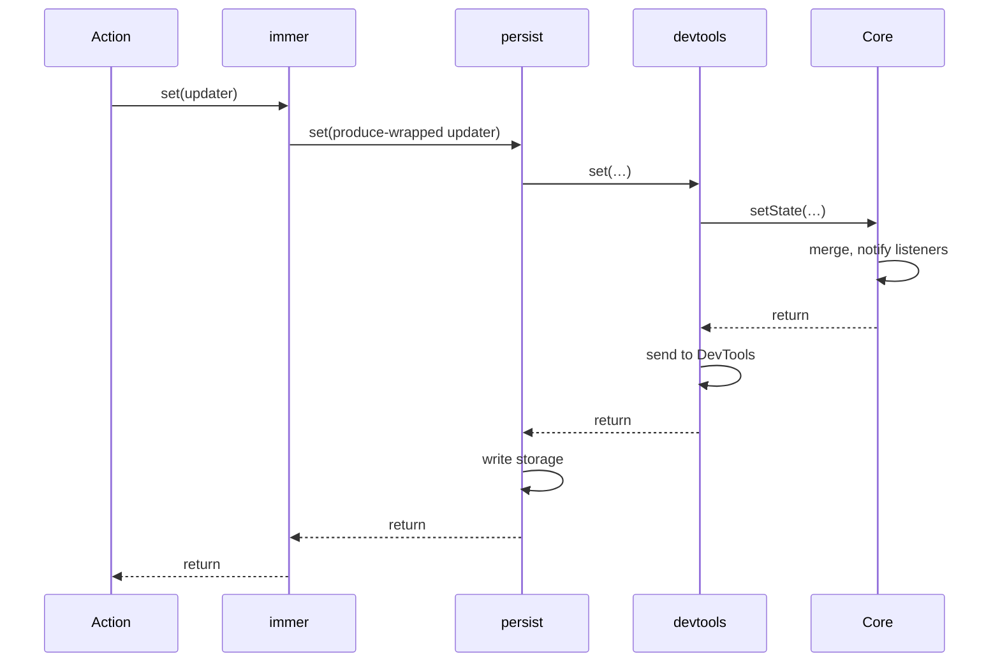

# Middleware and Store Types

This chapter explains how middleware changes a store and how TypeScript types the result. The middleware tasks in Chapter 8 rely on it.

## Roadmap

### Read this chapter if

You use Zustand's middleware, write stores in TypeScript, or plan to write a middleware.

### Before you begin

Read [How a store is created](#how-a-store-is-created) and [How listeners are notified](#how-listeners-are-notified).

### In this chapter you will

- Learn what a middleware can change and how a stack orders an update.
- Learn why TypeScript code calls `create<T>()(…)`.

### You can skip

Skip the last two sections if you write JavaScript.

## What middleware is

A middleware is a function that takes a state creator and returns a new state creator. You apply it by wrapping the creator you pass to `createStore` or `create`, as in `create<T>()(devtools(creator))`, and it behaves the same with either.

The middleware does its work when the store runs the creator, once, during [creation](#how-a-store-is-created). It receives `set`, `get`, and the store API, calls the creator it wraps, and can:

- wrap `set` before passing it inward, so that your actions' updates pass through it;
- replace store API methods such as `setState` or `subscribe`, so that outside calls pass through it too;
- add members to the store API, such as `store.persist`;
- transform the state the inner creator returns, which becomes the initial state.

Zustand bundles six middleware:

| Middleware | Purpose | Guide |
|---|---|---|
| `devtools` | Records updates in the Redux DevTools extension | [Inspect a store with Redux DevTools](#inspect-a-store-with-redux-devtools) |
| `persist` | Saves state to storage and restores it | [About persistence](#about-persistence) |
| `immer` | Lets an update mutate a draft | [Write updates as mutations with Immer](#write-updates-as-mutations-with-immer) |
| `subscribeWithSelector` | Calls a listener only when a selected value changes | [Subscribe to part of the state](#subscribe-to-part-of-the-state) |
| `combine` | Infers the state type from an initial object | [Infer the state type with combine](#infer-the-state-type-with-combine) |
| `redux` | Updates state with a reducer and actions | [`redux()`](#redux) |

## How middleware composes

A stack nests middleware calls, as in `devtools(persist(immer(creator)))`. The store runs the outermost state creator, so `devtools` receives the core `set` first, and each layer passes its own wrapped `set` inward.

An action's `set` call therefore runs through the layers innermost first and reaches the core `setState` last. A layer can act before forwarding the call, as `immer` does when it wraps a draft updater in Immer's `produce`, or after the call returns, when the core has stored the new state and every listener has run. On the way out, `devtools` sends its message before `persist` writes storage, because the layer nearer the core regains control first. Each layer also installs its wrapper as `store.setState`, so calls from outside the store take the same path.

**Figure 4-1: An action's set call passes through each middleware, innermost first, and the layer nearest the core finishes its work first on the way back.**

Put `devtools` outside every other middleware, because it records only updates that pass through its wrapper. `persist`, for example, hydrates the store through the `set` it received, so in `persist(devtools(creator))` the DevTools show the creator's defaults while the store holds the restored state. [Compose a middleware stack](#compose-a-middleware-stack) builds the cart stack in this order.

## Why `create` is curried in TypeScript

`create` and `createStore` have two type parameters: the state type `T`, and the list of mutators the middleware stack applies. The creator's `set` and `get` parameters get their types from `T`, so the creator itself gives TypeScript nothing to infer `T` from. You write `T` yourself. TypeScript also cannot infer some type arguments of a call while you supply others. Once you write `T`, the mutator list takes its default, the empty list, which a middleware's result does not match. Zustand therefore splits the call: `create<T>()` takes only `T` and returns a function that infers the mutator list from your creator.

Without middleware, the one-call form `create<T>(creator)` also type-checks. `create(combine(…))` needs no type argument, because `combine` infers the state type.

## How middleware changes the store type

A middleware that changes the store API declares a mutator: a type-level transformation of the store, registered in Zustand's `StoreMutators` interface under an identifier and written as a pair such as `['zustand/immer', never]`. Each middleware's return type puts its mutator in front of those of the creator it wraps, so a stack yields one list. `create` applies that list to `StoreApi<T>`, which is why `store.persist` exists in the type only when `persist` is in the stack.

The same lists appear in `StateCreator<T, Mis, Mos, U>`. `T` is the full state type. `Mis` lists the mutators applied outside this creator, which type the `set`, `get`, and API it receives. `Mos` lists the mutators this creator applies, and `U` is the type it returns. You write these parameters in two cases: a slice under middleware passes the stack's list as `Mis` ([Split a large store into slices](#split-a-large-store-into-slices)), and a middleware you write types both the creator it accepts and the one it returns ([Write your own middleware](#write-your-own-middleware)).

Write middleware calls inline, inside `create<T>()(…)`, so that each one infers `T` and the outer mutators from the enclosing call. A middleware call assigned to a variable first has nothing to infer from, so its updater parameters become implicit `any`. For a single middleware built separately, write its type argument, as in `devtools<CartState>(creator)`. That argument leaves the middleware's other type parameters at their defaults, so it fails for a stack, and for `persist` with `partialize`, whose persisted type then defaults to `T`. Write a stack inline, or type its innermost creator in full with `StateCreator<CartState, Mis, Mos>`, listing every mutator in the stack as `Mis`.
