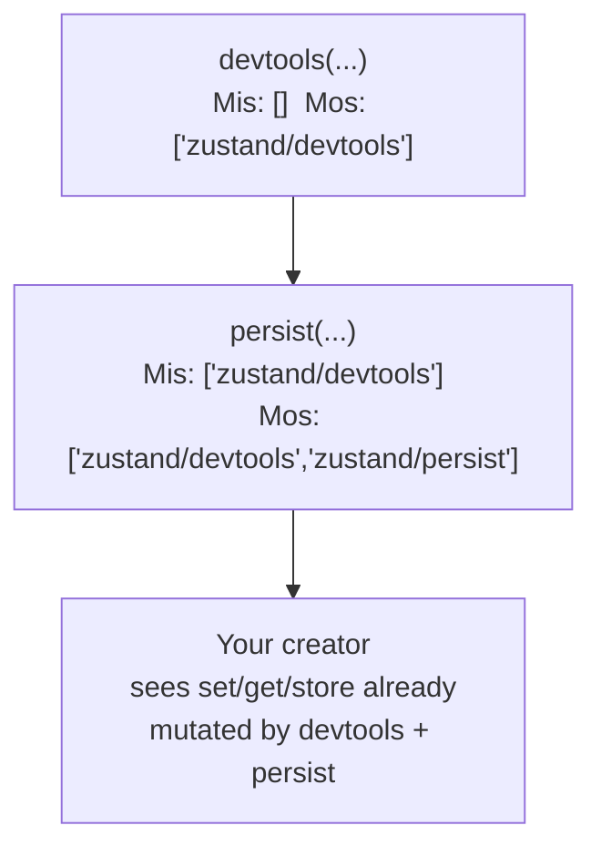

# TypeScript

Zustand is written in TypeScript and every public function is fully typed, but two aspects of its
API exist specifically to work around TypeScript inference limits: the curried `create<T>()(...)`
call form, and the mutator-identifier list threaded through `StateCreator`. Neither has a runtime
effect. This chapter explains what each one buys you and how to use both when writing your own
store, middleware, or slice.

## Read this chapter if

- You want to know why Zustand examples write `create<T>()(...)` instead of `create<T>(...)`.
- You are typing a store that uses more than one middleware.
- You are splitting a store into slices, or writing your own middleware, and need the types to
  follow along.

## In this chapter you will

- see why `T` in `create<T>(initializer)` cannot be inferred from `initializer` alone, and how the
  curried form works around it;
- type a store, a middleware stack, and a slice-pattern store correctly;
- get the reference for `StateCreator`, `StoreMutators`, `Mutate`, and `ExtractState`.

## About Zustand's TypeScript design

### Why `create<T>()(initializer)` instead of `create<T>(initializer)`

`create`'s initializer both **produces** `T` (it returns the state) and **consumes** `T` (through
the `get` parameter, which returns `T`). A type parameter that appears in both a covariant
position (the return value) and a contravariant position (a function parameter) is called
invariant, and TypeScript cannot infer an invariant type parameter from usage — it has no single
direction to infer *from*. Left alone, `create((set, get) => ({ ... }))` infers `T` as `unknown`.

The fix is not really about `create` at all; it works around a general TypeScript limitation
([microsoft/TypeScript#10571](https://github.com/microsoft/TypeScript/issues/10571)): TypeScript
requires you to supply either *all* of a function's type parameters explicitly or *none* of them —
you cannot supply one and let the others infer. `create<T>()` is a small function that takes no
runtime arguments, returns another function, and exists solely so you can write the explicit `T`
in one call and let the second call infer everything else:

```ts
interface BearState {
  bears: number
  increase: (by: number) => void
}

// T is explicit; the initializer's own parameter and return types are inferred.
const useBearStore = create<BearState>()((set) => ({
  bears: 0,
  increase: (by) => set((state) => ({ bears: state.bears + by })),
}))
```

> [!NOTE]
> `combine` and `redux` don't need the curried form. Both middleware *produce* the state type from
> their own arguments (an initial state object, or a reducer's return type), so there is no
> invariant parameter left for `create` to infer — `create(combine(...))` and
> `create(redux(...))` both infer correctly without `<T>()`.

### `StateCreator`'s four type parameters

Every state creator function — the argument to `create`, `createStore`, and every middleware in
Chapter 4 — has the type `StateCreator<T, Mis, Mos, U>`:

| Parameter | Meaning |
|---|---|
| `T` | The full state type this creator ultimately participates in. |
| `Mis` ("mutators in") | The list of middleware mutator identifiers already applied *outside* this creator, in the order they wrap it. |
| `Mos` ("mutators out") | The list of mutator identifiers *this* creator (typically a middleware) adds. |
| `U` | What this specific creator function returns — equal to `T` for a plain store, or a slice's own shape when writing the slices pattern. |

`Mis` and `Mos` are phantom type parameters: arrays of `[identifier, mutatorType]` tuples that
exist only so TypeScript can compute the final, fully-mutated `set`, `get`, and `store` types —
they hold no runtime value. Each middleware's mutator identifier is a fixed string, declared once
in `zustand`'s ambient `StoreMutators` interface: `'zustand/persist'`, `'zustand/devtools'`,
`'zustand/immer'`, `'zustand/subscribeWithSelector'`, and `'zustand/redux'`. `combine` adds no
identifier, because it does not change what `set`/`get`/`store` look like — only what `T` is.

**Figure 5-1: Each middleware layer consumes one mutator identifier from the list still to apply, and adds it to the list already applied, before calling the creator inside it.**



## Using TypeScript with Zustand

### Typing a middleware stack

You do not need to restate the mutator list by hand for the built-in middleware; wrapping your
creator with `devtools(persist(immer(...)))` produces the correct combined type as long as you use
the curried `create<T>()` form and apply the middleware directly inside it:

```ts
import { create } from 'zustand'
import { devtools, persist } from 'zustand/middleware'

interface BearState {
  bears: number
  increase: (by: number) => void
}

const useBearStore = create<BearState>()(
  devtools(
    persist(
      (set) => ({
        bears: 0,
        increase: (by) => set((state) => ({ bears: state.bears + by })),
      }),
      { name: 'bearStore' },
    ),
  ),
)
```

> [!IMPORTANT]
> Apply middleware directly inside `create<T>()(...)`, not through an intermediate variable such as
> `const withMiddleware = (f) => devtools(persist(f, options))`. TypeScript loses the contextual
> typing it needs through an extra layer of indirection; typing that pattern correctly requires the
> same higher-kinded mutator machinery middleware authors use (see below).

### Writing a middleware that does not change the store type

A logging middleware that wraps `set` without adding new store members or changing `T` only needs
to preserve the incoming `Mps`/`Mcs` lists:

```ts
import type { StateCreator, StoreMutatorIdentifier } from 'zustand'

type Logger = <
  T,
  Mps extends [StoreMutatorIdentifier, unknown][] = [],
  Mcs extends [StoreMutatorIdentifier, unknown][] = [],
>(
  f: StateCreator<T, Mps, Mcs>,
  name?: string,
) => StateCreator<T, Mps, Mcs>

type LoggerImpl = <T>(f: StateCreator<T, [], []>, name?: string) => StateCreator<T, [], []>

const loggerImpl: LoggerImpl = (f, name) => (set, get, store) => {
  const loggedSet: typeof set = (...a) => {
    set(...(a as Parameters<typeof set>))
    console.log(...(name ? [`${name}:`] : []), get())
  }
  return f(loggedSet, get, store)
}

export const logger = loggerImpl as unknown as Logger
```

The pattern — a precisely typed public signature (`Logger`) backed by a loosely typed
implementation (`LoggerImpl`), connected with one `as unknown as` cast — is the standard shape for
Zustand middleware. The public type is what callers see and what makes composition type-check; the
implementation type is what you can actually write and have the compiler accept.

### Writing a middleware that changes the store type

A middleware that adds a new member to the store (as `devtools` adds `cleanup` and `persist` adds
`persist.*`) additionally declares its own mutator identifier and extends `StoreMutators`:

```ts
import type { StateCreator, StoreMutatorIdentifier, Mutate, StoreApi } from 'zustand'

type Write<T extends object, U extends object> = Omit<T, keyof U> & U

declare module 'zustand' {
  interface StoreMutators<S, A> {
    foo: Write<Cast<S, object>, { foo: A }>
  }
}

type Cast<T, U> = T extends U ? T : U

type Foo = <
  T,
  A,
  Mps extends [StoreMutatorIdentifier, unknown][] = [],
  Mcs extends [StoreMutatorIdentifier, unknown][] = [],
>(
  f: StateCreator<T, [...Mps, ['foo', A]], Mcs>,
  bar: A,
) => StateCreator<T, Mps, [['foo', A], ...Mcs]>

type FooImpl = <T, A>(f: StateCreator<T, [], []>, bar: A) => StateCreator<T, [], []>

const fooImpl: FooImpl = (f, bar) => (set, get, _store) => {
  const store = _store as Mutate<StoreApi<ReturnType<typeof f>>, [['foo', typeof bar]]>
  store.foo = bar
  return f(set, get, _store)
}

export const foo = fooImpl as unknown as Foo
```

`declare module 'zustand' { interface StoreMutators<S, A> { ... } }` uses TypeScript's declaration
merging to add one case to the interface `Mutate` consults when resolving what a chain of mutator
identifiers produces on the final store type — this is the "higher-kinded mutator" mechanism the
built-in middleware also use, and the reason `StoreMutators<S, A>` is declared as an empty,
augmentable interface in `zustand/vanilla`.

### Typing the slices pattern

Each slice creator function should declare the *full* combined state as its `T`, so it can call
`get()` to read other slices, but return only its own slice as `U`:

```ts
import { create, type StateCreator } from 'zustand'

interface BearSlice {
  bears: number
  addBear: () => void
  eatFish: () => void
}

interface FishSlice {
  fishes: number
  addFish: () => void
}

type SharedState = BearSlice & FishSlice

const createBearSlice: StateCreator<SharedState, [], [], BearSlice> = (set) => ({
  bears: 0,
  addBear: () => set((state) => ({ bears: state.bears + 1 })),
  eatFish: () => set((state) => ({ fishes: state.fishes - 1 })),
})

const createFishSlice: StateCreator<SharedState, [], [], FishSlice> = (set) => ({
  fishes: 0,
  addFish: () => set((state) => ({ fishes: state.fishes + 1 })),
})

const useBoundStore = create<SharedState>()((...args) => ({
  ...createBearSlice(...args),
  ...createFishSlice(...args),
}))
```

If the combined store also uses middleware, add its mutator to the second type parameter of every
slice's `StateCreator`, for example `StateCreator<SharedState, [['zustand/devtools', never]], [],
BearSlice>`, so each slice's `set` carries the middleware-aware type.

## TypeScript reference

### `StateCreator<T, Mis, Mos, U>`

```ts
type StateCreator<
  T,
  Mis extends [StoreMutatorIdentifier, unknown][] = [],
  Mos extends [StoreMutatorIdentifier, unknown][] = [],
  U = T,
> = (
  setState: Get<Mutate<StoreApi<T>, Mis>, 'setState', never>,
  getState: Get<Mutate<StoreApi<T>, Mis>, 'getState', never>,
  store: Mutate<StoreApi<T>, Mis>,
) => U
```

The function type every state creator and every middleware conforms to. `setState`/`getState` are
typed as if every mutator in `Mis` has already been applied; `store` similarly has every method and
property those mutators add.

### `StoreMutators<S, A>`

```ts
interface StoreMutators<S, A> {}
```

An intentionally empty, augmentable interface declared in `zustand/vanilla`. Each built-in
middleware (and any middleware you write) adds one property to it via `declare module 'zustand'`,
mapping its mutator identifier string to the type transformation it performs on `S`. `Mutate`
resolves a list of mutator identifiers by looking each one up here, one at a time.

### `Mutate<S, Ms>`

```ts
type Mutate<S, Ms> = /* recursively resolves each entry in Ms against StoreMutators */
```

Given a base store type `S` and a list of `[identifier, extra]` tuples `Ms`, produces the store
type after applying every mutator in order. You rarely write `Mutate` directly; it appears inside
`StateCreator` and inside a middleware's own implementation signature (as in the `foo` example
above), not in application code.

### `ExtractState<S>`

```ts
type ExtractState<S> = S extends { getState: () => infer T } ? T : never
```

Extracts a store's state type from the store itself — useful when you built a store with
`combine` or `redux` and want the inferred state type available outside the `create` call:

```ts
import { create, type ExtractState } from 'zustand'
import { combine } from 'zustand/middleware'

const useBearStore = create(
  combine({ bears: 0 }, (set) => ({
    increase: (by: number) => set((state) => ({ bears: state.bears + by })),
  })),
)

type BearState = ExtractState<typeof useBearStore>
```

## Summary

### Mental model

`T` in `create<T>()` cannot be inferred because the initializer both produces and consumes it; the
extra `()` works around a general TypeScript limitation, not a Zustand-specific one. Middleware
compose their type-level effects the same way they compose at runtime — as a list of mutator
identifiers resolved one at a time by `Mutate`.

### Common path

1. Declare an interface for your state and actions together.
2. Write `create<YourState>()((set, get, store) => ({ ... }))`, or skip the curried form entirely
   when using `combine` or `redux`.
3. For slices, type each slice creator as `StateCreator<CombinedState, Mutators, [], OwnSlice>`.
4. For custom middleware, follow the public-type/implementation-type split shown above.

### Public surface

- **Types:** `StateCreator`, `StoreMutators`, `StoreMutatorIdentifier`, `Mutate`, `ExtractState`

### Invariants

- **Must** apply middleware directly inside `create<T>()(...)` for contextual inference to work;
  an intermediate wrapper function needs the full mutator-identifier machinery to type correctly.
- **Should** prefer `combine` over the curried form when a store's state is simple enough to infer
  from its initial value and actions alone.
- **Never** expect the curried `create<T>()` call or the mutator-identifier lists to have any
  runtime effect — both disappear entirely at compile time.

### Continue

- To see resetting, slicing, and transient-update patterns applied together in tests, read
  Chapter 6.
