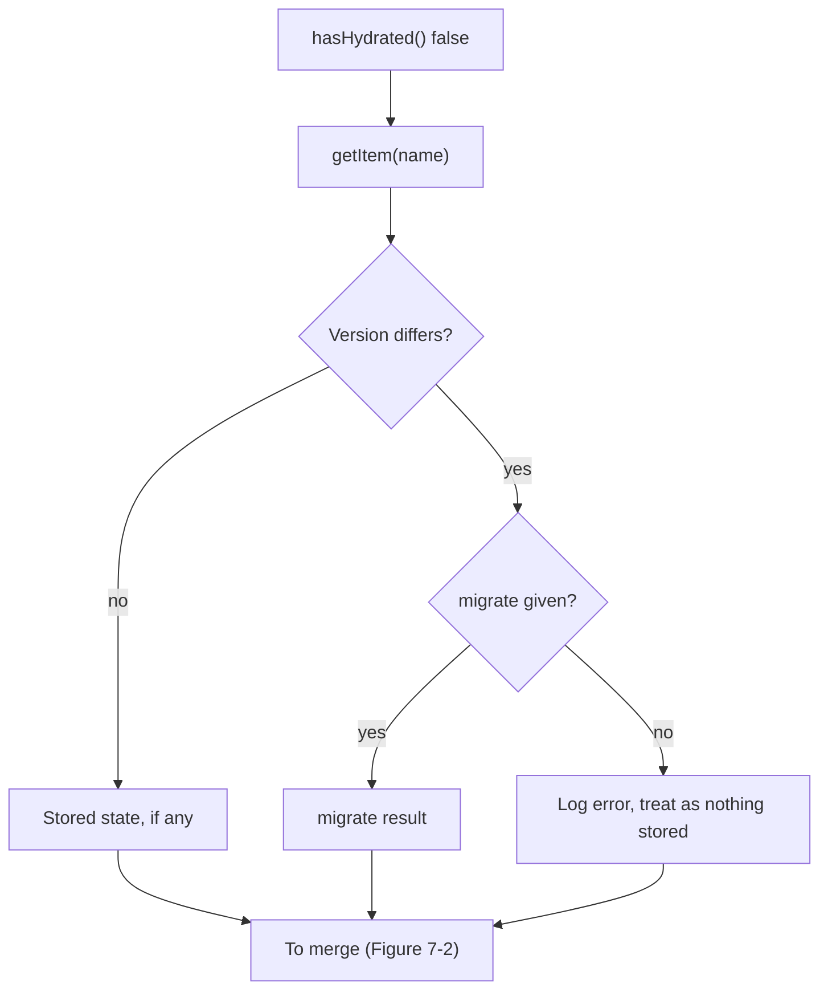
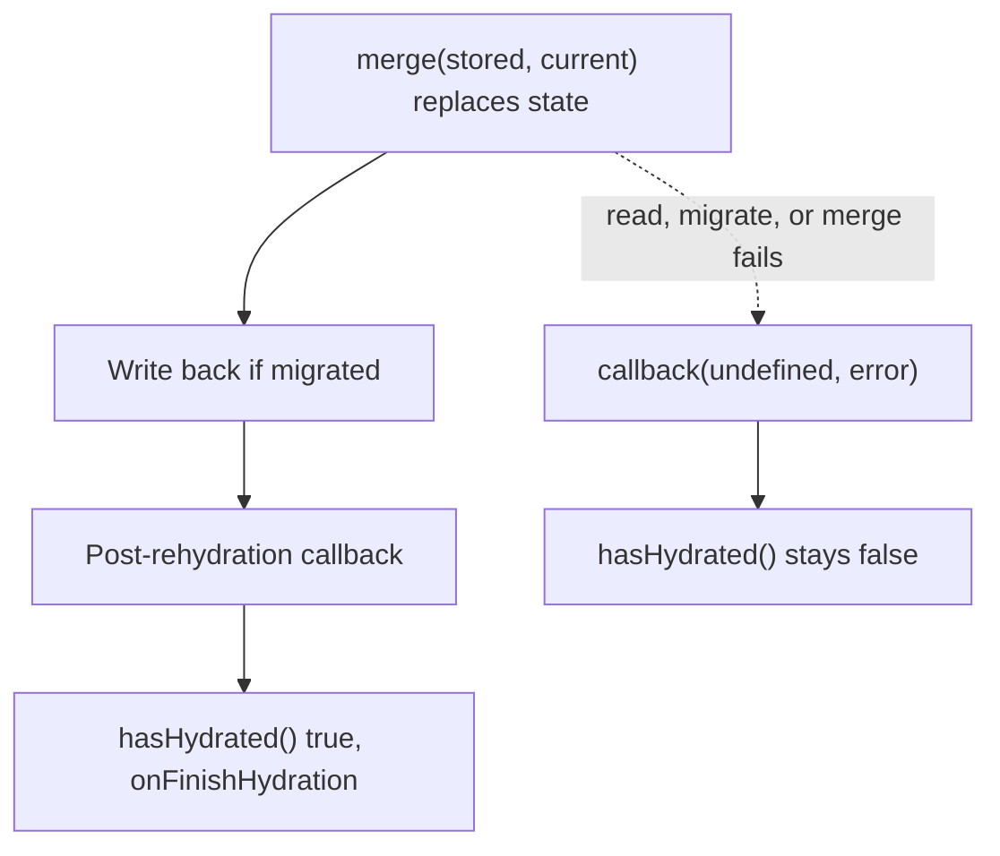

# Persisting State

The `persist` middleware saves part of a store's state to storage and loads it back when the store is next created.

## Roadmap

### Read this chapter if

You want state to survive a reload, or you change the stored shape of a persisted store.

### Before you begin

Read [How middleware composes](#how-middleware-composes). The listings run in Node with the Map-backed storage defined in [Persist a store](#persist-a-store).

### You can skip

Skip [Wait for hydration with asynchronous storage](#wait-for-hydration-with-asynchronous-storage) if you use `localStorage`, and [Control hydration for server rendering](#control-hydration-for-server-rendering) if you render only in the browser. Symptoms and recoveries are in this chapter's Troubleshooting section, just before the reference.

## About persistence

Persist stores an object `{ state, version }` under the key given by `name`. Its `state` field holds `partialize(currentState)`, the part of the store you chose to save. The default storage serializes the object as JSON, which drops functions; actions still exist after loading because the state creator defines them. Values such as a `Map` need [encoding](#store-values-json-cannot-represent).

Persist writes after every `set` and `store.setState` call, even a no-op, once the core store has updated and notified its listeners. It writes nothing at creation except a migrated value. It reads storage during hydration, at creation unless `skipHydration` is `true`.

Without a `storage` option, persist uses `localStorage`. Where storage cannot be obtained, as on a server, persist becomes a pass-through: the store works in memory, `store.persist` is `undefined` despite its type, and each `set` call from the state creator logs a warning.

`getInitialState()` returns the state from before hydration, so [resets](#reset-a-store) and [server rendering](#server-rendering-and-the-initial-state) use the defaults.

## The hydration lifecycle

Hydration runs these steps:

1. Persist marks the store as not hydrated and calls `onHydrate` listeners and `onRehydrateStorage`, which can return a post-rehydration callback.
2. It calls `storage.getItem(name)`.
3. If the stored `version` is a number that differs from the `version` option, it calls `migrate`, or without one logs an error and proceeds as though nothing were stored.
4. It replaces the state with `merge(storedState, currentState)`, which notifies listeners.
5. If a migration ran, it writes the result back.
6. It calls the post-rehydration callback, marks the store hydrated, and calls `onFinishHydration` listeners.

**Figure 7-1: Hydration reads storage and uses the stored state as it is, migrates it, or discards it, depending on its version.**



Every branch continues to the merge, so a missing `migrate` still produces a hydrated store, built from the defaults.

**Figure 7-2: Hydration merges, writes back a migration, and runs the callback before it marks the store hydrated.**



Code that waits for `hasHydrated()` or `onFinishHydration` therefore sees the merged stored state, and code that runs earlier sees the defaults.

If reading, parsing, migrating, or merging throws or rejects, persist passes the error to the post-rehydration callback as its second argument and leaves the state unchanged and `hasHydrated()` false. If writing the migrated value fails, the state has already been replaced, although `hasHydrated()` stays false. If the post-rehydration callback or an `onFinishHydration` listener throws, persist calls the callback a second time with that error; when a listener threw, `hasHydrated()` is already `true`.

With synchronous storage, hydration finishes before `create` returns. With asynchronous storage or migration, the store starts with its defaults and hydrates later. A newer `rehydrate()` or `clearStorage()` call cancels a hydration in progress.

## Persist a store

Persist the cart's items and coupon but not its checkout status, which describes one submission and is wrong to restore. Because the creator is defined apart from the `persist` call, its type names the persist mutator ([How middleware changes the store type](#how-middleware-changes-the-store-type)). The later listings in this chapter import this file:

```ts
// persisted-cart.ts
import type { StateCreator } from 'zustand/vanilla'
import type { StateStorage } from 'zustand/middleware'

export type CartItem = { sku: string; name: string; unitPrice: number; quantity: number }
export type CartState = {
  items: Record<string, CartItem> // keyed by sku
  coupon: string | null
  checkout: { status: 'idle' | 'submitting' }
  addItem: (item: Omit<CartItem, 'quantity'>) => void
}
export type PersistedCart = Pick<CartState, 'items' | 'coupon'>

export const partializeCart = ({ items, coupon }: CartState): PersistedCart =>
  ({ items, coupon })

export const cartCreator: StateCreator<
  CartState,
  [['zustand/persist', unknown]]
> = (set) => ({
  items: {},
  coupon: null,
  checkout: { status: 'idle' },
  addItem: (item) =>
    set(({ items }) => {
      const quantity = (items[item.sku]?.quantity ?? 0) + 1
      return { items: { ...items, [item.sku]: { ...item, quantity } } }
    }),
})

// Synchronous storage backed by a Map, for Node and tests.
export function createMapStorage() {
  const entries = new Map<string, string>()
  const storage: StateStorage = {
    getItem: (name) => entries.get(name) ?? null,
    setItem: (name, value) => void entries.set(name, value),
    removeItem: (name) => void entries.delete(name),
  }
  return { ...storage, entries }
}

export const tea = { sku: 'TEA-01', name: 'Sencha tea', unitPrice: 1250 }
```

```ts
// persist-cart.ts
import { createStore } from 'zustand/vanilla'
import { persist, createJSONStorage } from 'zustand/middleware'
import { cartCreator, createMapStorage, partializeCart, tea, type CartState } from './persisted-cart'

const memory = createMapStorage()
const createCartStore = () =>
  createStore<CartState>()(
    persist(cartCreator, {
      name: 'cart',
      storage: createJSONStorage(() => memory),
      partialize: partializeCart,
    }),
  )

createCartStore().getState().addItem(tea)
console.log(memory.entries.get('cart'))
console.log(Object.keys(createCartStore().getState().items)) // as after a reload
```

```text
{"state":{"items":{"TEA-01":{"sku":"TEA-01","name":"Sencha tea","unitPrice":1250,"quantity":1}},"coupon":null},"version":0}
[ 'TEA-01' ]
```

Give each store that shares a storage its own `name`, or they overwrite each other.

## Version and migrate persisted state

When a release changes the stored shape, increase `version` and supply `migrate`. Persist calls it for any differing version, including a newer one after a rollback, so treat its input as untrusted. This listing opens the cart of a returning user whose saved cart is at version 0, once with `migrate` and once without:

```ts
// migrate-cart.ts
import { createStore } from 'zustand/vanilla'
import { persist, createJSONStorage } from 'zustand/middleware'
import {
  cartCreator, createMapStorage, partializeCart, tea,
  type CartItem, type CartState, type PersistedCart,
} from './persisted-cart'

// Version 0 stored items as an array; version 1 keys them by sku.
function migrateCart(persisted: unknown, fromVersion: number): PersistedCart {
  const old = persisted as { items?: CartItem[]; coupon?: string | null } | null
  if (fromVersion !== 0 || !Array.isArray(old?.items)) {
    return { items: {}, coupon: null } // unknown version or shape
  }
  return {
    items: Object.fromEntries(old.items.map((item) => [item.sku, item])),
    coupon: old.coupon ?? null,
  }
}

// Opens the cart of a returning user whose saved cart is at version 0.
function openCart(options: { migrate?: typeof migrateCart }) {
  const memory = createMapStorage()
  const v0 = { state: { items: [{ ...tea, quantity: 2 }], coupon: null }, version: 0 }
  memory.setItem('cart', JSON.stringify(v0))
  const cartStore = createStore<CartState>()(
    persist(cartCreator, {
      name: 'cart',
      storage: createJSONStorage(() => memory),
      partialize: partializeCart,
      version: 1,
      ...options,
    }),
  )
  return { cartStore, memory }
}

const migrated = openCart({ migrate: migrateCart })
console.log(migrated.cartStore.getState().items['TEA-01']?.quantity)
console.log(migrated.memory.entries.get('cart'))

const unmigrated = openCart({})
console.log(unmigrated.cartStore.persist.hasHydrated(), unmigrated.cartStore.getState().items)
unmigrated.cartStore.getState().addItem(tea)
console.log(unmigrated.memory.entries.get('cart'))
```

```text
2
{"state":{"items":{"TEA-01":{"sku":"TEA-01","name":"Sencha tea","unitPrice":1250,"quantity":2}},"coupon":null},"version":1}
State loaded from storage couldn't be migrated since no migrate function was provided
true {}
{"state":{"items":{"TEA-01":{"sku":"TEA-01","name":"Sencha tea","unitPrice":1250,"quantity":1}},"coupon":null},"version":1}
```

With `migrate`, the user keeps the two saved teas, and persist writes the result back at version 1, so each value is migrated once. Without it, persist logs an error, keeps an empty cart, and reports the store as hydrated. The next update then overwrites the old value: the user's two saved teas are gone, and only the tea just added remains.

## Merge nested persisted state

The default merge is `{ ...currentState, ...storedState }`, one level deep, so a stored nested object replaces the current one whole. If a release adds `giftWrap: false` to a nested `preferences` object, returning users get no `giftWrap`. Pass a `merge` that merges the nested level too:

```ts
// merge-preferences.ts
import { createStore } from 'zustand/vanilla'
import { persist, createJSONStorage } from 'zustand/middleware'
import { createMapStorage } from './persisted-cart'

type PreferencesState = {
  preferences: { shipping: 'standard' | 'express'; giftWrap: boolean }
}

const mergePreferences = (persisted: unknown, current: PreferencesState) => {
  const saved = (persisted ?? {}) as Partial<PreferencesState>
  return {
    ...current,
    ...saved,
    preferences: { ...current.preferences, ...saved.preferences },
  }
}

// The current release added giftWrap; an earlier one stored only shipping.
function openPreferences(options: { merge?: typeof mergePreferences }) {
  const memory = createMapStorage()
  const old = { state: { preferences: { shipping: 'express' } }, version: 0 }
  memory.setItem('preferences', JSON.stringify(old))
  return createStore<PreferencesState>()(
    persist(() => ({ preferences: { shipping: 'standard', giftWrap: false } }), {
      name: 'preferences',
      storage: createJSONStorage(() => memory),
      ...options,
    }),
  )
}

console.log(openPreferences({}).getState().preferences) // default merge
console.log(openPreferences({ merge: mergePreferences }).getState().preferences)
```

```text
{ shipping: 'express' }
{ shipping: 'express', giftWrap: false }
```

`merge` receives `undefined` when nothing usable was stored, and its result becomes the whole state, so keep everything in `current`.

## Wait for hydration with asynchronous storage

With storage that returns promises, such as React Native's AsyncStorage, a new store holds its defaults until hydration finishes, which `store.persist.hasHydrated()` and `onFinishHydration` report.

> [!WARNING]
> An update made before asynchronous hydration finishes writes state built from the defaults over the stored value, so saved data can be lost. Wait for hydration before updating the store.

This listing gives the cart a storage whose reads take 10 ms. It updates one store before hydration finishes and another after:

```ts
// early-write.ts
import { createStore } from 'zustand/vanilla'
import { persist, createJSONStorage, type StateStorage } from 'zustand/middleware'
import { cartCreator, partializeCart, tea, type CartState } from './persisted-cart'

// Asynchronous storage backed by a Map. Reads take 10 ms, like AsyncStorage.
const entries = new Map<string, string>()
const slowStorage: StateStorage<Promise<void>> = {
  getItem: (name) =>
    new Promise((resolve) => setTimeout(() => resolve(entries.get(name) ?? null), 10)),
  setItem: async (name, value) => void entries.set(name, value),
  removeItem: async (name) => void entries.delete(name),
}

const createCartStore = () =>
  createStore<CartState>()(
    persist(cartCreator, {
      name: 'cart',
      storage: createJSONStorage(() => slowStorage),
      partialize: partializeCart,
    }),
  )
type CartStore = ReturnType<typeof createCartStore>

// Resolves when the current hydration succeeds; never resolves if it fails.
const whenHydrated = (store: CartStore) =>
  new Promise<void>((resolve) => {
    if (store.persist.hasHydrated()) return resolve()
    const stop = store.persist.onFinishHydration(() => (stop(), resolve()))
  })

// A returning user saved 3 teas.
const saved = { state: { items: { 'TEA-01': { ...tea, quantity: 3 } }, coupon: null }, version: 0 }

entries.set('cart', JSON.stringify(saved))
const early = createCartStore()
early.getState().addItem(tea) // before hydration: writes 1 tea over the saved 3
await whenHydrated(early)
console.log('early:', early.getState().items['TEA-01']?.quantity)

entries.set('cart', JSON.stringify(saved))
const gated = createCartStore()
await whenHydrated(gated)
gated.getState().addItem(tea)
console.log('gated:', gated.getState().items['TEA-01']?.quantity)
```

```text
early: 1
gated: 4
```

The early update wrote one tea before the delayed read ran, so hydration loaded that write and the three saved teas were lost. When the read runs first instead, hydration replaces the early update. The gated store waited and kept all four.

In React, read the hydration status with a hook whose server snapshot is `false`, so the first client render matches the server. This file also defines the cart's bound hook with the default `localStorage` storage:

```ts
// use-cart-store.ts
import { useSyncExternalStore } from 'react'
import { create } from 'zustand'
import { persist } from 'zustand/middleware'
import { cartCreator, partializeCart, type CartState } from './persisted-cart'

// Default storage: localStorage in a browser, none on a server.
export const useCartStore = create<CartState>()(
  persist(cartCreator, { name: 'cart', partialize: partializeCart }),
)

const subscribeToHydration = (onChange: () => void) =>
  useCartStore.persist?.onFinishHydration(onChange) ?? (() => {})

export const useHasHydrated = () =>
  useSyncExternalStore(
    subscribeToHydration,
    () => useCartStore.persist?.hasHydrated() ?? true, // no storage to wait for
    () => false, // server rendering and React hydration
  )
```

Render a placeholder and hold back updates while `useHasHydrated()` is `false`. A failed hydration never runs `onFinishHydration`, so handle errors in the post-rehydration callback.

## Control hydration for server rendering

Zustand's hooks render `getInitialState()` during React hydration, so they match server markup. With synchronous storage such as `localStorage`, though, the store hydrated when it was created, so a `getState()` call during the first client render sees stored state, and React reports a mismatch. To keep the first client render identical to the server's:

1. Add `skipHydration: true` to the persist options in `use-cart-store.ts`.
2. Near the root of the client tree, call `useCartStore.persist?.rehydrate()` in a `useEffect` with an empty dependency array, so it runs after React hydration. The optional chaining is required because `store.persist` is `undefined` on the server.
3. Gate updates until `rehydrate()` resolves or `useHasHydrated()` is `true`, as the warning in [Wait for hydration with asynchronous storage](#wait-for-hydration-with-asynchronous-storage) describes.

Step 2 as a component:

```tsx
// cart-hydrator.tsx
import { useEffect } from 'react'
import { useCartStore } from './use-cart-store'

// Render once near the root of the client tree.
export function CartHydrator() {
  useEffect(() => {
    void useCartStore.persist?.rehydrate() // persist is undefined on a server
  }, [])
  return null
}
```

For per-request stores, see [Create a store per server request](#create-a-store-per-server-request).

## Store values JSON cannot represent

JSON stores a `Map` or `Set` as `{}` and a `Date` as a string. Pass `createJSONStorage` a `replacer` that encodes such a value as a tagged object and a `reviver` that rebuilds it from the tag. This store saves products for later as a `Map` from SKU to quantity:

```ts
// saved-for-later.ts
import { createStore } from 'zustand/vanilla'
import { persist, createJSONStorage } from 'zustand/middleware'
import { createMapStorage } from './persisted-cart'

type SavedState = {
  saved: Map<string, number> // sku -> quantity
  save: (sku: string, quantity: number) => void
}

const memory = createMapStorage()
const storage = createJSONStorage<Pick<SavedState, 'saved'>>(() => memory, {
  replacer: (_key, value) => (value instanceof Map ? { __map: [...value] } : value),
  reviver: (_key, value) => {
    const tagged = value as { __map?: [string, number][] } | null
    return Array.isArray(tagged?.__map) ? new Map(tagged.__map) : value
  },
})

const createSavedStore = () =>
  createStore<SavedState>()(
    persist(
      (set) => ({
        saved: new Map(),
        save: (sku, quantity) =>
          set(({ saved }) => ({ saved: new Map(saved).set(sku, quantity) })),
      }),
      { name: 'saved', storage, partialize: ({ saved }) => ({ saved }) },
    ),
  )

createSavedStore().getState().save('TEA-01', 2)
console.log(memory.entries.get('saved'))
const reloaded = createSavedStore().getState().saved
console.log(reloaded instanceof Map, reloaded.get('TEA-01'))
```

```text
{"state":{"saved":{"__map":[["TEA-01",2]]}},"version":0}
true 2
```

For full control over serialization, implement [`PersistStorage`](#statestorage-and-persiststorage) instead.

## Clear persisted state

`store.persist.clearStorage()` removes the stored item but leaves the state in memory unchanged, and the next update writes again. To forget a cart at sign-out, call `setState(getInitialState(), true)` first, because the reset is itself a write, and then `clearStorage()`. For tests, see [Test persisted stores](#test-persisted-stores).

## Troubleshooting

| Symptom | Cause | Recovery |
|---|---|---|
| Saved state is lost on reload | An update ran before asynchronous hydration finished, or `version` changed without `migrate` | Gate updates until the store is hydrated ([Wait for hydration with asynchronous storage](#wait-for-hydration-with-asynchronous-storage)). Supply `migrate` with every version change ([Version and migrate persisted state](#version-and-migrate-persisted-state)). |
| A field added to a nested default is missing for returning users | The default merge replaces a stored nested object whole | Pass a `merge` that merges the nested level ([Merge nested persisted state](#merge-nested-persisted-state)). |
| React reports a hydration mismatch | The first client render reads stored state the server did not have | Set `skipHydration: true` and call `rehydrate()` in an effect ([Control hydration for server rendering](#control-hydration-for-server-rendering)). |
| `[zustand persist middleware] Unable to update item '…', the given storage is currently unavailable.` | No storage exists, as with the default `localStorage` on a server or in Node, or the storage factory threw | In Node and tests, pass a `storage` such as the Map-backed one in [Persist a store](#persist-a-store). On a server the store works in memory, so keep state updates out of server rendering ([About persistence](#about-persistence)). |
| `store.persist` is `undefined` | Storage is unavailable, so persist adds no `store.persist` | Write `store.persist?.` in code that also runs on a server, and treat a missing `store.persist` as hydrated ([Control hydration for server rendering](#control-hydration-for-server-rendering)). |
| Stored state never loads | `name` changed between releases, or another store in the same storage uses the same `name` and overwrites it | Keep `name` fixed across releases, and give each store that shares a storage its own `name` ([Persist a store](#persist-a-store)). |

## Persist reference

Declarations are in [`persist.ts`](https://github.com/pmndrs/zustand/blob/v5.0.16/src/middleware/persist.ts) at 5.0.16. Under persist, `set` and `store.setState` return the storage's `setItem` result, a promise you can await for asynchronous storage.

### `persist()`

`persist(initializer, options)` returns a state creator that writes as [About persistence](#about-persistence) describes and adds [`store.persist`](#store-persist). If a synchronous `setItem` throws, the update has already happened and the error reaches the caller. With asynchronous storage, a failed write rejects the promise that `set` and `setState` return; await or catch it where a lost write matters, because an ignored rejection is unhandled.

### `PersistOptions`

| Option | Default | Behavior |
|---|---|---|
| `name` | Required | Storage key, unique per storage. |
| `storage` | `localStorage` | `undefined` disables persistence. |
| `partialize` | Whole state | Returns what to store. |
| `version` | `0` | A differing stored version triggers `migrate`. |
| `migrate` | None | `(stored, version)` returns the current shape, or a promise. |
| `merge` | One-level spread | `(stored, current)` returns the new state. |
| `onRehydrateStorage` | None | Runs as hydration starts; may return the post-rehydration callback. |
| `skipHydration` | `false` | Skips hydration at creation. |

An option set to `undefined` replaces its default: `merge: undefined` makes every hydration fail, and `partialize: undefined` makes every update throw. Omit an option instead of passing `undefined`.

### `store.persist`

| Method | Behavior |
|---|---|
| `getOptions()`, `setOptions(options)` | Read or merge options. |
| `rehydrate()` | Starts a hydration; awaitable; does not reject on hydration errors. |
| `hasHydrated()` | `true` after the latest hydration succeeded. |
| `onHydrate(fn)`, `onFinishHydration(fn)` | Listen for hydration start or success; return an unsubscriber. |
| `clearStorage()` | Calls `removeItem(name)`; see [Clear persisted state](#clear-persisted-state). |

### `createJSONStorage()`

`createJSONStorage(getStorage, { replacer, reviver }?)` adapts a string `StateStorage` into a `PersistStorage`. It calls `getStorage` once and returns `undefined` if that throws. Unparsable stored text fails the hydration.

### `StateStorage` and `PersistStorage`

Both have `getItem`, `setItem`, and `removeItem`. A `StateStorage` stores strings, like `localStorage`; a `PersistStorage` stores [`StorageValue`](#storagevalue) objects. A `getItem` that returns a promise makes [hydration](#the-hydration-lifecycle) asynchronous.

### `StorageValue`

`{ state: S; version?: number }`, where `state` is the `partialize` output.
