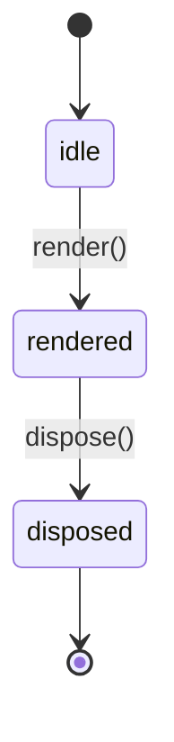

# About Widgets

A widget renders one value. This chapter explains the widget model.

## Read this chapter if

- you are new to widgets.

## The Widget Lifecycle

**Figure 1-1: A widget draws nothing until its first render() call.**



| State | Meaning |
|---|---|
| `idle` | Created, not yet drawn |
| `rendered` | Drawn at least once |
| `disposed` | Canvas released |

```ts
const widget = createWidget({ value: 42 });
await widget.render();
```

> [!WARNING]
> Do not call `render()` after `dispose()`. The widget has released its canvas, so the call throws.
